# Second Reality Scenes (Metal)

Scenes from Future Crew's 1993 PC demo *Second Reality*, re-created from scratch as one native macOS app
that draws on the graphics chip.

Every scene can be shown two ways, switchable at any time:

- **Modern look**: full display resolution, soft edges, smooth motion.
- **1993 look**: the original pixels (320x200 for most scenes) and 70 steps per second, as on a 486 with a
  VGA card.

| | Modern look | 1993 look |
|---|---|---|
| Dot Tunnel | 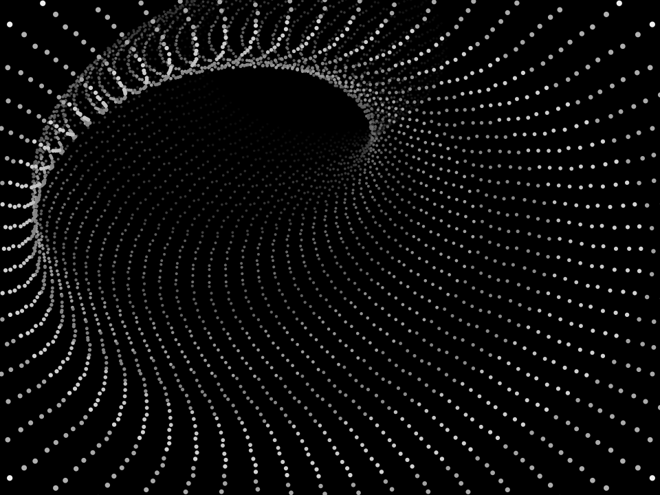 |  |
| Rings |  | 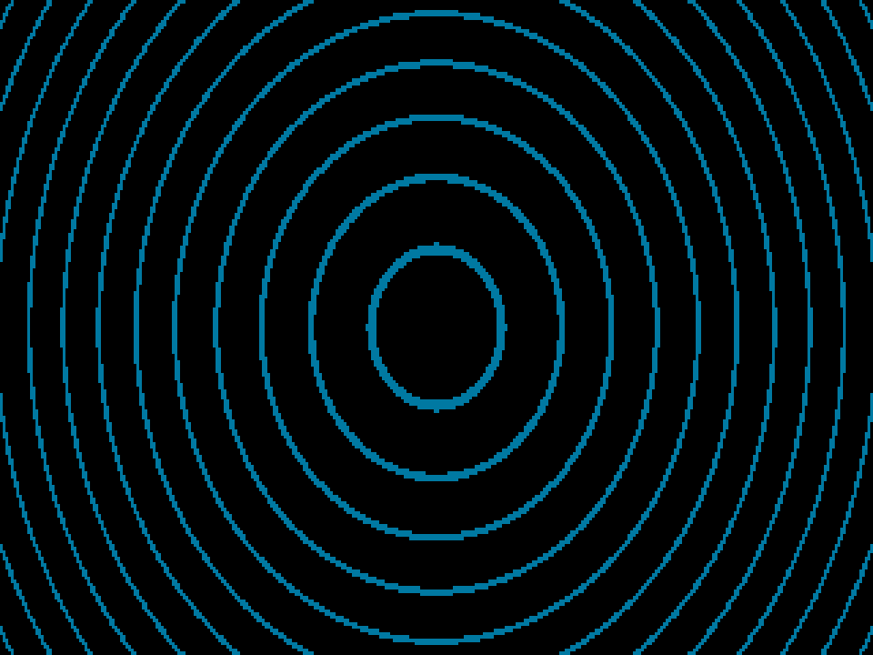 |
| Interference | 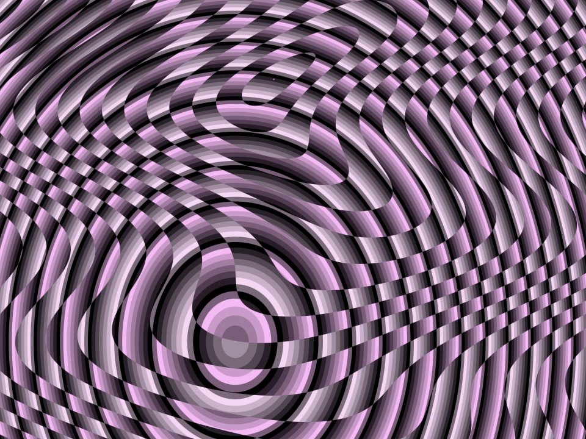 | 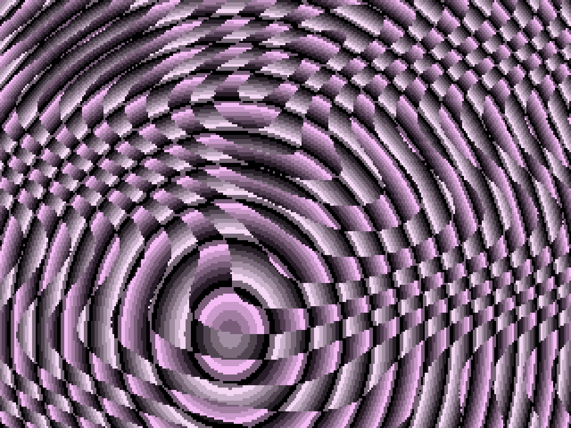 |
| Techno Bars | 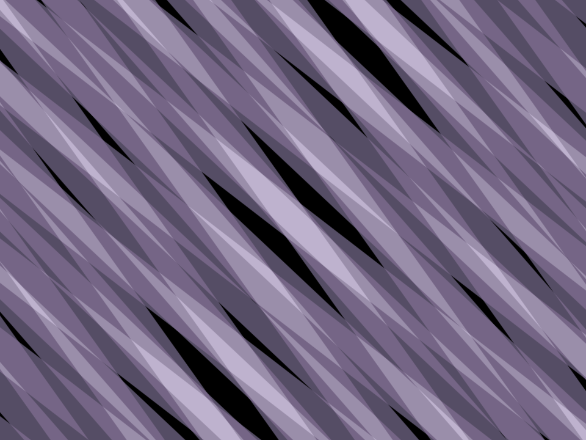 |  |
| Bouncing Dots | 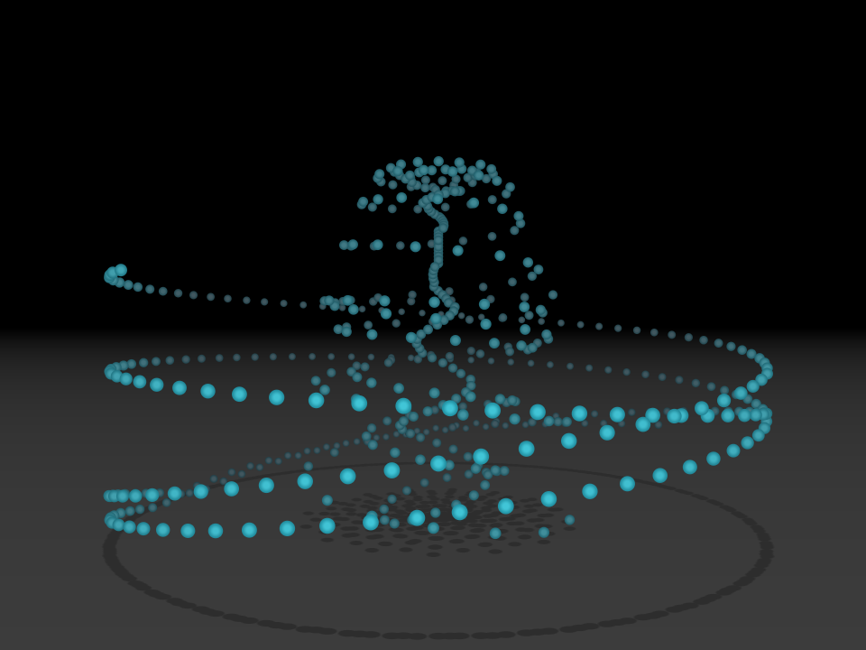 | 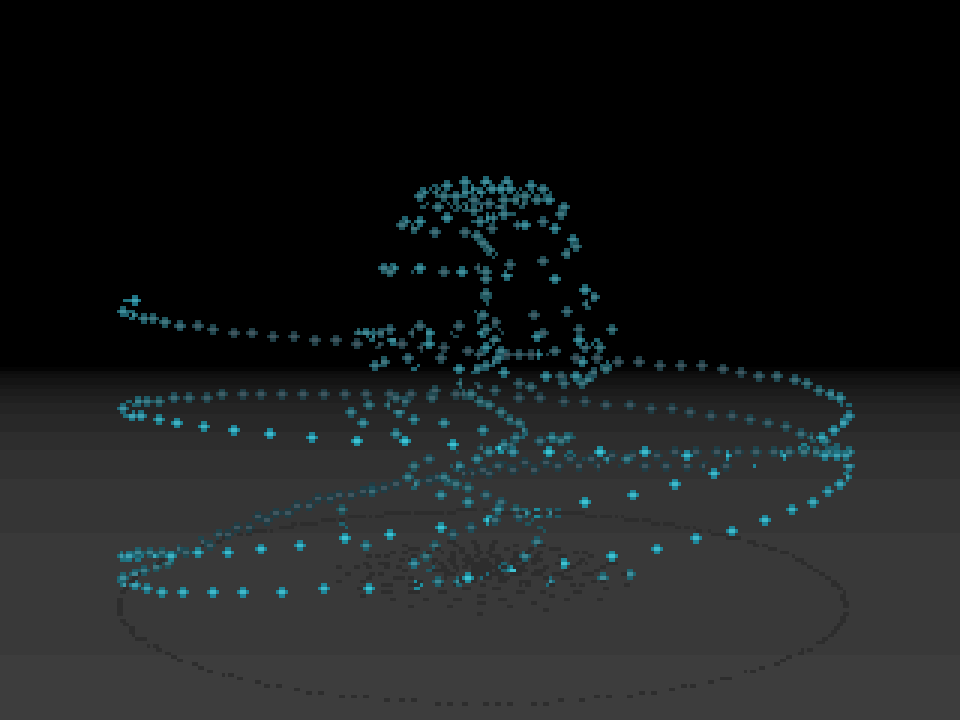 |
| Plasma | 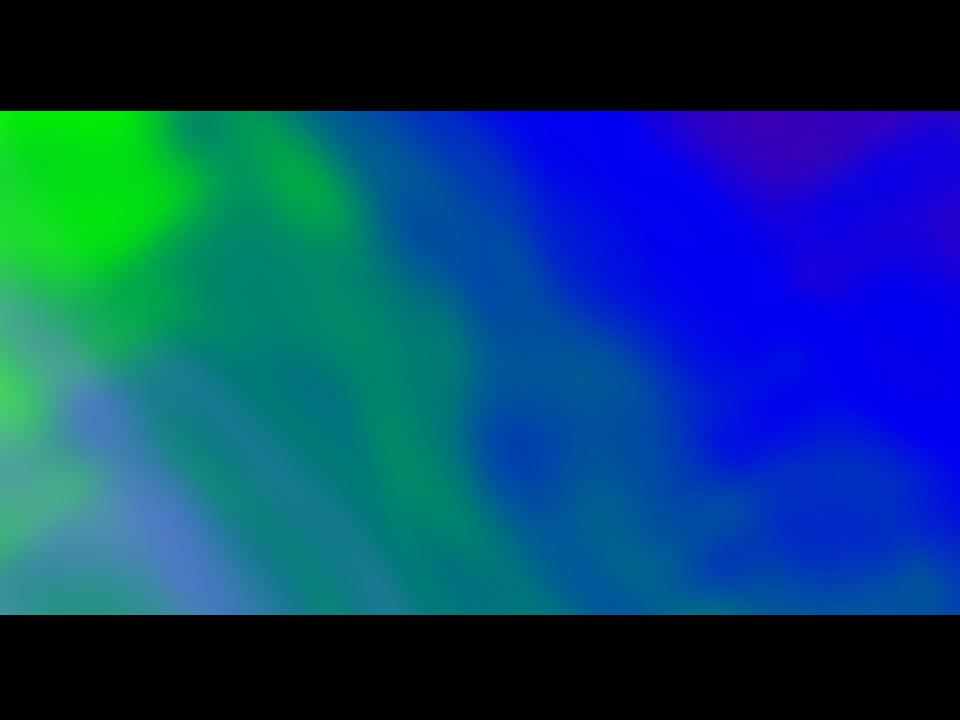 | 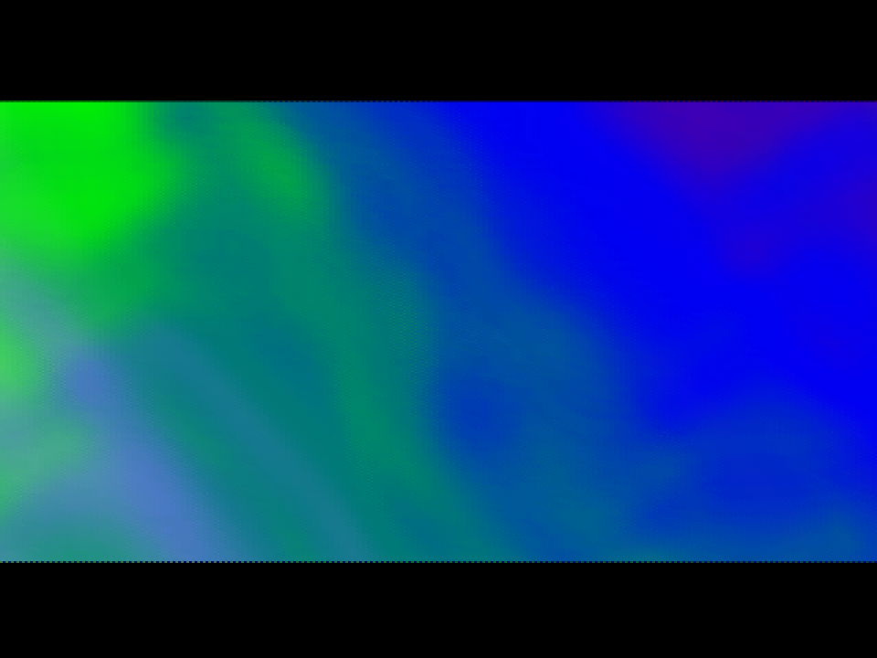 |
| Hidden Starfield | 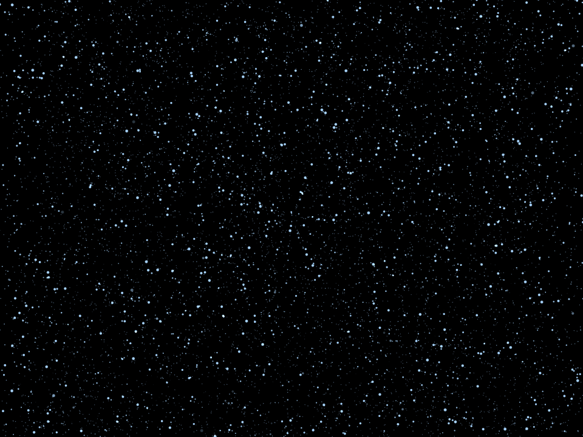 | 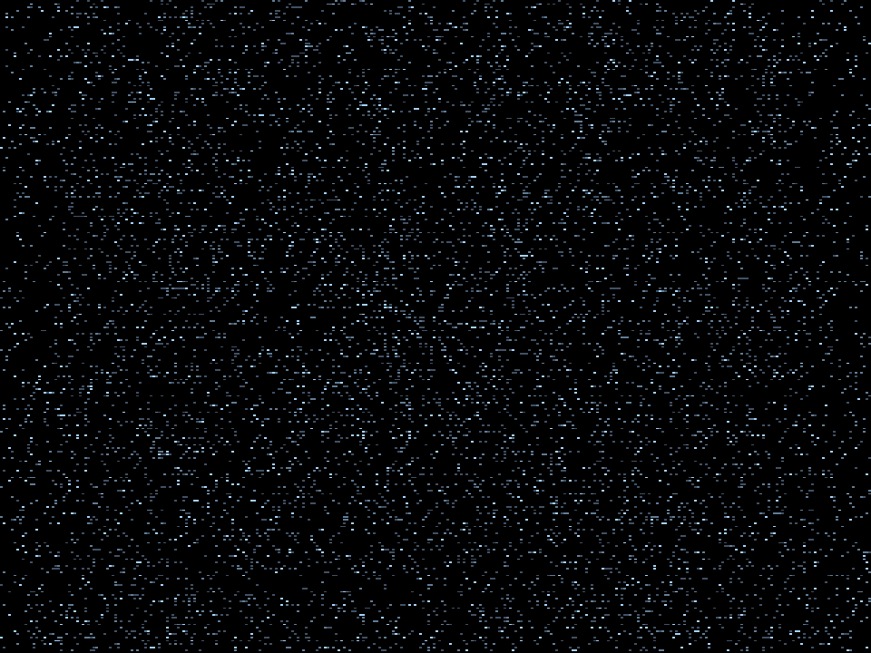 |
| 3D Sine Landscape |  |  |
| Plasma Cube | 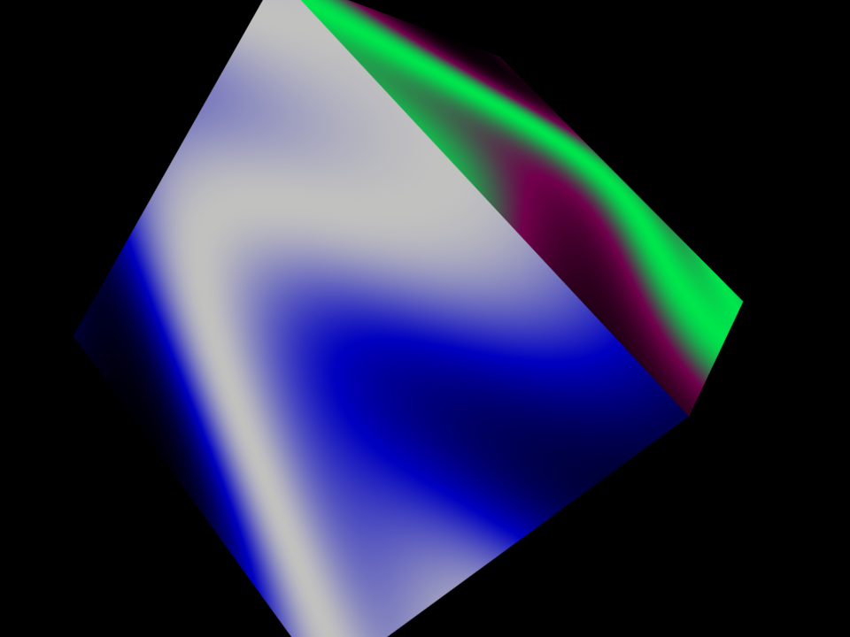 | 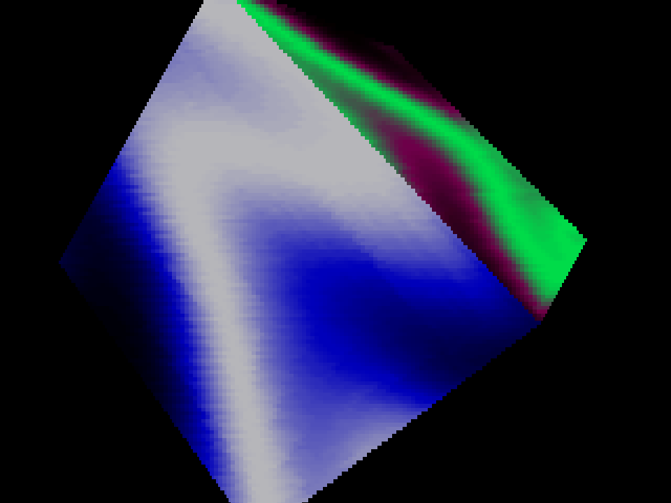 |
| Glenz Vectors |  | 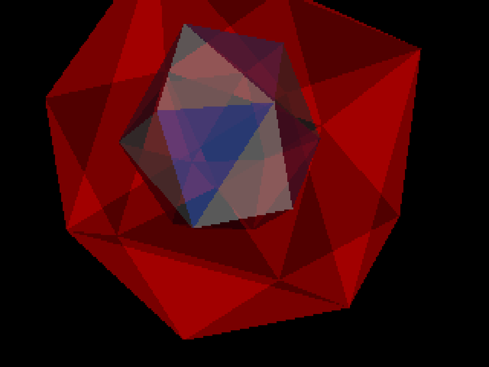 |

## What this is, and is not

This is not a port of the demo, and it does not play the demo from start to finish. A complete port already
exists (see [Credits](#credits-and-sources)). This project takes scenes one at a time, works out from the
original source code how each was done, and builds it again in a modern way, keeping a pixel-faithful 1993
look alongside for comparison.

The interesting part is the comparison. The original is full of tricks for making a slow machine look fast.
A modern graphics chip needs none of them, so each scene's documentation explains what the trick was and
what replaced it.

There is no music yet.

## Scenes

| Scene | Original coder | How the original did it, and how this version does |
|---|---|---|
| Dot Tunnel | Trug | [docs/scenes/dot-tunnel.md](docs/scenes/dot-tunnel.md) |
| Rings, Interference | Psi | [docs/scenes/rings-and-interference.md](docs/scenes/rings-and-interference.md) |
| Techno Bars | Psi | [docs/scenes/techno-bars.md](docs/scenes/techno-bars.md) |
| Bouncing Dots | Psi | [docs/scenes/bouncing-dots.md](docs/scenes/bouncing-dots.md) |
| Plasma | Wildfire | [docs/scenes/plasma.md](docs/scenes/plasma.md) |
| Hidden Starfield | Psi | [docs/scenes/starfield.md](docs/scenes/starfield.md) |
| 3D Sine Landscape | Psi | [docs/scenes/sine-landscape.md](docs/scenes/sine-landscape.md) |
| Plasma Cube | Wildfire | [docs/scenes/plasma-cube.md](docs/scenes/plasma-cube.md) |
| Glenz Vectors | Psi | [docs/scenes/glenz-vectors.md](docs/scenes/glenz-vectors.md) |

Planned, roughly easiest first: ships fly-by, 3D city.
Picture-based scenes, scrollers and stills are out of scope.

Everything on screen is calculated, with one exception: Glenz Vectors includes the original's hand-drawn
chequered plate (public domain, like the rest of the original), because the scene cannot do without it.

## Build and run

You need a Mac with macOS 15 or later and Apple's Command Line Tools (`xcode-select --install`).
The full Xcode app is not needed, and there are no other dependencies.

```bash
./build.sh
```

```bash
open build/SRMetal.app
```

### Controls


The window has a list of scenes down the left (the sidebar) and a toolbar along the top.

| To do this | Use |
|---|---|
| Choose a scene | Click it in the sidebar, or press the Right / Down arrow (next) or Left / Up arrow (previous) |
| Switch between the Modern and 1993 looks | The **Modern / 1993** switch in the toolbar, or press L |
| Play the current scene again from its start | The circular-arrow button at the right of the toolbar, or press R |
| Hide or show the sidebar | The sidebar button at the left of the toolbar, or Control-Command-S |
| Fullscreen | The green window button, or Control-Command-F (in newer macOS versions also the Globe key with F) |

In fullscreen the sidebar and toolbar get out of the way so that only the scene shows; the keys above still
work, and moving the pointer to the top of the screen brings the toolbar back. Leaving fullscreen puts the
sidebar back as it was.

The look, restart and next/previous actions are also in the **Scene** menu.

### Options

Put these after `--args` when starting the app, for example
`open build/SRMetal.app --args --scene techno-bars --look classic`.

| Option | Meaning |
|---|---|
| `--scene <id>` | Start on a scene: `dot-tunnel`, `rings`, `interference`, `techno-bars`, `bouncing-dots`, `plasma`, `starfield`, `sine-landscape`, `plasma-cube`, `glenz-vectors` |
| `--look modern` or `--look classic` | Start in that look |
| `--sidebar hidden` | Start with the scene list hidden |

Two more are run directly on the program inside the app, and open no window:

```bash
build/SRMetal.app/Contents/MacOS/SRMetal --selftest
```

runs the checks (see [docs/how-it-works.md](docs/how-it-works.md#the-self-test)), and

```bash
build/SRMetal.app/Contents/MacOS/SRMetal --snapshot dot-tunnel modern 500 picture.png
```

saves a picture of a scene at a given step. The pictures on this page were made that way.

## Documentation

- [docs/how-it-works.md](docs/how-it-works.md): how the app is put together, the two looks, the self-test,
  and how to add a scene.
- [docs/original-demo.md](docs/original-demo.md): how the 1993 demo was built, and the tricks its scenes share.
- [docs/scenes/](docs/scenes/): one page per scene, original versus new.
- [state.md](state.md): working notes: current status, decisions, and what is next.

## How faithful is the 1993 look?

It varies by scene, and each scene's page says exactly what was checked.

- **Dot Tunnel, Rings, Interference**: the original's data tables turned out to follow exact formulas. Those
  formulas were checked against the original data files with zero differences, and the result is compared
  pixel by pixel with what the graphics chip draws.
- **Plasma**: the same, except that 2 of one table's 8,192 values had to be set by hand, and the way the
  original laid two plasmas over each other was worked out by reading its source, not by running it.
- **Techno Bars, Bouncing Dots**: the original drawing code was ported step by step from the assembly.
  That port was checked by careful reading, not against a running copy of the original, so an
  off-by-one-pixel mistake is possible.
- **3D Sine Landscape, Plasma Cube, Glenz Vectors**: ported from the assembly too, but then checked against the
  original's own assembly text run instruction by instruction in a small interpreter (`tools/`). The
  pictures match exactly. The C code around the assembly was still ported by reading.

Some scenes also differ from the original on purpose, so that each works as a standalone, looping scene:
for example there are no full-screen white flashes, and Interference loops seamlessly. Every such change is
listed on the scene's page.

## Credits and sources

*Second Reality* was made by **Future Crew** and first shown at Assembly '93, where it won the PC demo
competition. The scenes here were originally coded by:

- **Psi** (Sami Tammilehto)
- **Trug** (Mika Tuomi)
- **Wildfire** (Arto Vuori)

with graphics by Marvel and Pixel and music by Purple Motion and Skaven.

Future Crew released the demo's source code and data into the public domain in 2013, for its 20th
anniversary. Everything here was worked out from that release:

- Original source: <https://github.com/mtuomi/SecondReality>
- A complete, playable port in C++ (Windows, Linux, macOS, web):
  <https://github.com/XorJS/SecondRealityPlusPlus>, based on the Windows port by Gargaj / Conspiracy,
  <https://github.com/ConspiracyHu/SecondRealityW32>
- Fabien Sanglard's code review of the original: <https://fabiensanglard.net/second_reality/>

No code from the original or from those ports is included here. The scenes were re-implemented from the
original's logic, and tables the original shipped as data files are calculated instead.

## Licence

This project is released into the public domain under the [Unlicense](UNLICENSE), the same terms Future Crew
chose for the original. You may copy, change and use it for any purpose, with no conditions and no warranty.
