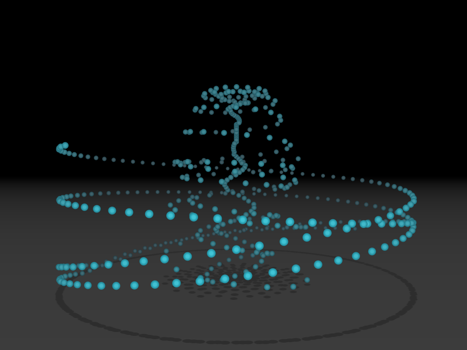
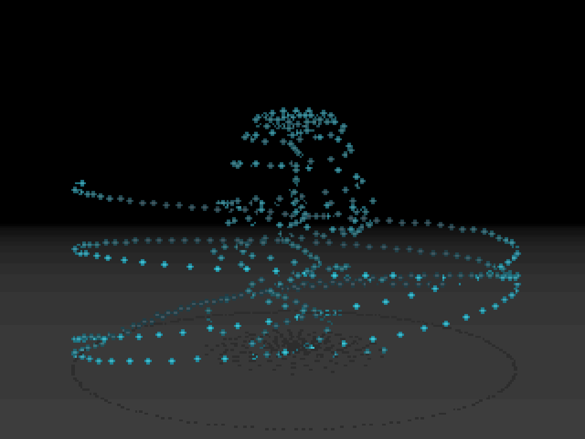

# Bouncing Dots

| Modern look | 1993 look |
|---|---|
|  |  |

512 dots fall onto a floor and bounce, each with a shadow, forming a wandering figure, then a ring, then a
fountain, then a cloud that ends up hanging in the air.

- **Original:** `DOTS/MAIN.C` and `DOTS/ASM.ASM` by Psi, about 540 lines. In the demo it was called
  "MiniVectorBalls".
- **This version:** `Sources/SRMetal/Scenes/BouncingDots/`
- **Length:** about 37 seconds, then it loops.

## How the original did it

### One rule makes all the patterns

There are always exactly 512 dots. Every step, one dot is taken out and dropped back in somewhere new. The
rule for "where" changes through the scene:

| Steps | Where the dot is dropped | What you see |
|---|---|---|
| 1 to 499 | Along a looping path, high above | A wandering figure, falling |
| 500 to 899 | On a circle, thrown upward | A ring |
| 900 to 1699 | On a circle at floor level whose size swells and shrinks, thrown upward | A fountain |
| 1700 to 2359 | At a random place | A cloud |

Because dots are replaced one at a time, in a shuffled order, each new shape grows out of the old one over
about seven seconds (512 steps).

During the cloud, gravity is reduced step by step to nothing, and the view begins to spin faster and
faster, so the dots end up hanging in the air as the scene turns.

### Physics

Each dot has a height and a falling speed. Each frame, gravity is added to the speed and the speed to the
height. At the floor, the speed is reversed and reduced to 13/16, so each bounce is lower than the last.

### Drawing

For each dot, an assembly routine:

1. rotates it about the vertical axis (the view swings from side to side),
2. divides by its distance to get a screen position (perspective),
3. draws a two-pixel shadow on the floor directly beneath it, and
4. draws the dot: 2 pixels, 4 pixels, 2 pixels, in one of 16 shades picked by distance from a table.

### Erasing by putting the background back

The program keeps a copy of the empty background. To rub a dot out, it copies the background back over the
12 pixels where the dot was last drawn, and the same for the shadow. Only the pixels that changed are
touched; the screen is never cleared.

### The floor

The floor is 100 rows, each a slightly lighter grey than the one above, set up once in the palette.

## How this version does it

### 1993 look

The processor replays the original drawing routine exactly: the same 16-bit whole-number arithmetic, the
same erase-by-copying-background, the same order. It produces a picture of colour numbers and a 256-colour
palette, which the graphics chip turns into colours.

The "random" cloud matches 1993 too. The original used the random-number function of the Microsoft C
compiler it was built with, which is a known formula; this version uses the same one, so the dots land
where they did then.

### Modern look

The graphics chip paints a smooth floor, then draws every shadow and every dot as a soft round shape at
full resolution.

- Nearer dots are larger. The original's were the same 4x3 pixels at any distance.
- Dots are sorted so that nearer ones are drawn over further ones.
- Dots glide between steps, with three exceptions where a dot jumps to its new place instead: on the
  step it is re-dropped; on the first step with dots (there is nowhere earlier to glide from); and when
  its height "wraps round" (see "Code review" below).
- The floor is a smooth gradient instead of 100 bands.

| | 1993 | This version (modern look) |
|---|---|---|
| Erasing | Copy the background back over each dot | Redraw the whole picture every frame |
| Dot shape | A fixed 4x3-pixel pattern | A round, soft-edged shape sized by distance |
| Shade by distance | A lookup table of 16 shades | Calculated, continuous |
| Floor | 100 palette entries | A gradient calculated per pixel |

## What was checked

- **The graphics chip matches the processor** pixel for pixel at eleven moments (self-test).
- **The modern look never glides a dot between two places it was never between** (self-test, one whole
  loop and 300 steps of the next). In ordinary motion no dot or shadow moves more than 27 canvas pixels in
  a step; the check fails on any glide over 50. With the fixes below removed it fails at step 131.
- **The modern look's fade stays between black and full brightness and never snaps** (self-test).
- **Motion, by program** (`--motion-check`, both looks, the whole loop): after the fixes, no jumps in
  either look. Many pictures near the end have pixels seen for one picture only; that is the cloud
  spinning fast (small dots moving further than their own width per step), in both looks.

### What was not checked

The 1993 look depends on the port of the assembly being right. That has now been checked twice by
reading (once when it was written, once in the review below, in a separate session), but never against a
running copy of the original, and unlike the tunnel there is no second program to compare with. The
self-test cannot catch a mistake there, because the processor does all the work and the graphics chip
only looks up colours.

Two things cannot be known from the source:

- The saved background is exactly 64,000 bytes, and on the "off the side" path the original can read two
  bytes past its end (for a dot last drawn on the bottom two rows). What was there depended on the PC's
  memory. This version reads zeros. The effect is at most two pixels of floor restored a frame later.
- How often the original skipped steps on a slow PC (it could run several steps per picture).

The modern look was checked by program and in still pictures, not by eye in the running app.

## Code review (2026-11-14)

Reviewed line by line against `DOTS/MAIN.C` and `DOTS/ASM.ASM` (`drawdots`), in a separate session from
the one that wrote the port, and with `/code-review`.

**The port of the drawing routine was found to match the original.** Checked instruction by instruction:

- The distance: the top halves of two products, subtracted, plus 9000. (The original's `mov ax,ax` typo
  means a leftover value is subtracted from the low half, which is then thrown away; no effect.)
- The sideways position: the 32-bit sum, shifted right 8, plus the same shifted right 3 more, divided by
  the distance with rounding towards zero, plus 160; the unsigned "off the side" test.
- The shadow row (524288 / distance + 100) and the same unsigned test on it.
- The order: restore old shadow, draw shadow, gravity, bounce, restore old dot, draw dot.
- Gravity and bounce in 16 bits: speed + gravity, height + speed, a signed compare with the floor (8105),
  then speed = low 16 bits of (-speed x 13), shifted right 4, and added once more.
- The dot's row (height x 64 / distance + 100); the three paths (off the side, off the top or bottom,
  drawn) and what each restores and remembers, including the leftover value on the first.
- The shade table (index = distance / 256), its rounding towards zero, and the byte patterns of the three
  rows of a dot; shadow colour 87.
- `MAIN.C`: the two shuffles and the number of random numbers they use; the four drop rules and their
  frame limits; `f` reset at frame 500; the dropper; the view angle taken before it is updated; the spin
  after frame 1900; gravity falling at frames 1920, 1952 and 1984; the palette and the 130-step fade-in.
- Ranges: the distance stays within 808...17192, so no division can overflow or divide by zero, and every
  write stays inside the 65,544-byte picture.

**Found and fixed, all in the modern look** (the 1993 pictures are unchanged):

- **Dots streaked in from the top-left corner on the first step with dots.** Before any dot has been
  drawn, the "previous place" of each is a placeholder at (0, 0). On step 131 the modern look glided
  511 dots and their shadows from there to their real places. Half-way through that step all the shadows
  sat in the black sky at about (81, 79). Now nothing glides on that step.
- **A dot could streak down the screen.** Once gravity is off, a rising dot keeps rising. The original
  held heights in 16 bits, so after -32768 the height becomes +32767: far above the screen one step, far
  below it the next, and usually back again the step after. The 1993 look never shows either place. The
  modern look glided between them, straight across the screen: dot 419 at steps 2383 and 2384, dot 332
  at 2492 and 2493, and six more glides of 300 to 400 rows. Now a dot whose height wraps jumps instead of
  gliding.
- **The fade-in overshot.** The original's fade reaches full brightness two steps before it ends. The
  modern look's smooth version carried on past it, making the whole picture (black sky included) up to
  1/63 too bright, then snapped back at step 130. Now it stops at full brightness.

**Noted, not changed:**

- A dot the 1993 look hides because it is off the side, or so near that its shadow would fall below the
  screen (the first kept quirk below), is still drawn by the modern look when its own place is on screen.
  Such a dot does not fall while hidden, so in the modern look a few near dots of the cloud hang still
  for a moment. Hiding them would make dots blink out in mid-air; left as it is.

**Possible tidy-ups** (left for a later pass): the floor and dot colour
formulas are written two or three times (palette, modern colours, shader); the shade rule is written out
again in the scene; the 1993 look copies the 64,000-byte picture and rebuilds the palette on every draw;
320, 200, 160 and 100 are literal numbers throughout.

## Differences from the original, on purpose

- **No white flash at the end.** The original flashed to white and then faded to black. This version fades
  straight to black and loops into the original's fade-in.
- **The re-drop counter starts at zero.** See below.

### Quirks that were kept

These are in the original code and affect which pixels are drawn, so the 1993 look reproduces them.

- A dot that is off the side of the screen does not fall that step. It resumes when it comes back into view.
- The distance calculation combines two results that have each been rounded separately.
- On the "off the side" path, a leftover value is stored as the dot's old shadow position.

## A bug in the original

In `DOTS/MAIN.C`, the counter that picks which dot to re-drop each step (`j`) is declared but never given
a starting value. In C, such a variable holds whatever was left in that spot of memory by whatever used it
before.

What happens depends on the leftover value:

- **Small (0 to 1023):** harmless. The scene runs perfectly.
- **Large:** on the first step the program looks up a junk dot number and writes a dot's position into the
  wrong place in memory, once.
- **Negative:** it stays wrong for up to 511 steps, about seven seconds, writing to a wrong place each time.

The dot table lives in the same block of memory as the assembly drawing routine and its tables. A stray
write can therefore land on the machine code that draws the dots, and the machine locks up the next time
that code runs.

The leftover value is not chance. It depends on what the PC had in memory beforehand: the DOS version, the
drivers loaded, where the program was placed. So a given machine would either never crash here, or crash
on the same frame every time. That would explain a demo that ran perfectly on one PC and reliably crashed
during this scene on another.

The bug is certainly in the file. That it caused any particular crash is a reasoned guess; it cannot be
confirmed without knowing what was in memory on the machine concerned. Every division in the drawing
routine was also checked for overflow (the other common cause of an instant crash), and none can overflow.
