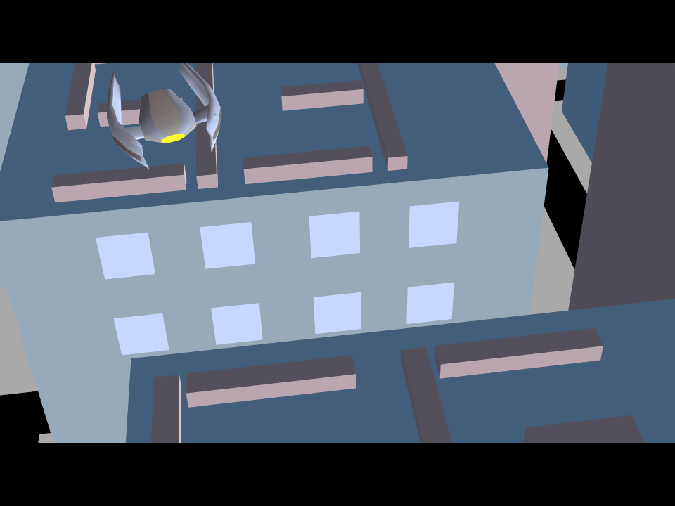
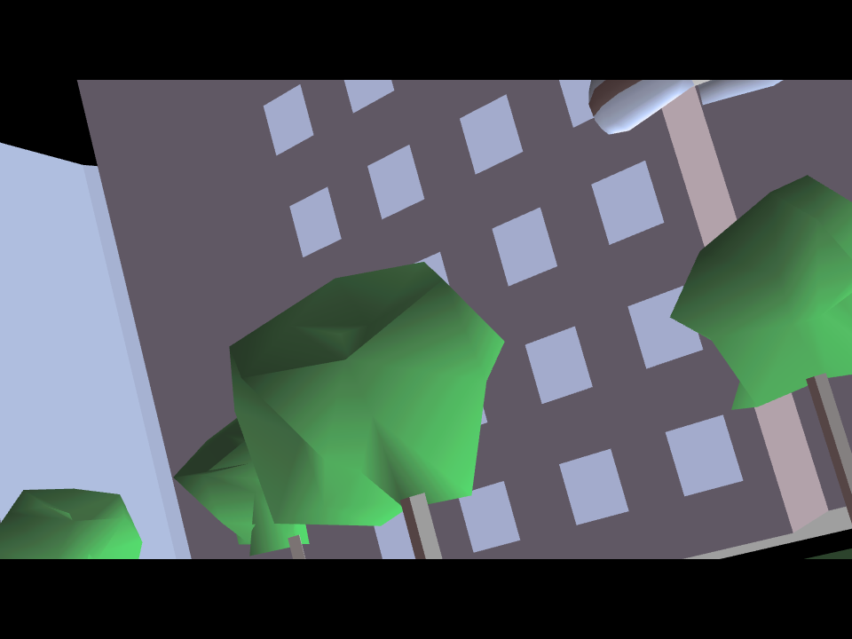
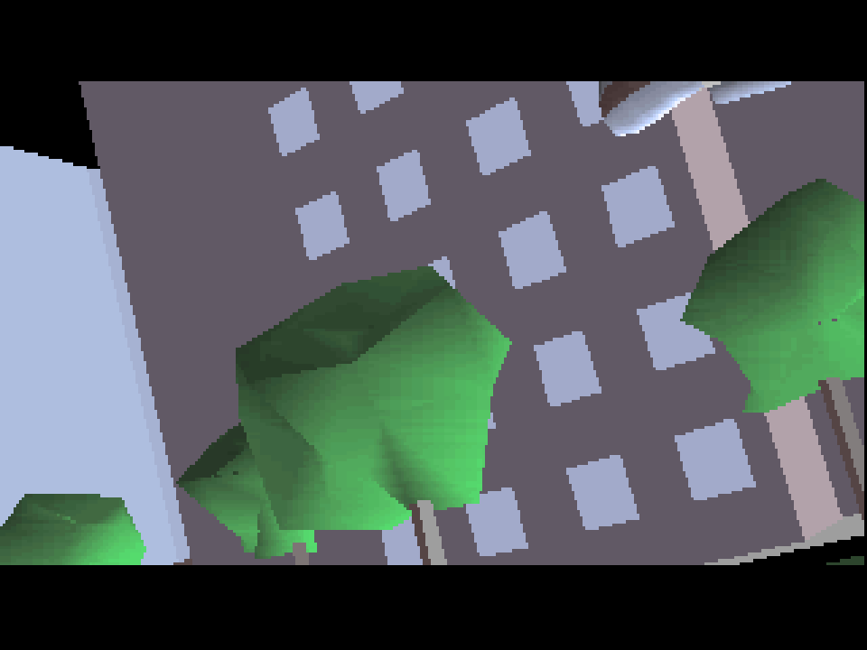
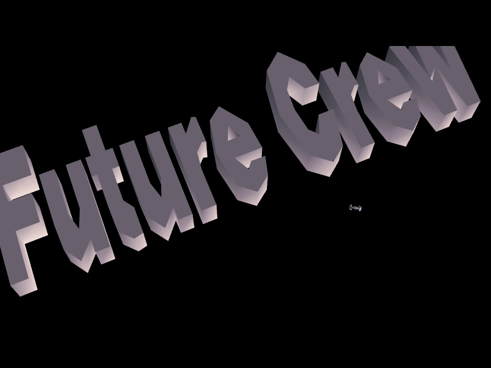

# 3D City

| Modern look | 1993 look |
|---|---|
|  |  |
|  |  |
|  |  |

A long flight through a city of flat-coloured buildings, behind a small ship: along a street past
trees and parked cars, through a tunnel, up over the rooftops, and finally out into empty space where
the ship swings round a huge solid "Future Crew" logo and flies straight past the viewer.

- **Original:** `U2E.EXE` ("Vector Part II"), by Psi: the scene program `VISU/C/U2E.C`, the shared 3D
  engine `VISU` (see [the engine's page](../visu-engine.md)), and the scene's data files `U2E.*`.
- **This version:** `Sources/SRMetal/Scenes/City3D/`, on the engine in `Sources/SRMetal/Core/Visu/`.
- **Length:** 3,639 steps, about 52 seconds, then it repeats.

**This scene uses original 3D data.** Nothing you see in it is calculated from a formula: the city,
the trees, the cars, the ship and the logo are the original's 3D models, and the flight is the
original's recorded animation, made by Future Crew in 3D Studio. Models and animation cannot be
calculated. The files are in `Data/Visu/` (public domain, like the rest of the original; see that
folder's README) and are copied into the app when it is built. The scene uses **no picture**: unlike
the Ships Fly-by there is no painted background, only black.

Words used below are explained on the engine's page: vertex, polygon, flat and Gouraud shading,
clipping, depth buffer.

## Which original files are live

`VISU/C/MAKEFILE` builds `u2e.exe` from `u2e.obj`, the engine library `visu.lib` and the demo's
shared `disc.obj`. The data files are in `VISU/C/SCENE/`; the engine's page shows they are byte for
byte what the shipped demo carried.

Not live: `U2EOLD.C`, `CITY.C`, `CPLAY.C` (older players), `CITY.3DS`, `CITY.LBM`, `CITY.PAL` and the
like (the artists' working files).

## How the original did it

### What is in the scene

57 objects made from 42 model files, 1,384 polygons in all. A model used several times is stored once.

| What | Models | Shading |
|---|---|---|
| Buildings, tunnels, street details (`"BuildingH"`, `"talot"` = "houses", `"tunneli"`, `"KDETAIL04"` ...) | 26 | flat: every wall one colour |
| Ground plates (`"_platform"`, `"_laatta"` = "slab", `"_levyt"` = "plates" ...): the names start with an underscore | 9 | flat |
| Trees (`"Tree01g"`, used 5 times, 70 polygons each) | 1 | Gouraud |
| Cars (`"Car02"`, used 3 times) | 1 | Gouraud |
| The ship (`"s01"`, 124 polygons; the same small ship as in the Ships Fly-by, in other colours) | 1 | Gouraud |
| The logo (`"logo"`, 190 polygons) and loose letters (`"fcirto"`, "FC loose", used 8 times) | 3 | Gouraud and flat |

The animation (`U2E.0AB`, 77 KB) holds 1,801 frames. Each frame says, for the camera and every object
that moved or was switched on or off, what changed since the frame before. The flight is not worked
out by the program: it is played back, like a film of positions. Only the objects near the camera
are switched on at any time, which is how a 486 coped with a whole city.

### One picture

The engine's page describes this in full. In short, for every picture `U2E.C`:

1. fills the page with colour 255, which is black (`vid_clear255`);
2. brings each switched-on object into the camera's view and measures the depth of its centre point;
3. sorts the objects farthest first by that one depth, **with two overrides of its own**:
   - an object whose name starts with an underscore (a ground plate) counts as infinitely far, so the
     ground is always drawn first and everything else lands on top of it;
   - during animation frames 901 to 1099 the ship counts as distance 1, so it is drawn after
     everything that is in front of the camera. In that stretch the ship flies low between tall
     buildings, whose centre points can be nearer than the ship's although the ship is in front of
     their walls; sorting by centre would have drawn a building over the ship;
4. has the engine draw each object: hidden faces dropped, lit, clipped, filled.

Only a 320x150 band in the middle of the 320x200 screen is drawn into (rows 25 to 174), as in the
Ships Fly-by.

### Colours

The scene file's 256 colours, with four changed by `U2E.C`: 255 and 252 black, 253 and 254 white.
255 is the clearing colour; the other three were used by the lead-in (below).

### Timing

Tied to the screen's 70 refreshes a second, **not to the PC's speed**. An interrupt counts refreshes
(`syncframe`); after each picture the program works out how many refreshes it is behind and reads
`(behind + 1) / 2` animation frames, adding twice that to its own count (`currframe`). So the
animation runs at exactly **one frame per two refreshes**, 35 a second, on any PC: 1,801 frames take
51.5 seconds. A slow PC simply drew fewer of the frames. Finished pictures were queued over four
video pages and shown by the interrupt, each for as many refreshes as it took to draw.

### Start, end and the music

- **Start.** The part before leaves its picture on screen. `U2E.C` fades that whole picture to white
  (33 refreshes), waits, repaints the screen as a white band between black bars, fades to the city's
  colours, and waits for the music to reach its cue (order above 18). The first picture of the city is
  a white wall filling the whole band, which then slides away to the left like a curtain: so the
  white screen turns into the city without a visible cut. The program's very first drawing turn is
  skipped (`firstframe`).
- **End.** When the animation runs out, with the logo filling the picture, all 256 colours are faded up
  to white in 16 refreshes, and the demo's end picture follows.
- **Nothing else is drawn**: no text, no logo picture, no overlay. The "Future Crew" logo is a 3D
  object in the animation.

## How this version does it

**The model** (`City3DModel.swift`) is small, because the engine does the work. It sets up the palette
as `U2E.C` did, turns on the two ordering rules (`VisuWorld.cityOrdering`), and keeps the timetable:

| Steps | What shows |
|---|---|
| 0, 1 | black (animation frame 0: nothing switched on) |
| 2 to 3,603 | animation frames 1 to 1,801, two steps each |
| 2 to 72 | ... fading up from black |
| 3,499 to 3,604 | ... fading down to black |
| 3,604 to 3,638 | black |
| 3,639 | = step 0 again |

Three named numbers in `City3DModel` set the start and end and are there to be changed by eye
(70 = one second): `fadeInSteps` (70), `fadeOutSteps` (105, taken from the END of the animation, while
the logo is still turning) and `darkSteps` (35).

Playing the recording, keeping a second copy one frame ahead for the modern look, and resetting the
engine on restart are the same for this scene and the Ships Fly-by, so that code is shared:
`Core/Visu/VisuPlayback.swift`.

**1993 look: replayed on the processor.** On every second step the model fills a 320x200 screen of
colour numbers with 255 and has the engine replay draw the frame, exactly the original's loop.
`IndexedCanvas` shows it through the palette, scaled up with hard-edged pixels. The fades scale the
palette's 0...63 values and drop the fraction, as a VGA palette fade did. Every animation frame is
drawn once, whichever look is showing, because the engine carries a little state from one picture
to the next.

**Modern look.**

- The objects are drawn by the engine's modern renderer (`VisuModernRenderer`): real triangles at the
  display's resolution, a depth buffer between objects, the original's own back-to-front order within
  an object, the original's lighting rule without rounding to whole colour numbers, smoothed edges.
- **Motion** glides between animation frames. Each frame lasts two steps, so the blend runs across
  both: a quarter of the way at half a step, half-way at the second step, and so on.
- **The camera's roll is evened out.** The recording holds the camera's roll (its tilt about the line
  of sight) only to the nearest whole degree. So whenever the camera banks, it snaps one degree
  between two frames instead of turning evenly, hundreds of times in the flight. At 320x200 that
  passes; at full resolution with everything else gliding it showed as a constant small twitch of
  the whole picture (the motion check below found it). The model works out, once, the smoothest roll
  that never strays more than half a degree from the recorded one (half a degree is the most the
  rounding can have lost), and the modern look uses that. `City3DModel.smoothCameraRoll` switches it
  off. The 1993 look is untouched.
- The fades are smooth instead of in 64 levels.

## 1993 versus this version

| | 1993 | This version, 1993 look | This version, modern look |
|---|---|---|---|
| Resolution | 320x200, picture in a 320x150 band | the same | the display's |
| Objects | polygons filled by the engine, whole-pixel corners | the same, replayed | triangles on the graphics chip, corners in decimals, smooth edges |
| What is in front | objects sorted by one point each, ground first, ship last in frames 901-1099; polygons in prepared orders | the same | depth buffer between objects; the same prepared orders within one |
| Shading | whole colour numbers: bands, and 4-pixel blocks in gentle gradients | the same | smooth |
| Motion | 35 animation frames a second; a slow PC skipped frames | every frame, two steps each | glides between frames |
| Camera roll | whole degrees | the same | evened out (within half a degree) |
| Start | fade to white, white band, wait for the music; a white wall slides away | fades up from black as the wall slides away | the same |
| End | 16-refresh fade to white | fades to black over the last 1.5 seconds, half a second of black, repeats | the same |

## What was checked

- **The 1993 pictures, against the original's own assembly.** The engine was checked before this
  scene existed: 124 test pictures (109 at first, 15 added by the code review below) identical to
  those from the original assembly run instruction by instruction (see
  [the engine's page](../visu-engine.md)). Forty-five of them are whole frames of this animation,
  spread from frame 1 to frame 1800 and including both sides of the ship-ordering rule (905, 960,
  1040, 1099 inside; 880 and 1101 outside). The self-test now also draws those frames
  through the SCENE (one engine drawing every frame from the start, onto colour 255) and requires the
  same colour number wherever the test picture has a pixel, and colour 255 everywhere else. All 45
  agree. That also shows the engine's carried-over state (see "Kept quirks") changes nothing in these
  frames.
- **The pace**, from `U2E.C`: one animation frame per two refreshes, independent of the PC (see
  "Timing"). This was read from the source and the arithmetic followed by hand.
- **The ordering rules as the scene applies them** (self-test, every frame): ground plates are
  always first; in frames 901 to 1099 the ship comes after every object in front of the camera.
- **The graphics chip against the processor** for the 1993 look at 13 steps (self-test). For this
  kind of scene that only proves the display path.
- **Speed of the 1993 replay.** Measured over the whole loop on this Mac: **0.25 ms a step on
  average, about 1 ms at worst**, against the 14.3 ms a step lasts at 70 a second. So it holds 70 a
  second with more than tenfold room, and nothing needed optimising. The self-test measures this on
  every run (and fails above 2 ms average or 10 ms worst). The whole self-test takes about 10
  seconds; the sidebar picture needs 1,600 steps, about half a second, on a background thread.
- **The two looks against each other.** Pictures at 26 moments across the flight were looked at side
  by side: same city, same viewpoint, same ship. The self-test holds the two looks together at 6
  steps as the app draws them (average difference per colour channel 3.6 of 255 at most).
- **Motion, every step of the loop, by program** (`--motion-check`, below). All 3,604 steps were
  drawn in the modern look both on the step and half-way to the next (7,207 pictures) and in the
  1993 look (1,882 different pictures, fades included), and each picture was compared with its neighbours for (a) a
  change much bigger than the changes around it (a jump) and (b) pixels unlike both neighbours while
  the neighbours agree (something showing for one picture only). What it found:
  - **The predicted depth trouble did not happen.** The engine's notes expected flicker where
    objects lie almost on top of each other (roads 10 units above ground plates) and where the
    original forced the ship's drawing order. To test that directly, every animation frame was drawn
    a second time with the objects in REVERSE order: if two surfaces were fighting for the same
    depth, the winner would flip. At most 2 pixels of 172,800 changed in any frame. So the depth
    buffer separates every pair of objects cleanly, the modern picture does not depend on drawing
    order at all, and no depth bias and no forced order are needed. (The original needed its ship
    rule only because it sorted whole objects by one point.) In the forced stretch the two looks
    were also looked at side by side at 8 moments: the ship is in front in both.
  - **A twitch of the whole picture, hundreds of times: found and fixed.** One-picture-only pixels
    kept appearing along every edge in the picture at once, on the first step of certain frames.
    The cause is in the data: the recorded camera roll moves in whole degrees (see "How this
    version does it"). After evening the roll out, the number of such spikes fell from 213 to 53
    and of uneven changes from 111 to 19, and the camera's frame-to-frame roll unevenness fell
    about 17-fold.
  - **What is left is the recording's own.** The remaining small spikes (at most about 300 pixels of
    172,800) are thin outlines of the ship alone, at moments when the ship's own recorded motion
    changes direction between two frames; and single moments when an object is switched on or off, or
    a large wall turns to face the camera. They are the same in both looks.
  - **One real jump**, steps 3,516 to 3,526: the ship flies straight at the camera and out past it,
    filling the picture for a few frames. Same shapes in both looks: it is the recorded flight.
  - **The glide is even**: averaged over the run, the four quarter-frames carry the same change
    (within 1%).
- **The glide** (self-test, every step): half-way through a frame every object is at the middle of
  its two recorded places, and each glide ends exactly where the next step starts. This is the check
  that catches the "nothing pairs up, so it silently shows the next frame" trap met in the Ships scene.
- **The roll smoothing stays within half a degree** of the recording at every frame (self-test).
- **The loop and restart**: black at both ends, step 3,639 is step 0 again, and restart returns to
  the exact first frame, engine state included (self-test).
- **The Ships Fly-by is unchanged** by moving the shared code: all of its self-test checks pass as
  before, including its 15 assembly-verified frames.

The motion check is now part of the app, so it can be repeated for any scene:

    build/SRMetal.app/Contents/MacOS/SRMetal --motion-check city-3d modern
    build/SRMetal.app/Contents/MacOS/SRMetal --motion-check city-3d classic

It takes about 8 seconds for this scene's whole loop and also reports how long a step takes.

## What was not checked

- **Against a running original or a recording.** Everything above compares with the original's code
  and data, not with a PC running it.
- **`U2E.C` by running it.** The clearing, the palette changes, the ordering rules and the pace
  were ported by reading. (The animation reader and the ordering are part of the engine's
  `VisuWorld`, written twice by the same author, in Python and Swift; the 45 frames above were made
  with the Python version's ordering, so the two agree with each other.) The code review below read
  `U2E.C` again independently and found no difference, and the third-party port was consulted for
  the ordering rule and the frame counting and agrees. The C program has never been compiled and
  run against this version.
- **The start and end as the demo showed them** (the white fades, the white band, the music cue):
  read from the source, not seen, and deliberately not reproduced.
- **The page queue and frame skipping** are not modelled; every frame is drawn.
- **That the roll steps are rounding, not intent.** The whole-degree steps are plain in the numbers,
  and evening them out is a judgement that they are an artefact of how the flight was exported.
- **The cause of the remaining ship-outline spikes** was judged from where the pixels are (on the
  ship only), not traced in the animation's numbers.
- **The ship's visibility across the whole forced-order stretch** was looked at in 8 samples, not
  measured in all 199 frames.
- **The modern look by eye in the running app.** The motion check was done by program on rendered
  pictures, plus looking at samples. The user is the first to watch it move, and to judge the fade
  lengths.

## Deliberate differences

- **The start.** No fade to white and no white band. The picture fades up from black over the first
  second while the white wall of the opening slides away, so the band is never fully white: the wall
  is still dim while it fills the picture.
- **The end.** No flash to white and no end picture. The picture fades to black over the last 105
  steps of the animation (the logo keeps turning as it fades), stays black for 35 steps, and the
  flight starts again.
- **Every frame is drawn**, as on a PC fast enough never to skip, and each picture is shown the step
  it is made.
- **Modern look only:**
  - The camera's roll is evened out, so the modern picture can be tilted up to half a degree from
    the 1993 one at the same moment.
  - Where two objects overlap, the depth buffer decides pixel by pixel; the original drew whole
    objects in order of one point each. Where the original's sorting put a far object over a near one
    for a few frames (see "Kept quirks"), the modern look does not.
  - Shading and fades are smooth.
  - Between frames, each object's turn numbers are blended in a straight line, and an object that is
    switched on or off at the next frame appears or disappears up to two steps early (as in the
    Ships Fly-by; here a frame lasts two steps).

## Kept quirks

All in the 1993 look:

- **Objects sorted by one point each.** Now and then a building or a wall is drawn over something
  that is really in front of it, for a few frames, until the order flips back. This is the
  original's look, with its two patches (ground first, ship last in frames 901 to 1099).
- **The camera rolls in whole-degree steps** (from the recording).
- **Blocky gradients** on the trees, cars, ship and logo: gentle Gouraud gradients are filled in runs
  of 2 or 4 pixels.
- **Wrong colours where a Gouraud polygon is cut by the near plane**, as the ship passes the camera at
  the end (see the engine's page).
- **A clip flag that is never cleared**, so a frame's exact pixels could depend on which frames were
  drawn before it. This is why the model draws every frame in order and why restart also resets the
  engine. (The self-test now shows that in this animation no pixel does depend on it: see the code
  review below.)
- **One building is lit harder than the rest.** The recording stretches `"talojota"` ("house
  row") to twice its depth, and the engine's light uses the stretched surface directions as they
  come, so its light and dark sides are further apart than an unstretched building's. Both looks
  do this (the modern look since the code review below).

## Code review (2026-11-14)

Reviewed with the `/code-review` tool and by hand against `VISU/C/U2E.C` and the engine's `VISU.C`.
The engine's own review is on [its page](../visu-engine.md).

**Found and fixed** (both in the engine, both affecting this scene)

- **A damaged data file crashed the program** instead of giving an error. Every count and position
  in the files is now checked when they are read.
- **Modern look: a scaled object was lit differently from the 1993 look** (here the one stretched
  building, see "Kept quirks"; it mattered more for the ships scene's big ship).

No fault was found in the scene's own files (`City3DModel.swift`, `City3DScene.swift`).

**New test cases from this scene.** Playing the whole flight with counters in the engine showed
what the engine's test pictures had never reached: five engine paths (listed on the engine's
page) and 32 pairs of object and drawing order. Fourteen more frames (97, 296, 417, 424, 498, 1129, 1176,
1242, 1247, 1250, 1271, 1285, 1301, 1571) reach all of them; the original assembly drew them and
this version's pictures are identical, through the engine alone and through the scene.

**Confirmed, nothing to fix**

- `U2E.C` against this scene, read independently: the fill with colour 255; the four palette
  changes; ground plates (second character of the name an underscore) given distance 1,000,000,000;
  the ship (`s01`) given distance 1 while the program's frame counter is over 1800 and under 2200,
  and since that counter goes up by two per animation frame, that is frames 901 to 1099; the first
  drawing turn skipped, so frame 1 is the first picture; the pace of one frame per two refreshes.
- The timetable and fades by reading and by the existing self-test: frame 1 arrives on step 2, the
  fade-in starts there from black, the fade-out reaches black exactly as the last frame's two steps
  end, the modern look's fade runs between steps and meets the 1993 look's on every step, and the
  glide never looks ahead past the last frame.
- The camera-roll smoothing by reading: the roll is measured about the line of sight only (turning
  the camera left or right or up or down adds nothing to it), the correction is zero at both ends
  of the flight, and it is applied the right way round.
- One engine drawing all 1,801 frames in turn gives exactly the pictures a fresh engine gives for
  each frame alone (self-test).
- Built and stepped on four threads at once, the scene draws what it draws alone (self-test).
- **Motion check re-run after the fixes** (`--motion-check city-3d modern` and `classic`): the
  1993 look's report is identical to before. Modern look: 5 jumps before and after (the ship
  flying past the camera, steps 3,522 to 3,524); pictures with one-picture-only pixels 6,386 before
  and 6,388 after of 7,207, and 137 over 0.1% of the picture both times.

**Looked at, not demonstrated, left alone**

- The modern renderer keeps its palette in one buffer shared by all frames, so if the graphics chip
  ever ran a frame behind, a fade could be one step early for one frame (engine page).

**Possible tidy-ups** (none is a bug): the palette list is rebuilt on every drawn frame, even at
full brightness; the objects are still drawn (in black) during the black steps;
`City3DModel.animationFrames` (1801) is written out though the engine can count the frames.

**Still not verified:** against a running original or a recording; the start and end as the demo
showed them; that the roll steps are rounding and not intent; the ship's visibility in every frame
of the forced-order stretch; the modern look by eye in the running app, including the fade lengths.
