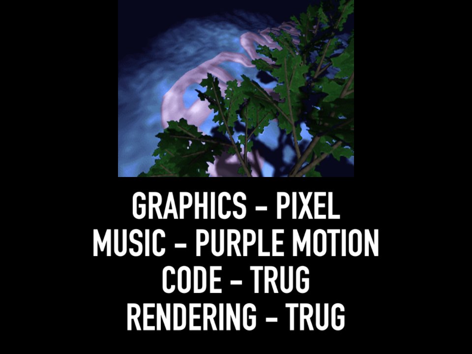
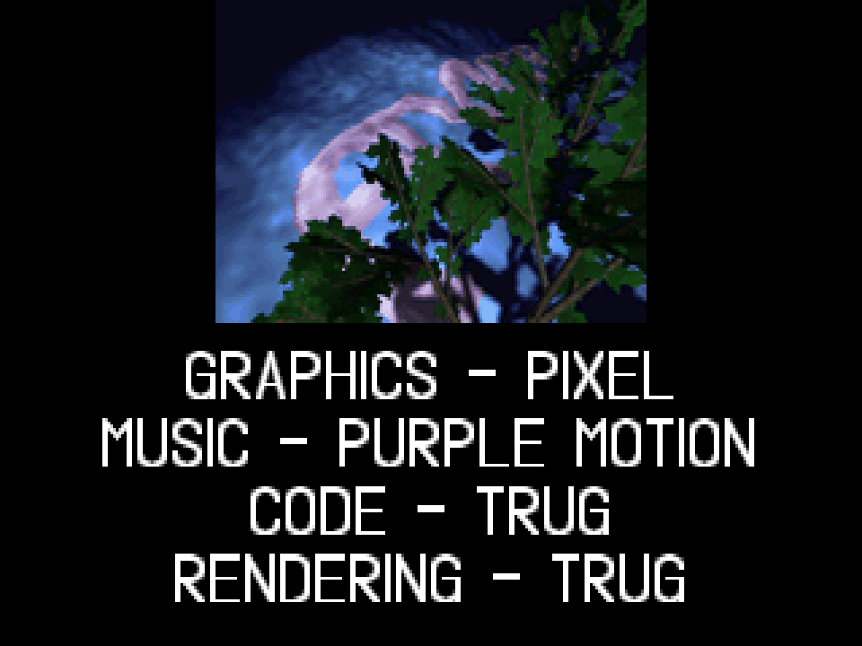

# Credits

| Modern look | 1993 look |
|---|---|
|  |  |

After the end picture, 21 screens name who made each part: a small picture of the part slides in from the
right into the top half while its credits rise from the bottom, both slowing down; everything holds for a
few seconds; then both slide away, speeding up, and the next screen comes.

- **Original:** `CREDITS/MAIN.C` with `TWEAK.ASM` (by Wildfire), built as `CRED.EXE`.
- **This version:** `Sources/SRMetal/Scenes/Credits/` (added 2026-11-25). In the sidebar too, between End
  Picture and End Scroller.
- **Data:** the RELEASED pictures and font, in `Data/Credits/` (see below). Reference replay:
  `tools/credits_reference.py`.
- **Length:** 21 screens of 362 steps (5.2 s): 7,602 steps, 1 min 48.6 s. On its own it then starts again.

## The released version differs from the source

The pictures and texts in the source release are not the ones the demo shipped with. The released
`MAIN/DATA/CRED.EXE` (packed with PKLITE; `deark -m pklite` unpacks it) holds:

- **Pictures:** 14 of 21 are the artist's files as they are. Seven were changed for the release: 02 (in the
  source a "PART PIC MISSING" placeholder; released, the ships over the horizon), 05b, 09, 14b, 16 (another
  view of the city), 17 and 18. Every palette differs slightly from the artist's files.
- **Texts:** six lines differ from the source's `MAIN.C`: "OBJECTS - WILDFIRE" (screen 2), "SKETCH -
  SKAVEN" (screens 11 and 12, where the source says "GRAPHICS - PIXEL, SKAVEN"), "WORLD - TRUG" (screen 19),
  and screens 20 and 21 credit Skaven for the music. The C++ port has the same changes ("updated from final").
- **Font:** the same as the source's `FONA.INC`, byte for byte.

This version uses the released pictures, texts and font.

## How the original did it

**One screen of memory, wider than the screen.** The program set up a 256-colour mode whose rows in video
memory are 640 pixels wide (twice the screen), each shown on two of the card's 400 lines. The picture was
drawn at memory x 400...559, rows 200...299, and the text in the top rows. Nothing was redrawn while it
moved: two of the card's registers did all the motion.

- **The picture slides** because the card was told to show the top half from memory x = yy onwards (the
  start address, in steps of 4 pixels, plus a fine scroll of 0...3). yy goes from 0 to 320, which brings the
  picture from beyond the right edge to x 80...239.
- **The text rises** because of the split screen: below a chosen line (the "line compare"), the card starts
  again from the top of memory, unscrolled. Moving that line from the bottom (400) up to the middle (200)
  raises the text into the lower half.

The motion: in, `y = 25600`, then `y = y x 12 / 13` while above 0 (102 refreshes, fast then slow); still for
200 refreshes; out, `y` grows by 0, 15, 30, 45 ... (59 refreshes, slow then fast). The split line is
`y / 128 + 200`, the slide `320 - y / 80` in and `320 + y / 80` out. With the one wait before each
screen, 1 + 102 + 200 + 59 = 362 refreshes.

**Only every other row of the font reached the screen.** The text was drawn with `tw_putpixel`, which
works out an address as if rows were 320 pixels wide (80 bytes), but the screen's rows are 640 wide (160
bytes). So font row y lands on screen row y / 2, and every odd row lands 320 pixels to the right, where
the split screen never shows it. The font is 30 rows tall; on screen it is 15 rows, each shown twice:
ordinary capitals. (The C++ port draws every row: tall, narrow letters, and lines 3 and 4 of a four-line
screen fall off the bottom. Four lines fit only the way the original showed them.) The picture was drawn
at `y x 2`, which allowed for the wide rows; the text was not.

**Colours.** Each picture brought its own 240 colours, moved up to colours 16...255; colours 0...9 are the
text's ten shades, greys 0, 7, 14 ... 63.

## How this version does it

### 1993 look

`CreditsModel` works out the video memory as the program left it (the text through `tw_putpixel`'s
address sum, the picture where it was drawn) and, each step, the screen the card made of it: the top
half from memory row 200 through the scrolled window, the lines below the split from row 0.

**Step pairing.** `dis_waitb` returns just after vertical retrace begins (`MAIN/COPPER.ASM`,
`copper_end`). The program then sets the split line, the start address and the fine scroll. The split
line and fine scroll apply to the coming refresh. The card takes the start address at the start of
retrace, so the one written after the wait shows a refresh later. While the picture slides, its coarse
position therefore lags its fine scroll by a step, as it did in 1993 (up to 3 pixels of difference). This
rests on how VGA cards latch the start address, not on the source alone.

### Modern look (chosen by the user, 2026-11-25)

- **Pictures:** this project's own scenes, captured in their Modern look at the step whose 1993 look
  is most like the released picture (`SRMetal --credits-match`; the ships by eye, since no step of the
  ships scene matches the released picture well). `build.sh` renders them into the app at 1280x960
  (`SRMetal --credits-captures`), so they always match the scenes as built and are not kept in git.
  Picture 1 (the opening credits, not built yet) is the released picture through Super-xBR. Picture 21
  shows the credits screen itself, as the released one does: it is this scene's own Modern screen 21,
  captured with that picture made the plain way.
- **Text:** DIN Condensed Bold (comes with macOS), white, capitals as tall as the 1993 letters (15 rows)
  on the same rows, each line centred.
- **Motion:** the same slides, gliding between steps, without the 1993 scroll's one-step lag.

| Picture | Captured from | Step |
|---|---|---|
| 1 | (released picture, Super-xBR) | — |
| 2 | Ships Fly-by | 360 |
| 3 | Explosion | 124 |
| 4 | Title Picture | 158 |
| 5 | Glenz Vectors | 594 |
| 6 (05b) | Dot Tunnel | 745 |
| 7 (06) | Interference | 218 |
| 8 (07) | Techno Bars | 68 |
| 9 (08) | Troll | 87 |
| 10 (09) | Mountain Scroller | 338 |
| 11 (10) | Lens | 456 |
| 12 (10b) | Rotozoomer | 3400 |
| 13 (11) | Plasma | 726 |
| 14 (12) | Plasma Cube | 458 |
| 15 (13) | Bouncing Dots | 1527 |
| 16 (14) | Water Scroller | 1013 |
| 17 (14b) | 3D Sine Landscape | 546 |
| 18 (15) | Jelly Logo | 264 |
| 19 (16) | 3D City | 858 |
| 20 (17) | End Picture | 160 |
| 21 (18) | Credits (its own screen 21) | 7490 |

### Inside Play Demo

Play Demo shows this scene for the credits part, 7,602 steps from its first, then the end scroller
(until 2026-11-25 it showed the 21 pictures as stills). The part has no music cues.

## What was checked

- **The 1993 screens** match `tools/credits_reference.py`, which reads the released `CRED.EXE` itself
  (texts included), at 39 steps: through the first screen's slides, and every screen held. Proven to fail
  with the text drawn at full height, with the start address not delayed, and with a source text in place
  of a released one.
- **Every other font row:** row 0 of a letter is on the left half of memory, row 1 on the right.
- **The graphics chip matches the 1993 reference** at 14 steps (the generic per-scene check).
- **Modern look:** the 20 captures are in the app at 1280x960; held, the picture covers exactly the 1993
  picture's place and the text starts on the 1993 text's line; the capitals are 15 rows tall on the same
  rows. Each proven to fail with the detail broken.
- **Play Demo:** the scene shows for the script's 7,602 steps from its own first step, then the end scroller.

### Not checked

- Nothing was compared with the original running. The start-address lag rests on VGA behaviour.
- The original drew each screen's text and picture after its first wait; on a slow PC that took longer
  than a refresh, so each screen in 1993 lasted slightly more than 362 refreshes. Not counted (the timing
  research does not count it either).
- The 1993 screen at the very start of a screen shows black; the fine scroll the card still held from
  the previous screen is not modelled (nothing is drawn within sight then).
