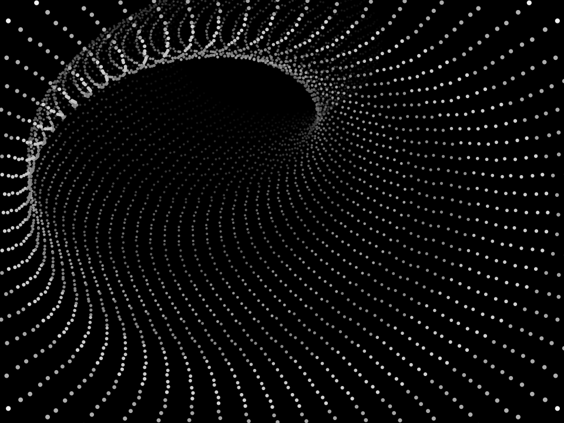
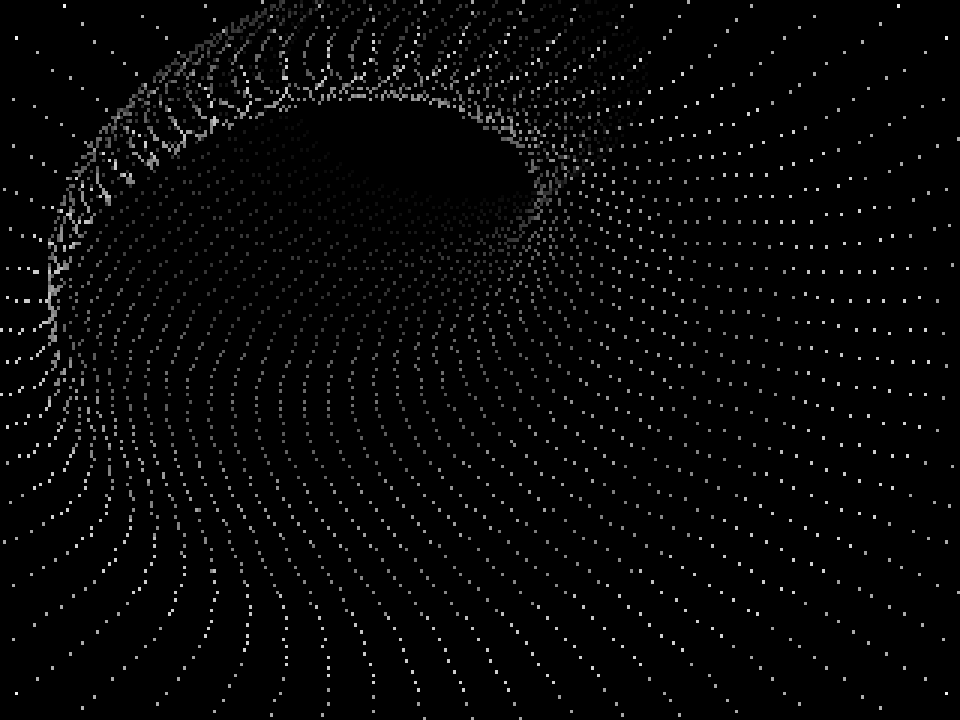

# Dot Tunnel

| Modern look | 1993 look |
|---|---|
|  |  |

A tunnel of dotted rings that snakes around as you fly down it, with alternating light and dark bands.

- **Original:** `TUNNELI/TUN10.PAS` by Trug, about 230 lines of Turbo Pascal with a short assembly loop.
- **This version:** `Sources/SRMetal/Scenes/DotTunnel/`
- **Length:** 1060 steps, about 15 seconds, then it loops.

## How the original did it

It looks 3D, but there is no 3D maths in it.

- **Circles are drawn ahead of time.** A separate program worked out the positions of 64 dots around a
  circle, for every circle size needed, and saved them to a file (`TUNNEL.DAT`).
- **The tunnel is a list of about 100 rings.** Each ring has a sideways position, an up-down position and a
  colour. Nothing else.
- **Depth is faked by size and brightness.** Rings further down the list use a smaller circle from the
  table and a dimmer colour. Ring size is 16384 divided by a number that grows with distance, which is
  real perspective, but only for the size. A ring's sideways offset is not reduced with distance, which is
  what gives the tunnel its exaggerated bend.
- **Movement is a conveyor belt.** Every step, each ring's position is copied to the next slot, and a new
  position is fed in at the far end from a few sine waves added together.
- **Bands come from one line of code.** Every 8 steps the colour given to the newest ring switches between
  light and dark.
- **Drawing is erase-and-redraw.** Each dot remembers where it was last frame, blanks that pixel, and draws
  itself at the new spot. About 5,000 dots per frame, near the limit of a 486.
- **That erasing eats dots.** The screen is never cleared as a whole. Rings are drawn far to near, and
  each dot does its blanking just before it is drawn. Neighbouring rings lie close together, so the pixel a
  dot blanks is quite often one where a further ring has only just drawn a dot this frame. That dot is
  then missing until the next frame. Roughly one dot in twenty is lost this way, different ones each frame,
  which gives the original a slight sparkle. (A dot off the left or right edge is remembered by a
  meaningless number, which can blank a pixel in the second row of the screen for the same reason.)

### Two speed tricks

**No bounds checks.** The program never tests whether a dot is above or below the screen. It keeps a table
that turns a row number into a screen position, and places two extra tables directly before and after it in
memory, filled with the value 64000. A row number that is too small or too large reads from a neighbour
instead, and 64000 is the first position past the bottom of the visible screen, so the dot is drawn where
nobody can see it. That saved a comparison on every dot.

**Self-modifying code.** Before drawing each ring, the program writes that ring's colour into the machine
instruction that draws a dot. The colour then costs nothing to fetch inside the loop.

## How this version does it

Both looks share one model: the ring list, the conveyor belt, the sine-wave formula that steers the tunnel,
the band timing, the sizes and the brightness rule, all kept exactly. So it moves the same way.

For the modern look the processor only works out about 80 rings per frame: a centre, a size and a
brightness for each. It hands those to the graphics chip, and a shader places all 64 dots of every ring by
calculating their positions with sine and cosine. The whole screen is cleared and redrawn every frame.

| | 1993 | This version (modern look) |
|---|---|---|
| Dot positions | Looked up in a pre-made table | Calculated on the graphics chip each frame |
| Erasing | Each dot blanks its own old pixel | Clear the screen, redraw everything |
| Off-screen dots | Sent somewhere invisible by a table trick | Clipped by the graphics chip |
| Ring colour | Written into the machine code | An ordinary value passed to the shader |
| Tables | Loaded from data files | Calculated from formulas at start-up |

### Modern look

- Dots are round with soft edges, and nearer dots are larger. The original's were all one pixel.
- Rings glide between slots instead of jumping one slot per step, and sizes and brightness change smoothly.
- It keeps the original's projection, including the un-reduced sideways offsets. Using true perspective
  throughout would have changed how the tunnel bends.

### 1993 look

The processor replays the original's drawing loop exactly: the same circle table, the same order (far
rings first), and the same erasing, each dot blanking the old pixel of the dot in its place in the drawing
order just before it is drawn. So the same dots go missing each frame as in 1993. The result is a 320x200
picture of colour numbers, which the graphics chip shows through the original's palette.

(Until the code review of 2026-11-14 this look was calculated on the graphics chip with the screen cleared
every frame, which showed every dot. See "Code review" below.)

## What was checked

- **The tables are exact.** The original's generator programs survive (`BALLGEN3.PAS`, `SINGEN.PAS`). The
  formulas in them reproduce `TUNNEL.DAT` (all 8,832 circle points) and `SINIT.DAT` (both sine tables) with
  zero differences, using round-half-to-even rounding. So no data files are needed.
- **The 1993 pictures match a separate re-run of the original.** The original's main loop (`TUN10.PAS`,
  Pascal and its inline assembly) was written out again in Python, reading the original `TUNNEL.DAT` and
  `SINIT.DAT`, erasing included. This version's screen has the same checksum at steps 60, 250, 500, 777,
  900 and 1000 (self-test). The Python re-run and the Swift replay were written by the same reviewer from
  the same source, a few minutes apart, so this guards against slips in the port, not against both
  misreading the original the same way.
- **The circle table is the original's.** Spot values from `TUNNEL.DAT` are in the self-test, and the
  formula was checked against all 8,832 points again during the review.
- **No dots are left behind at the end.** The re-run shows the original's screen is empty from step 1053
  on, and so is this version's (self-test, steps 1054 to 1059).
- **The graphics chip shows the processor's picture** pixel for pixel at six moments (self-test). Since
  the review this only proves the display path; the check above is the one that matters.
- **Motion, by program** (`--motion-check`, both looks, the whole loop). Modern look: no jumps, including
  at the loop point. 1993 look: four steps stand out (110, 111, 117, 124). They are the original's: at
  those steps the ring everything is drawn relative to moves by one whole pixel, so the whole picture
  shifts by a pixel at once. The modern look glides through them.

### What was not checked

- Nothing was compared with a running original or a recording.
- The original's list of old dot positions is never set up before use, so on a real PC it held whatever
  was in memory. Here it starts as zeros. The re-run shows the choice does not matter (starting it
  off-screen instead gives identical pictures at every step).
- On a slow PC the original skipped steps (it advanced the tunnel once per screen refresh that had
  passed, but drew once). That changes which dots get blanked. This version always draws every step.
- The modern look was checked by program and in still pictures, not by eye in the running app.

## Code review (2026-11-14)

Reviewed line by line against `TUNNELI/TUN10.PAS` (with `BALLGEN3.PAS` and `SINGEN.PAS` for the tables;
`ROUTINES.ASM` is an older drawing routine that `TUN10.PAS` does not use), and with `/code-review`.

**Found and fixed: the 1993 look showed dots the original did not.** The page used to say that erasing
dot by dot only mattered at the very end. It matters all the time (see "That erasing eats dots" above):
a clear-and-redraw picture differs from the original's in 163 to 296 pixels at steps 100, 300, 500, 700
and 900 (of about 3,800 lit), and in 1,003 of the 1,061 frames. The 1993 look now replays the original's loop. Its
pictures changed at every step with dots on screen; for example the lit pixels at step 500 went from
3,895 to 3,732. `docs/images/dot-tunnel-classic.png` was made again.

**Corrected in this page:** the old note that the original left "a few stale dots" on screen as the
tunnel emptied. It does not: the only ring that is never erased is the one in the nearest slot, and that
ring is always entirely off the screen.

**Confirmed correct:** the conveyor belt and the order of its steps; the steering formula and its table
indexes; the band switch every 8 steps; the 102 invisible rings at the end and the length of 1060; ring
sizes (`16384 div (slot*7+95)`, used as an index into the circle table, whose first entry is radius 10);
the palette, including the two black entries that blank the ring in slot 5; rows off the top or bottom
never reach beyond the original's guard tables (rows stay within -67...248; the guards cover -100...401),
so no stray pixels come from there. Modern look: every use of the "how far to the next step" value was
checked: rings glide towards the slot they will be in next step, the reference point glides the same way,
and the tunnel is empty for the last three steps, so nothing is carried across the loop.

**Possible tidy-ups** (left for a later pass): the size and brightness formulas are written out again in
the modern look; 320, 200, 160 and 100 are literal numbers in several places; the modern look's far ring
appears at once at 3% brightness (slot 81) rather than fading in.

## Differences from the original

- **Looping.** The original ran once. This one loops; the tunnel has emptied by then, so the loop is clean.
- **Modern look only:** the original's palette happened to blank one ring near the viewer. The modern look
  does not.
