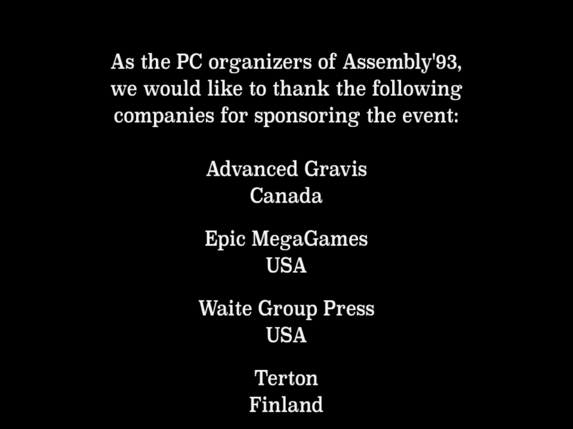
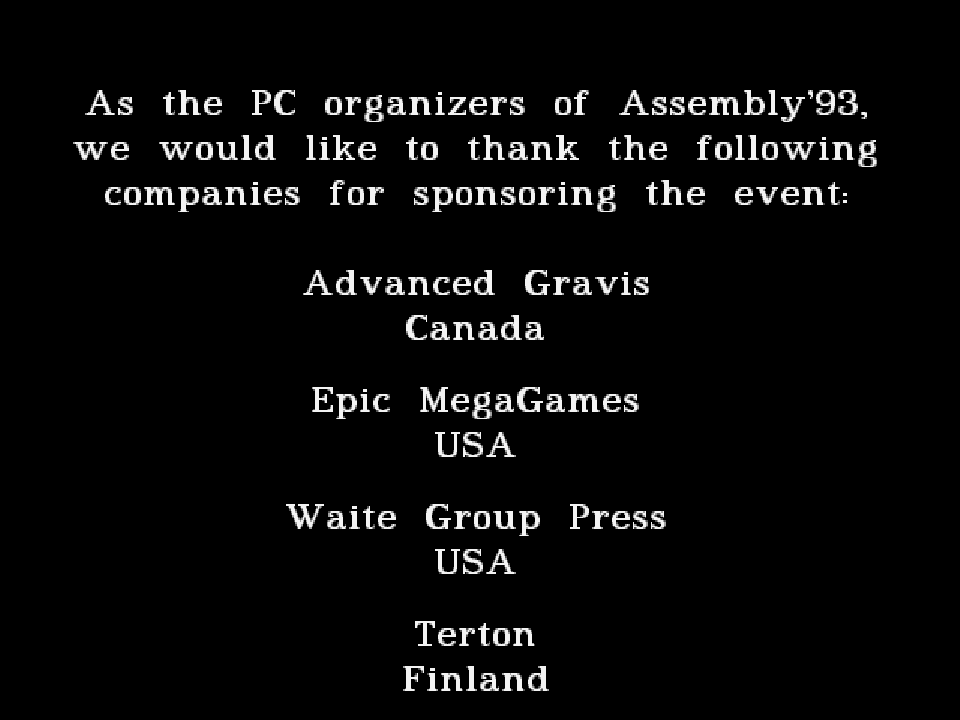

# End Scroller

| Modern look | 1993 look |
|---|---|
|  |  |

The very end of the demo: after the credits, a long text creeps up the screen: "Second Reality /
Copyright (C) 1993 by the Future Crew / This demo won the Assembly'93 ...", the sponsors, how to contact the
group, greetings to other groups. When the text is through, the demo is over: the program quits.

- **Original:** `ENDSCRL/MAIN.C` (about 125 lines), built as `ENDSCRL.EXE`.
- **This version:** `Sources/SRMetal/Scenes/EndScroller/` (added 2026-11-24). In the sidebar too.
- **Data:** the released text and font, in `Data/EndScroller/` (see "The released text" below).
- **Length:** the text is 542 lines; its end mark (a line starting `%`) is line 538, 11,500 rows down; at 35
  rows a second that takes 5 minutes 28.6 seconds (23,002 steps). In Play Demo the demo ends there, at
  16:21.0: the screen stays black and the scene list opens, with Play Demo still chosen (P plays it again). On
  its own the scene then starts the text again.

## How the original did it

The program switched to a 640x350 16-colour mode and changed one register so it showed 400 rows, then set
four greys: colour 1 = level 20, 2 = 40, 3 and up = 60 (of 63).

Every second screen refresh (`if(dis_waitb()==1) dis_waitb();`) it drew ONE new row of pixels: the current
row of the current text line, into the row of video memory just off the bottom of the screen (twice: the
ring of 401 rows is stored twice over, so the screen can start anywhere without wrapping), and told the
card to start the screen one row lower. So the whole screen moves up a row, 35 times a second, for the
cost of drawing 640 pixels.

Each text line is 25 rows (the font's height). When a line starts, its width is added up (every character's
glyph plus 2 pixels, including the carriage return, which has no glyph) and the line is centred:
start = (639 − width) / 2. A space is 16 pixels wide.

The glyphs are found the way `init()` finds them: scan the font picture for runs of columns with ink, and
give them to the characters of a fixed list in order.

## The released text

The source release's `ENDSCRL` folder has only an earlier version: its `ENDSCROL.TXT` is a joke
work-in-progress ("A font test!!! Yeah!!!!", "PIXEL SUCKS", then about 80 empty lines), and its font has
no Y, Z, ä, ö, / or &. The released demo used a newer text (542 lines) and a 25-row font with those six
characters added; and the released program also understood two markers in the text: a line starting
`[nn` is a gap of nn rows, a line starting `%` sends it back to the first line.

Those released files survive in the data of the C++ port **SecondReality++** (public domain, like the
original), whose authors extracted them from the released demo. This project takes the two files from
there unchanged (and nothing else: the scroller is written from the original `MAIN.C`). Where exactly they
came from, with checksums: [Data/EndScroller/README.md](../../Data/EndScroller/README.md). Chosen by the
user, 2026-11-24.

## This version

**The model** (`EndScrollerModel`) is the original's loop: a ring of 401 rows of shade numbers, one new row
every 2 steps, the same centring, glyph search, 2-pixel gaps and 16-pixel space, and the two markers.

**1993 look:** the model's 640x400 screen in the original's four greys, through `IndexedCanvas`. The
self-test checks: a row every 2 refreshes; the first line's ink starts exactly where the original's
centring puts it; a `[15` line takes 15 rows and a `[8` line 45; the demo ends on the first row of the `%`
line (alone, the text starts again after it); the font has Y, Z and ä;
and the graphics chip shows the model's screen exactly at 12 moments.

**Modern look:** the same lines at the same places, but drawn in **SuperClarendon**, a Clarendon-style
typeface that comes with macOS (so it costs nothing in the program's size). It was chosen by the user over
the original font smoothed by Super-xBR, after comparing them on real lines of the text
(sheets made into `build/scaler-compare/fonts/`, a folder that is not kept in the repository). Capitals are as tall as the original's 14 rows, sitting on the same row;
the original's tall pixel shape (1.2:1) is kept; the letters use the typeface's own spacing (the original
font's letters were wider, so lines are a little narrower, but each is centred, as before). The text glides
up smoothly instead of a row at a time. Each line is drawn once, at 4 times the original's width, into a
picture of its own, and moved as it scrolls.

| | Original | 1993 look | Modern look |
|---|---|---|---|
| Screen | 640x400, 4 greys | the same | full resolution |
| Font | released 25-row font | the same | SuperClarendon (macOS) |
| Scroll | 1 row every 2 refreshes | the same | smooth, same speed |
| End | the program quits at the `%` line | Play Demo: ends there; alone: starts again | the same |
| Characters the font has no glyph for | nothing shows | the same | the quotation marks around a nickname show (kept on purpose); the "%" loop line and tabs show nothing |

Until 2026-11-25 the Modern look drew the "%" line (the marker that starts the text again) as a real
percent sign just above "Second Reality" on every loop; found in the code review and fixed, with a check.

## The two marks, as the released program reads them (2026-11-26)

Two kinds of line in the text are marks, not text. The source release's `MAIN.C` is an earlier version
without them, so they were read from the released program itself (`MAIN/DATA/ENDSCRL.EXE`, unpacked with
`deark -m pklite` and then `deark -m lzexe`, and disassembled):

- **A line starting `[`** draws nothing and takes (2nd character − 48) × 10 + (3rd character − 48) rows
  (code at 164Fh-1681h). The program does not test that the characters are digits. `[10`, `[12` and `[15`
  are 10, 12 and 15 rows. The six `[8` lines (between the USA's BBS operators) have the line's carriage
  return (13) as their third character: 80 − 35 = **45 rows**, not 8. It looks like a slip in the text,
  but it is what the demo did.
- **On the first row of the line starting `%`** the program calls `exit(0)` (169Ah). The demo ends
  there; it does not start again from the top.

Until 2026-11-26 this version had both wrong: it wanted two digits, so `[8` was drawn as text (the user
noticed it in the app), and it started the text again at `%`, as the C++ port does. Fixing the gaps
moved everything after them 3.4 seconds later. The music runs out at 15:57.7; the last line of text
("Second Reality") leaves the top of the screen at 16:12.2; the demo ends at 16:21.0 on a black screen.

## Limits

- The released text and font are not taken from our own copy of the released demo (its parts are
  compressed) but from the port's data; the marker handling is inferred from the released text and matches
  the port.
- The text's few non-English characters are shown in SuperClarendon by their DOS meaning (0x84 = ä).
- Not compared with the original running.
