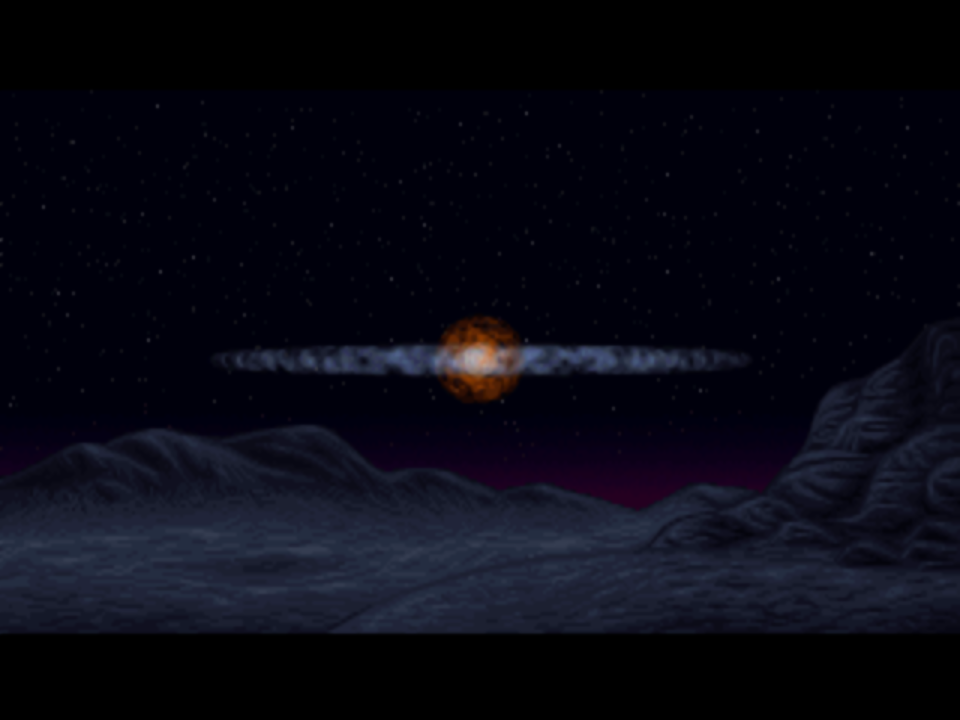
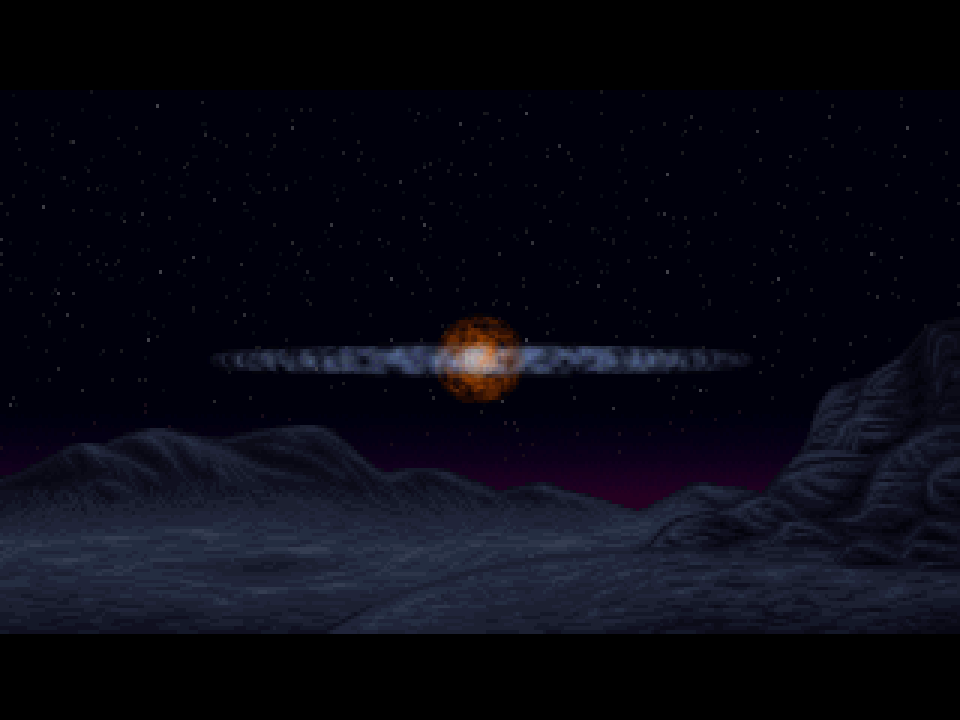

# Explosion

| Modern look | 1993 look |
|---|---|
|  |  |

Right after the ships fly away, the screen flashes white and a planet explodes over the horizon: a
fireball with a ring of debris, which fades back to white. Part 3 of the demo, about 2.6 seconds.

- **Original:** `PAM/OUTTAA.C` (about 70 lines) with `PAM/ASMYT.ASM`, `COPPER.ASM` and `TWEAK.ASM`, by
  Trug and Wildfire. Built as `PAM.EXE`.
- **This version:** `Sources/SRMetal/Scenes/Explosion/`.
- **Length:** 180 steps (about 2.6 seconds), then it starts again. In Play Demo it starts on the music's
  sync value 10, as the original did.

**This scene uses original artwork.** The explosion is a hand-drawn animation, made in Autodesk Animator
(`PAM/PRAX4.FLI`); it cannot be calculated. Its 40 frames were exported from the demo's own copy
(`PAM/OUT.ANI`) into `artwork/original/rgb/explosion/` (see [artwork/README.md](../../artwork/README.md)).

## How the original did it

1. Wait for the music's sync value 10 (see [demo-timeline.md](../demo-timeline.md)). Meanwhile the
   screen still shows the ships' horizon.
2. Make 64 copies of the animation's palette, each a step further towards white: copy `a` has every
   colour level `c` (0...63) changed to `(63·a + (64 − a)·c) / 64`.
3. Set the whitest copy: the screen goes white.
4. 45 rounds, each 4 screen refreshes long (17.5 rounds a second). In round `f` it unpacks animation
   frame `f` (rounds 41 to 45 keep frame 40) into the video page not on show, flips to it, and switches
   to palette copy `wfade[f]` from a fixed table: 32, 16, 8, 4, 2, 1, then 0 for most of the animation,
   then 1, 2, 4, 6, 9, 14, 20, 28, 37, 46, 56, and 63 for the last five rounds.

So the screen flashes white, the explosion fades in within a few frames, plays, and fades out to white.
The title picture follows.

The frames are stored as changes from the frame **two** before (there are two video pages, and each
frame is drawn over the page shown two frames earlier). The export undid that, so each exported frame
is a whole picture.

## This version

**The timing** (`ExplosionModel`) is the original's: round = step / 4, frame = the round (at least 1, at
most 40), white fade = `wfade[round]`. The table is copied from `OUTTAA.C`.

**1993 look:** each frame's original pixels, drawn with the shared picture toolkit
(`Core/PictureLayer.swift`, see [how-it-works.md](../how-it-works.md#pictures-in-the-modern-look)), which
fades every colour level by the original's whole-number rule. The self-test compares the graphics chip's
picture with the same rule worked out on the processor from the frame files at 15 moments (white flash,
fade-in, middle, fade-out, last step): all identical.

**Modern look:**

- Each frame is made 8 times larger by Super-xBR (2560x1600) just before it is needed. While one frame is
  on screen, the next is prepared on a background thread, so a frame change never waits. Only those two
  are kept (making all 40 ahead of time would take over 1 GB, and a moment at the start).
- The fade to white is laid on top of the enlarged frame, and glides smoothly from one round's value to
  the next instead of changing every 4 steps. Fading after scaling keeps Super-xBR's edge choices the same
  throughout the fade.
- The animation still runs at the original's 17.5 frames a second. Blending between frames was considered
  and left out: on an explosion it looks like two fireballs half-visible rather than smoother movement.

| | Original | 1993 look | Modern look |
|---|---|---|---|
| Frames | 40, 320x200, 17.5 a second | the same | the same, each 8x by Super-xBR |
| Fade | palette copies, changed every 4 refreshes | the same rule, the same colours | smooth, laid on after scaling |
| Before it starts | waits for sync 10 on the ships' horizon | Play Demo does the same | the same |

## Differences from the original

- The original's white screen before the first frame is the palette at full white over whatever was in
  video memory; this version shows frame 1 faded to full white, which is the same colours (every level
  becomes 62 or 63).

## What was not checked

- Not compared with the original running. The frames' decoding was checked by structure (every frame
  covers exactly the screen) and by eye, not against the Autodesk Animator file.
