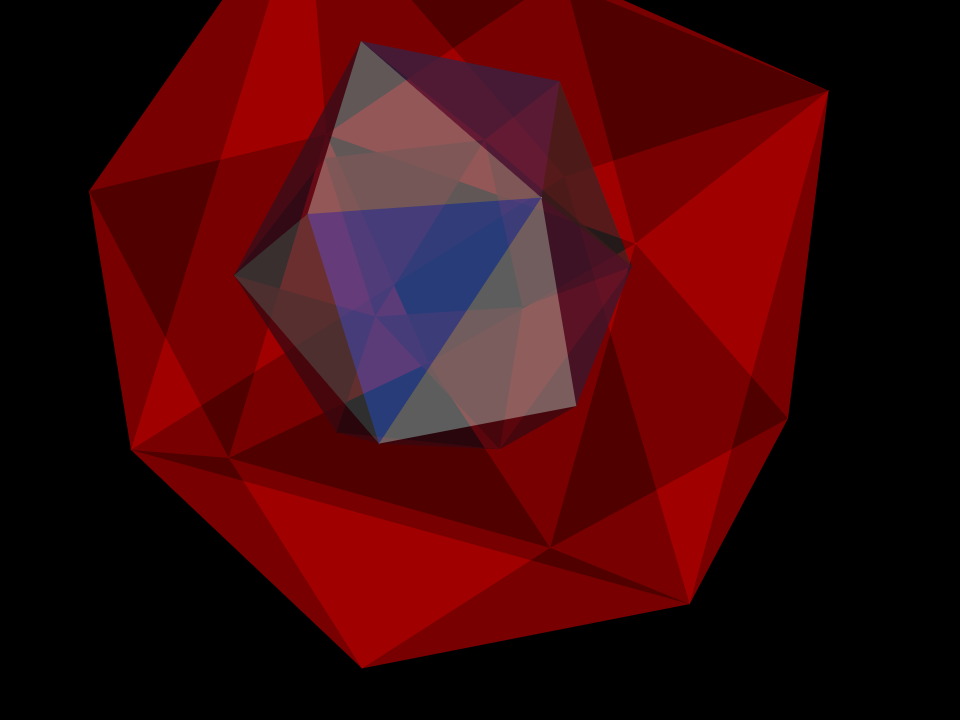
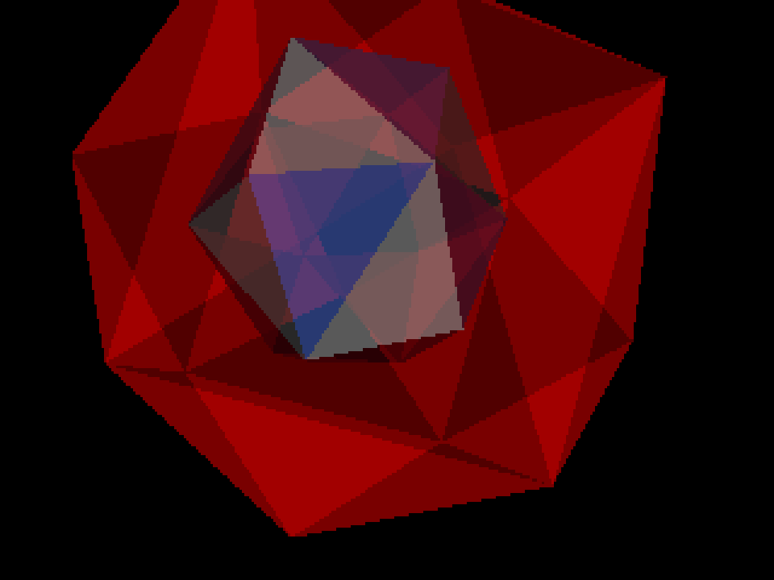
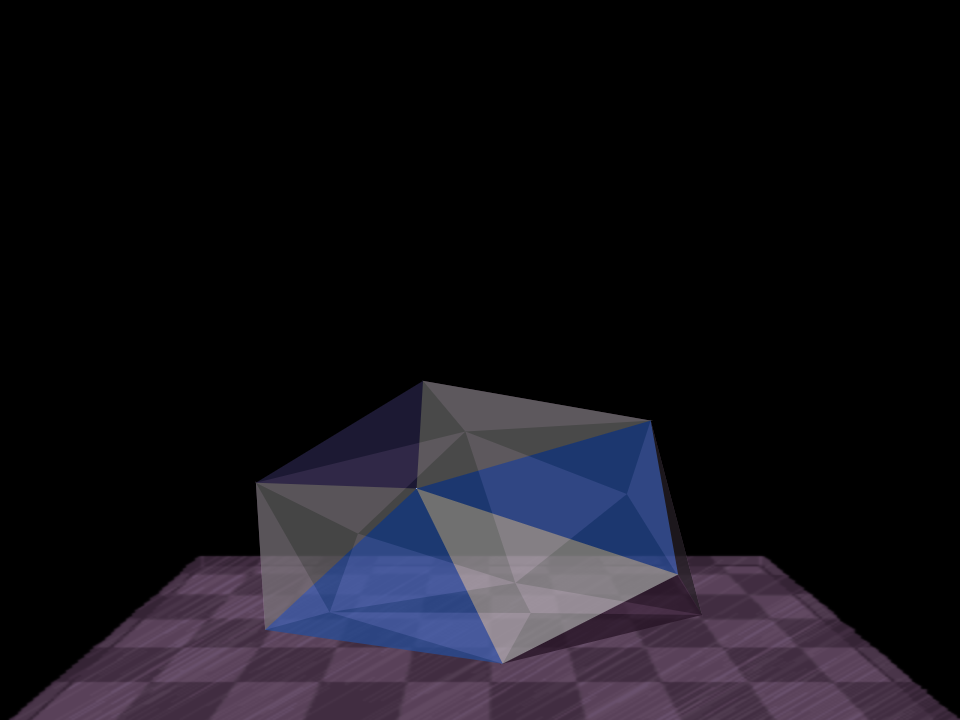
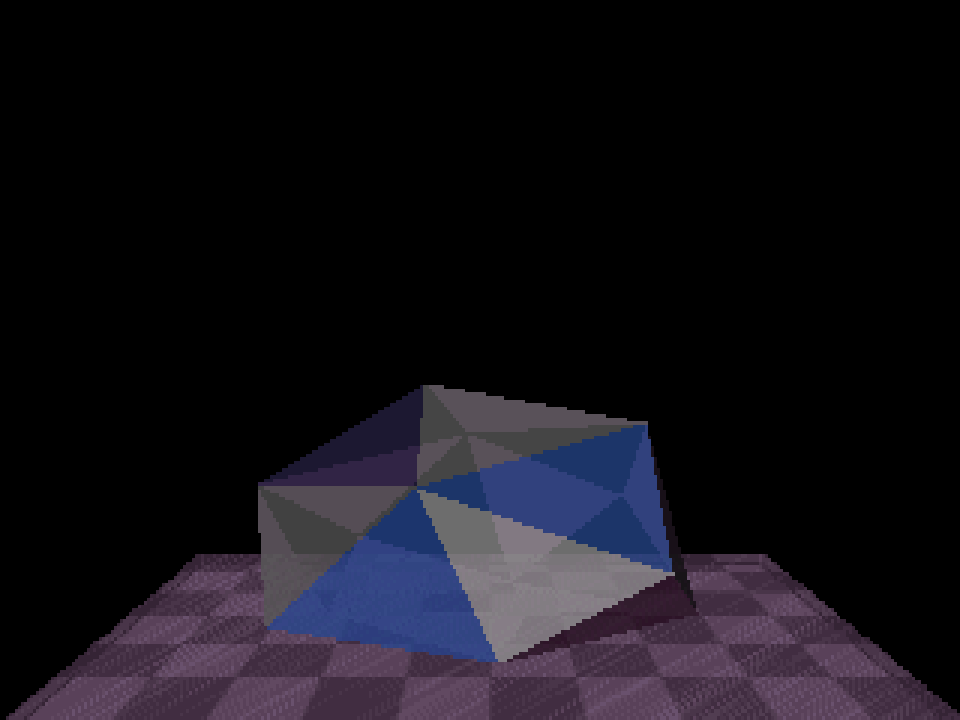

# Glenz Vectors

| Modern look | 1993 look |
|---|---|
|  |  |
|  |  |

A chequered plate drops onto the bottom of the screen and bounces to rest. A see-through, blue-and-white
faceted solid (a "glenz", demo slang for a glass-like object) falls onto it, squashing like jelly each
time it lands. The plate fades away, the glenz rises to the middle, and a larger red glenz grows around
it. Both tumble and wander; the blue one shoots up out of the picture, the red one swings ever wider,
and both shrink to nothing.

- **Original:** `GLENZ.EXE`, by Psi: `MAIN.C` (the script), `MATH.ASM` with `MATHSIN.INC` (the turn
  matrix), `VEC.ASM` (turning, projecting, deciding which faces show, colouring them), `NEW.ASM` (the
  see-through polygon filler), `VID.ASM` (screen mode numbers), and the picture `FC.UH` (the plate).
- **This version:** `Sources/SRMetal/Scenes/GlenzVectors/`, plus `Core/Math3D.swift` and
  `Core/SmoothTriangles.swift`.
- **Length:** 2360 steps, about 34 seconds, then it repeats.

**This scene uses original artwork.** The plate is a hand-drawn picture from the 1993 demo, kept in
`GlenzFloorArt.swift` as data. See "The plate is a picture" below for why.

## Which original files are live

The `MAKEFILE` builds `v.exe` (copied into the demo as `glenz.exe`) from `zoomer.obj main.obj vid.obj
zoom.obj adata.obj asm.obj vec.obj math.obj _fc.obk`, the demo's shared `disc.obj`, and the library
`gl10.lib`. The link map `V.MAP` agrees. `VID.ASM` pulls in `VIDMISC`, `VIDINIT`, `VIDTWE`, `VIDNRM` and
`VIDPOLY.ASM`, and `VIDPOLY.ASM` pulls in `NEW.ASM`; `VEC.ASM` does not actually include `VECCMD.ASM`,
whatever the makefile says.

Most of what is linked is never run. Following the calls from `main()`:

| Used by the scene | Linked but never called | Not built at all |
|---|---|---|
| `MAIN.C` | `ZOOM.ASM` / `ZOOMLOOP.INC` (only its sine table is read) | `MAIN1.C`, `MAINNORM.C`, `MAINTRAN.C`, `MAIN.1`, `MAIN.2`, `MAIN.BBK` (older versions) |
| `MATH.ASM`: `cmatrix_yxz`, `calcmatrix` | `ZOOMER.C` `zoomer1` (see below) | `NEW1.ASM`, `NEW2.ASM`, `NEWNORM.ASM`, `NEW.9`, `VEC.BK1`, `VEC.A`, `ASM.A` |
| `VEC.ASM`: `setmatrix`, `rotlist`, `cliplist`, `projlist`, `ceasypolylist`, `checkhiddenbx`, `demo_glz`, `demo_glz2` | the other fillers and screen modes in `VID*.ASM` | `EDGE.C` (a separate test program), `DOLOOP.C`, `KOE.C` |
| `NEW.ASM`: all of it | `VEC.ASM`: `cpolylist`, `cclipedges` | `FC.LBM`, `FCX.LBM`, `PIC001.LBM`, `PIC002.LBM`, `_BGPIC.OBK`, `EYE4.UH` (pictures) |
| `VID.ASM` `init320x200` (numbers only) | `MAIN.C`: the cube and the four extra point lists (a morph, commented out) | |
| `_FC.OBK` = `FC.UH` (the plate picture) | | |

`DOC` describes the list formats the routines pass around. `NOTS` says only "martin, silents".

**What the planning notes said, and what the program does.** The team's `SCRIPT` describes the title
picture tipping over to become a plate seen edge-on, a block bouncing down, a glenz dropping onto it,
a second glenz fading in inside it, and the outer one growing past the screen. The shipped program is
different:

- The routine that would tip a picture over (`zoomer1`) is still in the source but is never called.
  Instead `zoomer2` wipes the previous scene's picture away, then the plate drops in on its own.
- There is no separate block. The thing that bounces down first is the plate.
- The second glenz is the **larger** one and is red. It grows from nothing around the first.
- Nothing grows past the screen. The first glenz flies out of the top; both then shrink away.

## How the original did it

### The screen

Mode 13h: 320x200 pixels, one byte per pixel, 256 colours, one screen (no hidden second page). This is
the plain "chunky" mode, not the bit-plane modes other parts used. The transparency does not come from
bit planes; it comes from the filler and the palette.

### The plate is a picture

There is a chequered floor, and it is not calculated. `FC.UH` is a 16-colour picture of a plate drawn in
perspective, with hand-shaded squares, 100 rows of plate and 8 rows of front edge.

`main()` starts with a small loop that drops it into place. A position falls under gravity and bounces
off row 48 with two thirds of its speed. For position `y`, the 100 picture rows are squeezed between
screen rows `130 + y/2` and `130 + 3y/2`, followed by the front edge. So the plate starts as a thin bar
and opens out downwards as it "falls flat". The loop ends by itself when a bounce is slower than 4.

The screen is then copied into memory as the background picture, `bgpic`.

The picture is drawn, not generated: the squares carry hand-made scratchy shading, so no formula can
reproduce it. The glenz lands on it, flattens against it and shows it through its faces, so this version includes
the picture's 108 rows and 16 colours as data.

### The shape

A cube with a four-sided pyramid on each face: 14 corners, 24 triangles. Corners are written in the
source: the first glenz is a cube of half-width 5000 with tips at 8500; the second 5940 and 10395.
This version calculates both lists from those four numbers.

### Turning, squashing and projecting

Each frame, for each glenz:

1. `cmatrix_yxz` builds a 3x3 turn matrix from three angles in tenths of a degree, using a 3600-step
   sine table. Numbers are 16-bit fractions (32767 means 1).
2. `rotlist` multiplies every corner by the matrix with 32-bit arithmetic.
3. `rotlist` is called a second time with a matrix that only stretches: three sizes, one per axis.
   This is the jelly: the first glenz gets wider and flatter, or thinner and taller. The same call
   moves the glenz to its place.
4. `cliplist` (first glenz, while the plate is there) moves any corner that is below the floor up onto
   it. A glenz that lands is therefore pressed flat against the plate, not sunk into it.
5. `projlist` divides by distance: screen x = 160 + 256 * x / z, screen y = 130 + 213 * y / z.

The first glenz turns by 3.2 and 0.7 degrees per frame about two axes. The second turns the opposite
way at a third of that speed.

### Which faces show, and how bright

`checkhiddenbx` works out twice the area of each triangle on the screen, with a sign: negative means
the face is turned away.

That same number is the lighting. A front face's brightness is its on-screen area divided by 128 (later
by about 171), limited to 0...63. There is no light direction: a face seen flat-on is large and
therefore bright, a face seen edge-on is a sliver and dark.

### Transparency: colour numbers, XOR and a prepared palette

Faces are not sorted and nothing is blended. Three pieces work together.

**1. Every face gets a colour number** (`demo_glz` for the first glenz, `demo_glz2` for the second):

| Face | Colour number |
|---|---|
| First glenz, front face | a multiple of 16 (16, 32, 48 ...), its own, for as long as it faces forward |
| First glenz, back face, blue | 4 |
| First glenz, back face, white | 0 (not drawn) |
| Second glenz, front face | 0 or 1, alternately round the shape |
| Second glenz, back face | 4 or 2, alternately |

**2. The filler XORs them.** `NEW.ASM` keeps a list of every polygon edge with its colour number, the
rows it spans and its sideways movement per row. An edge shared by two faces is stored once with both
numbers XOR-ed together. Then, for each screen row, it walks the edges crossing that row from left to
right, XOR-ing each edge's number into a running value. The running value between two edges is the
colour number of those pixels. The effect: **a pixel's colour number is the XOR of the numbers of all
faces covering it.** Because the numbers above use separate bits (1, 2, 4, and the multiples of 16),
XOR-ing them is the same as collecting them: the result says exactly which kinds of face are there.
Only one case really cancels: a blue back face of the first glenz over a "4" back face of the second
gives 0.

**3. The palette gives every combination a colour.**

- Colours 0-15 are "what is there without a first-glenz front face". At first they are the plate's 16
  colours. Once the plate has gone they are rewritten as reds: bit 1 adds red 10, bit 2 adds red 30,
  bit 4 adds red 20. So the second glenz alone shows as red 20, 30 or 40 (of 63) depending on which
  of its front and back faces overlap.
- Each front face of the first glenz owns 16 palette entries, rewritten every frame: entry k is the
  face's own lit colour (white, or blue) **plus a quarter of colour k**. So through a front face you
  see everything behind it at quarter strength.

The floor picture joins in by a fourth step: when the filler writes a pixel, it writes the colour
number OR-ed with the background picture's pixel there (0-15). So over the plate, the low four bits
are the plate's colour, and a front face shows itself plus a quarter of the plate.

### Writing only what changed

The filler keeps the previous frame's list of colour changes and compares it with the new one as it
goes. Pixels whose colour number is the same as last frame are not written at all. With one screen
and no clearing, this is what made the effect fast enough.

### The script

Everything is driven by a frame counter that counts screen refreshes (70 a second), so the motion's
speed did not depend on the PC; a slow PC drew fewer pictures of the same motion. In this version's
steps (original frame = step - 212):

| Steps | What happens |
|---|---|
| 1-177 | The plate drops in, bounces, settles |
| 178-212 | Pause (see "Deliberate differences") |
| 213- | The first glenz falls from above the screen under gravity |
| 362, 620 | It lands and bounces; near the floor it is squashed by how deep it is, then wobbles as a spring |
| 879-882 | Third landing (see "Kept quirks": it sticks for four frames) |
| 912-976 | The plate's colours fade to black; from 922 the glenz drifts up to the middle |
| 977-1001 | The plate is wiped from the background picture; the 16 colours become the reds |
| 1013-1102 | The second glenz grows from nothing to full size |
| 1112- | Both wander on sine paths |
| 2012- | The first glenz accelerates up and out; the second's wander grows to cross the whole screen |
| 2221-2345 | Both shrink to nothing; colours 0-15 fade to black over the last 64 steps |
| 2346-2359 | Black, then the loop restarts |

The bounce keeps 6/7 of the speed the first time, then 8/8, then 10/9, 12/10 and so on: the numbers
were plainly tuned by eye.

### Start, end and the music

The original waited for a position in the music before starting, ran `zoomer2` (the previous scene's
picture is covered by bars closing in from top and bottom while its colours fade to grey, then the
screen is cleared), dropped the plate, waited for music frame 300 and then 333, and ran the main
loop until a later music position or frame 7000. By then the screen has long been black.

## How this version does it

**The model** (`GlenzModel.swift`, with the script in `GlenzScript`) holds the rules: the plate's fall,
the script, the turn matrix, the two passes through `rotlist`, the floor clamp, the projection, the
facing test, the colour-number rules and the palette writes, all in the original's 16- and 32-bit whole
numbers. `GlenzFiller.swift` is the filler.

**1993 look: replayed on the processor.** The picture depends on what was written to the screen in
earlier frames (only changed pixels are written) and on which palette entries each face happened to be
given, so a formula per pixel will not do. The model keeps a 320x200 screen of colour numbers and the
video card's 256 colours, and `IndexedCanvas` shows them. One simplification is exact rather than
approximate: instead of sorting edges and comparing two change lists, the filler marks each edge's
pixel, sweeps the XOR across, and compares with the previous frame's colour numbers pixel by pixel.
That gives the same pixels (XOR does not care about order), and the reference tool confirms it.

It does not share code with the Techno Bars filler (`BarRasteriser`), although both are by Psi and
both rely on XOR. That one flips single bits in a one-colour picture and has a separate clipper; this
one carries colour numbers on a list of edges with fixed-point slopes and clips nothing (edges are
simply held to columns 1...319).

**Modern look: real triangles, real blending.** The model works out the same corners in decimals (via
`Math3D.rotationYXZ` and `Math3D.canvasPosition`), gliding between steps, and sorts the faces into
three groups. `GlenzScene` draws them as triangles with smooth edges (`Core/SmoothTriangles.swift`)
in this order, each with a different blending rule on the graphics chip:

1. The plate, from the picture (made 8 times larger by Super-xBR when the scene starts, then smoothly
   scaled; see [how-it-works.md](../how-it-works.md#pictures-in-the-modern-look)).
2. The "4" bit. Blue back faces of the first glenz and "4" back faces of the second are drawn into the
   picture's spare fourth channel with a blend that works as XOR for on/off values, so two overlapping
   ones cancel as in the original. A full-screen pass then adds the bit's tint wherever it is on.
3. The second glenz's other faces **add** their tints. Adding is exact here because the original's
   reds were chosen to add up (10 + 30 = 40, and so on).
4. Front faces of the first glenz. Their coverage is collected in the spare channel, a full-screen pass
   dims the picture to a quarter where they are, and then their lit colours are added. That is the
   "own colour plus a quarter of what is behind" rule.

So overlapping faces mix by the original's rule, not by ordinary glass-style blending. Smooth edges
work without seams because neighbouring faces fade in opposite directions across their shared edge,
and every step above adds coverage up. The 3D turning and perspective are done by the app in decimals
and the chip is handed triangles already placed on the screen; nothing here needed a depth buffer.

## 1993 versus this version

| | 1993 | This version, 1993 look | This version, modern look |
|---|---|---|---|
| Resolution | 320x200 | 320x200 | the display's |
| Motion | 70 steps a second (fewer pictures on a slow PC) | one picture per step | glides between steps |
| Maths | 16/32-bit whole numbers, sine tables | the same | decimals |
| Transparency | XOR of colour numbers + palette | the same, replayed | blending that follows the same rule |
| Lighting | on-screen area, via 16 palette entries per face | the same | on-screen area, per face |
| Edges | hard | hard | smooth |
| Plate | picture, rows squeezed | the same picture | the same picture, 8x by Super-xBR, then smoothly scaled |
| Start | after a lead-in tied to the previous scene and the music | plate drops in from black | the same |
| End | black until a music cue | loops after 2360 steps | the same |

## What was checked

- **The 1993 pictures, against the original's own assembly.** `tools/glenz_reference.py` reads
  `MATH.ASM`, `VEC.ASM` and `NEW.ASM` as text and carries their instructions out one at a time in the
  small x86 interpreter first written for the Plasma Cube tool (extended with 20 or so more
  instructions, near calls and the colour ports; both layers now live in `tools/x86interp.py`). `MAIN.C` is re-written in Python. At 26 steps spread over the whole
  scene (1, 100, 177, 214, 330, 420, 440, 600, 800, 925, 960, 980, 1000, 1014, 1100, 1300, 1500, 1700,
  1900, 2050, 2100, 2200, 2250, 2300, 2340, 2359) the screen's colour numbers and all 256 palette
  colours are identical to the Swift model's. The self-test repeats this comparison by checksum. Since
  every frame depends on the ones before, a match at step 2340 says a good deal about the 2339 before it.
  This comparison found one mistake in the first Swift version (the "unlit on its first frame" quirk
  below), which is the point of having it.
- **The sine table.** `MATHSIN.INC` (4500 entries) equals `trunc(sin * 32767 + 0.5)` except entries
  3300 and 3900, where the true value lies exactly on the rounding edge; those two are set by hand.
  Checked by checksum in the self-test. `SIN1024.INC` equals the app's shared table.
- **The plate picture.** The linked `_FC.OBK` holds `FC.UH` byte for byte; the embedded rows and
  colours match `FC.UH` by checksum in the self-test.
- **The corner lists** follow from four numbers; the lists themselves are in `MAIN.C`.
- **16-bit arithmetic in the compiled script.** The third bounce depends on a 16-bit overflow. The
  compiled `MAIN.OBJ` contains exactly that sequence (`neg ax`, 16-bit `imul`, `cwd`, 16-bit `idiv`),
  so the overflow is real, not an assumption about the compiler.
- **Out-of-range table writes do not happen.** The filler files each edge under its starting row in a
  256-entry table. The tool counts edges starting on rows 200-255 (198 over the scene; stored, never
  drawn) and would stop if one started on row 256 or lower, which would be written outside the
  table. None does.
- **The graphics chip against the processor** for the 1993 look at 14 steps (self-test). For this kind
  of scene that only proves the display path.
- **The two looks against each other**: pictures at steps 365, 420, 440 and 1300 looked at side by
  side, and at step 1300 the red levels sampled on a grid of points agree.
- **The loop**: black at step 0 and at step 2359, and step 2360 is step 0 again (self-test).
- **The modern look in motion (2026-11-14 review).** A self-test runs one whole loop and into the next
  and checks, for both glenzes at every step they are drawn (3,502 in all): the modern look's 14 corners
  start each step within 3 pixels of the 1993 look's (worst found: 1.85; the 1993 ones are rounded to whole
  pixels), and each step's glide ends exactly where the next begins. Together these mean every glide runs
  from one 1993 position to the next and across nothing else: not across the bounces, the squash, the
  second glenz appearing, the change of wander rule at step 2013, the shrink or the restart. It also checks
  that both looks start and stop drawing each glenz on the same step, and that the plate never moves
  further in a step than it is falling. `--motion-check glenz-vectors modern` over the loop reports two
  jumps, both expected: the plate's first appearance, and step 1070 (see "Kept quirks").

## What was not checked

- **Against a running original or a recording.** Nothing here has been compared with the real program
  on screen.
- **`MAIN.C` as a whole.** The script was ported by reading, twice (Python and Swift), by the same
  author, and read a third time, independently, in the 2026-11-14 review, which found no difference.
  Only the bounce line was confirmed in the compiled code. It has not been run.
- **Three small changes to the assembly text in the tool**: `rotlist` writes numbers into its own
  instructions, which the tool keeps in variables instead; the C calling wrappers are bypassed; a
  debugging macro is emptied. None should change a result.
- **Timing against the music**: how long the original paused between the plate and the glenz, and
  when the music cut the part off.
- **The modern look's colours in motion.** Positions are now checked by program (above); how the
  colours and blending look while moving was checked only by the picture-difference numbers of
  `--motion-check` and a few still pictures, not by a person watching.
- **The linked library `gl10.lib`.** `zoomer2` calls `setpalarea`, which is in no source file here, so
  it presumably comes from that library. Only the left-out lead-in uses it.

## Deliberate differences

- **The lead-in is left out**: the wait for the music and `zoomer2`, which wipes away the previous
  scene's title picture. The scene starts with the plate dropping into a black screen.
- **The pause is a guess.** The original waited for music frame 333 between the plate settling and the
  glenz; this version waits 35 steps.
- **It loops.** After the fade it restarts at step 2360; the original stayed black until a music cue.
- **One picture per step.** The original advanced the script once per screen refresh but drew only as
  often as the PC could. On a fast PC that is the same thing. On a slow one, faces would have been
  given palette blocks on different frames, which matters only to the two "first frame" quirks below.
- **Palette and picture are shown the step they are made.**
- **Modern look only:**
  - Over the plate, the original ORs the plate's colour number with the "4" bit; this adds the bit's
    tint instead. The difference is a slightly different shade of the plate under blue back faces.
  - While the plate fades (steps 912-976), the original keeps showing it at full quarter-strength
    through the glenz (see quirks). The modern look fades it everywhere.
  - The blue faces' red is a steady 7 (later 10) out of 63, without the first-frame accident, and
    faces are lit from their first frame.
  - The squash uses the wobble value without rounding to whole steps.
  - The plate picture is scaled (Super-xBR, then smoothly), not row-picked.
  - The plate comes to rest where its fall ended, 47 15/16 rows down, not at the whole row (47) the
    1993 look draws. That is under half a canvas row at its far edge.

## Kept quirks

All in the 1993 look.

- **The third landing sticks.** The bounce multiplies the speed by 10 before dividing by 9, and 4016 x
  10 does not fit in 16 bits. The speed comes out still pointing down, so the glenz is held against
  the floor for four frames (steps 879-882) while the rule fires again with 12/10, 14/11 and 16/12,
  until one finally sends it up.
- **Blue faces have accidental red.** The red part of a blue face is whatever was left in a processor
  register: 7 normally, 10 once the second glenz is bigger than the first, and 15 minus the number of
  palette blocks in use on the frame a face first gets a block.
- **A face is unlit on its first frame.** Fetching a new palette block overwrites the register holding
  the brightness. (Faces come into view edge-on, so they would have been nearly dark anyway.)
- **The plate does not fade under the glenz.** The fade changes colours 0-15 only. The first glenz's
  front faces have their own copies of the plate's colours at quarter strength, and those are not
  faded. So for a second the plate is visible only through the glenz.
- **The first glenz dims by a quarter in one step** at step 1070 (both looks). The original halves its
  light rule (`lightshift` 9 becomes 10) the moment the red glenz's size number (116) passes the first
  one's (115, where the wobble happened to leave it), and the blue faces' red goes from 7 to 10.
- **Wiped rows.** While the plate is being wiped, two screen rows a frame are cleared outright. Any part
  of the glenz on those rows whose colour number did not change that frame stays cleared until it
  does change.
- **Axes swapped twice.** `rotlist` returns its second and third results in each other's place. Every
  corner goes through it twice, so the swap undoes itself, but it means the third size number is the
  one that squashes the height.
- **Angles crossed.** `cmatrix_yxz(rx, ry, rz)` stores `rx` where the matrix routine expects its Y
  angle and `ry` where it expects X.
- **Column 0 and the last pixel.** The filler holds every edge to columns 1...319, and its final
  sweep stops one pixel short of the bottom-right corner.
- **A face narrowed to nothing**: if a triangle's first and last corners land on the same pixel, the
  last is dropped and the two-cornered remainder draws nothing.

## Code review (2026-11-14)

**What was reviewed.** `GlenzModel.swift` (script, plate, pipeline, colour rules, modern look),
`GlenzFiller.swift`, `GlenzScene.swift` and `GlenzFloorArt.swift`. The script and the plate's fall were
read line by line against `GLENZ/MAIN.C`. The assembly routines (`MATH.ASM`, `VEC.ASM`, `NEW.ASM`) were
not read again in full: they are already run instruction by instruction by the reference tool, and the 26
stored comparisons still pass. Also a general code review of the folder, and the modern look in motion.

**Found and fixed: the plate snapped when it settled (modern look).** While falling, the modern look
places the plate by the fall's exact position; once settled it used the whole row the 1993 look draws.
The fall ends at 47 15/16, so on step 177 the plate jumped up by 0.94 of a row within one step, about four
times its speed just before (`--motion-check`: a change of 0.8 where 0.13 is usual). Now it stays where
the fall ended. The new self-test fails at exactly that step with the fix removed.

**Looked like a fault, is the original's:** the one-step dimming at step 1070 (see "Kept quirks"). Both
looks do it, and a re-run of `MAIN.C`'s rule puts the switch on that step.

**Confirmed correct, by reading against `MAIN.C`:** the plate's fall and its row arithmetic; the 256
starting colours; rotation counters; both wander rules and the first glenz's exit; grow and shrink (the
original's `else if (frame > 1400+789)` branch can never run and is rightly absent); the bounce, squash
and spring, with 16-bit wrapping where the original has it; the three palette phases; which glenz is
drawn when; the floor clamp ending at frame 800. No out-of-range read was found: the wipe touches rows up
to 199, palette blocks stay inside the 256 colours, the filler holds columns to 1...319.

**Confirmed by program:** the modern look's geometry (`Math3D.rotationYXZ`, `Math3D.canvasPosition`, the
crossed angles and the swapped scale numbers) agrees with the 1993 look to within 1.85 pixels at every step.

**Still unverified:** see "What was not checked".

**Possible tidy-ups** (not done; for a later `/simplify` pass): `modernState()` copies the model and
steps the script on the copy for every drawn frame, where once per step would do; the 1993 look rebuilds
its 256-colour list and the modern look its vertex lists on every frame; `GlenzModel.plateShown` is now
only used to tell whether the plate has been drawn at all.

