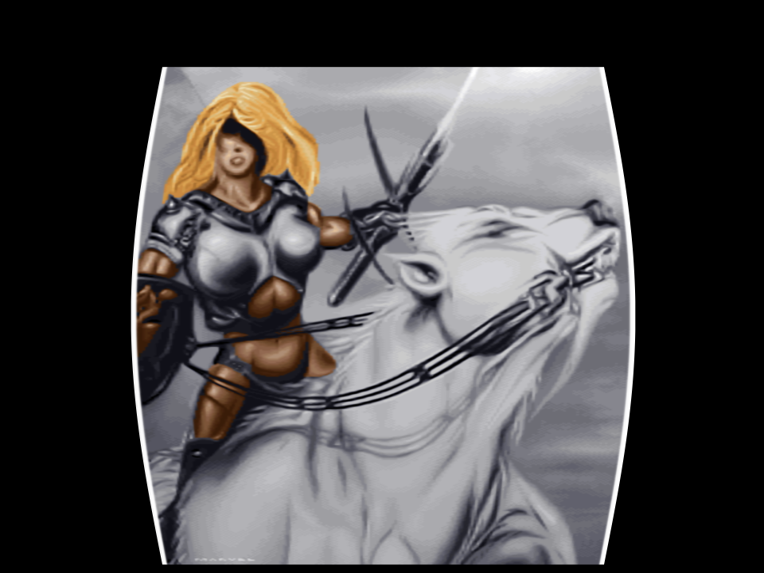
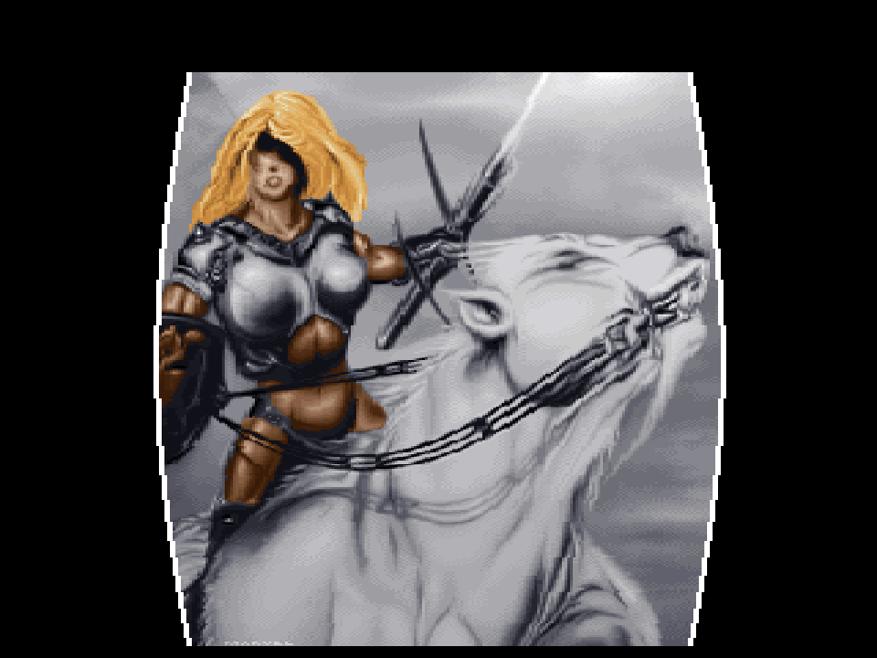
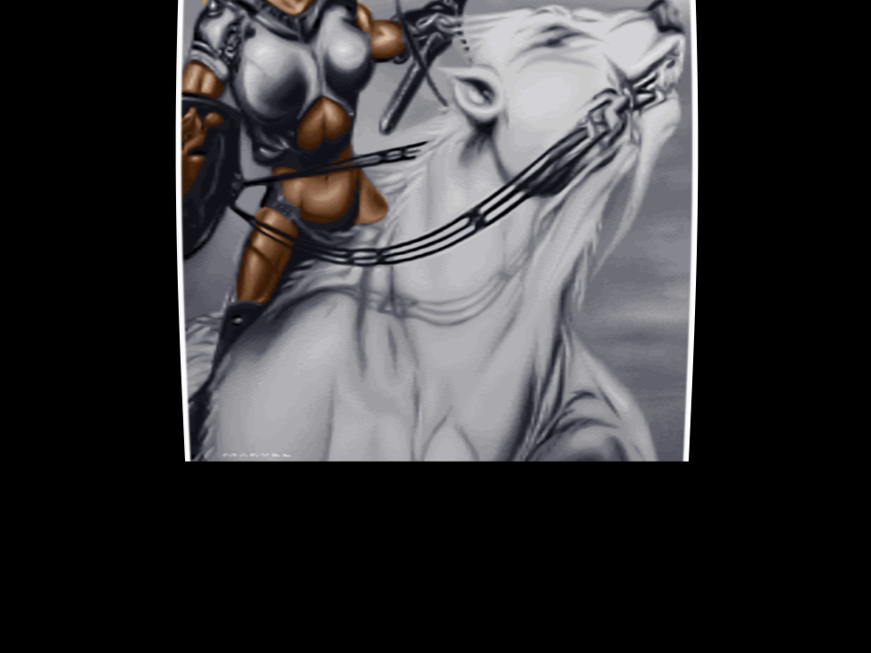

# Jelly Logo

| Modern look | 1993 look |
|---|---|
|  |  |

A tall painting (a rider on a white horse, framed by thin white lines) drops in from the top of the
screen. As it lands it wobbles like jelly: squashed, its middle bulges out; stretched, it grows thin,
bouncing a few times before it settles. Part 15 of the demo, just before the 3D city.

- **Original:** `JPLOGO/JP.C` (about 220 lines), `JPLOGO/ASM.ASM` (`linezoom`) and `JPLOGO/ZOOM.INC`
  (53 line-stretching routines, 16,800 lines), by Psi. `ZOOM.INC` was written beforehand by a small
  program, `JPLOGO/DOL.C`. Built into `JPLOGO.EXE`.
- **This version:** `Sources/SRMetal/Scenes/JellyLogo/` (added 2026-11-25).
- **Length:** on its own 856 steps (about 12.2 seconds): 86 of slide-in, 35 waiting, 700 of jelly, 35
  holding the last picture, then it starts again. In Play Demo it waits for the music as the original did
  ("music plus" ≥ 4) between the slide-in and the jelly, and the 3D city follows the 700 steps.

**This scene uses original artwork:** the picture (`artwork/original/rgb/15-jelly-logo.png`; it is signed
"Marvel" at the bottom left). Nothing
else is shipped: the line routines, the bounce and the sine table are all worked out.

## How the original did it

1. **The screen** is a tweaked 320x400 mode. The picture is the middle 184 columns (70...253) of a
   320x400 painting; each of its 400 rows gets one more pixel at the right, colour 65, which is white.
   The program also sets the screen's border to white (colour 255).
2. **Slide-in (86 refreshes).** The whole picture is drawn once at full width into rows 0...399 of video
   memory, while the screen shows row 400 onwards (black). Then the screen's start row moves back to 0,
   faster and faster (`y -= a; a += 6`, in 1/64 rows): the picture drops in from the top.
3. **The bounce** is worked out before anything shows: the picture's top and bottom edges, 200 frames in
   1/16 pixels. The bottom falls onto the floor (row 400) and bounces, losing speed; the top follows,
   pulled towards keeping the height at 400. After frame 90 the top is tied to the bottom, and the motion
   stops at frame 95. A second table spreads the 200 frames over 800 refreshes, 4 each, but its formula
   ((f[b]·(3 − c) + f[b+1]·c) / 3, c = 0...3) reaches f[b+1] at c = 3, so every value shows on two
   refreshes in a row.
4. **The jelly (700 refreshes).** Every refresh, each screen row between the edges shows source row
   b = (y − top)·400 / height at width 184 + (sin(b)·xsc + 32) / 64, where xsc = (400 − height) / 8 and
   the sine goes once from 0 up and back down over the picture's height. Squashed (height under 400), the
   middle rows are wider; stretched, narrower. Rows outside the edges are blanked. From refresh 379 the
   picture is flat again and stays so until 700.
5. **Line stretching.** `linezoom` calls one of the routines in `ZOOM.INC`: one for every even width
   from 140 to 244, each a straight run of instructions that copies source pixels to the four VGA memory
   planes (narrower or wider requests use the nearest end). The program that wrote them, `DOL.C`, says
   which source column lands where: column x of a width-w line (from 160 − w/2 to 160 + w/2, w + 1
   columns) shows source column ((x − left)·185 + (w + 1)/2) / (w + 1); the rest of columns 32...287 is
   black.
6. **A row cache.** To save time a row is only drawn again when its source row or width has changed.
   But blanking a row does not clear that memory, so a row that is blanked and then comes back with the
   same source row and width is not drawn: it stays black. Over the whole part this happens 134 times
   (a row for a refresh), near the bottom edge during the big bounces.
7. JPLOGO has its OWN copy of the shared sine table (`SIN1024.INC`): unlike the other parts' copies it is
   clamped to −255...255 (sin × 256, rounded towards zero, at most 255).

## This version

**The data.** The line routines are worked out from `DOL.C`'s formula; `tools/jelly_reference.py` runs
every routine of the original `ZOOM.INC` instruction by instruction on a model of the four VGA planes and
finds the same pixels for all widths. The bounce is JP.C's own arithmetic; the sine table is the shared
one, clamped.

**1993 look:** the original's 320x400 screen, kept from step to step and changed exactly as the program
changed it: the slide-in by whole rows, the doubled bounce values, whole-pixel edges, even widths, the
column rounding, and the rows the cache leaves black. Shown through `Core/IndexedCanvas.swift`, colour
numbers rebuilt from the exported picture. Each step shows what the program had set up before its next
wait for the screen (the same rule as the TV switch-off). The original drew straight onto the screen
being shown, so on a real VGA a refresh could show half old, half new rows; that tearing is not copied.

**Modern look:** drawn afresh every frame from the picture made 8x by Super-xBR. Each screen pixel works
out its own source row and line width from the same formulas, unrounded, with soft edges. The slide-in
glides in 1/64 rows; the bounce is spread evenly over its 4 refreshes (no value twice) and blended between
steps; no rows stay black.

| | Original | 1993 look | Modern look |
|---|---|---|---|
| Slide-in | whole rows | the same | 1/64 rows, blended |
| Bounce | each value on two refreshes | the same | spread evenly, blended |
| Widths | even, columns rounded | the same | unrounded |
| Row cache | some rows stay black | the same | none |

## Checks

- `tools/jelly_reference.py` runs `ZOOM.INC` against `DOL.C`'s formula, checks the sine table, works out
  the bounce, and replays the part from the ORIGINAL picture file (`_PIC.OBK`), printing checksums at 29
  steps and the 134 rows the cache leaves black.
- The self-test compares the app's 1993 pictures with that tool at those 29 steps (all identical), checks
  the sine table, the bounce and the column tables against the tool's checksums, the 134 black rows, the
  loop after 856 steps, and, in a silent Play Demo run, that the jelly starts on the very step the demo
  script gets past its music cue and the city follows 700 steps later. Each of those checks was seen to
  fail with the detail broken on purpose (no clamp, the cache cleared, the cue off by one).
- `--motion-check jelly-logo modern`: two jumps, the loop back to black and the landing (step 121 to 122:
  the bounce's first value already has the top 31 rows down, in 1993 too).

## Differences and limits

- Modern: the bounce evenly spread, no black rows, unrounded widths.
- The white border (overscan) is not drawn, as in every other scene.
- Not compared with the original running.
