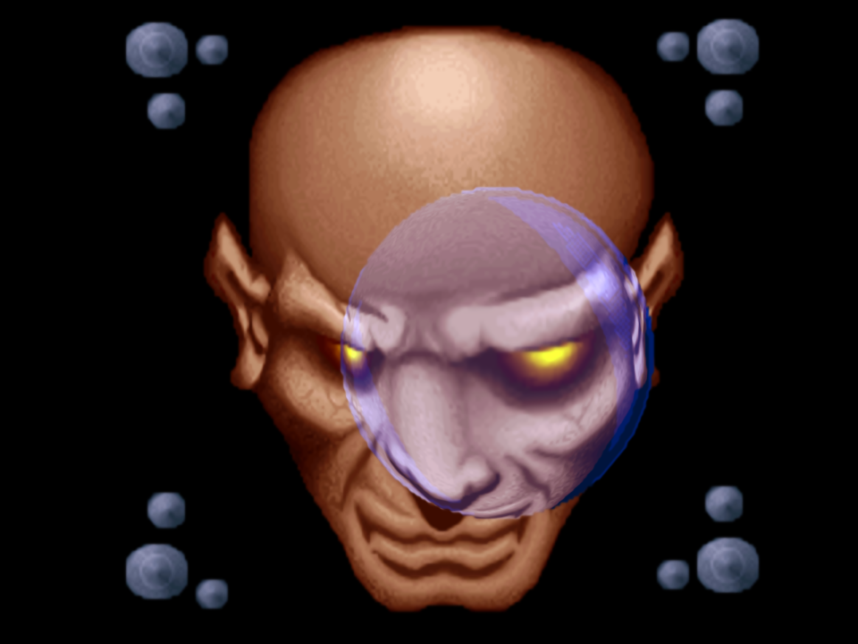
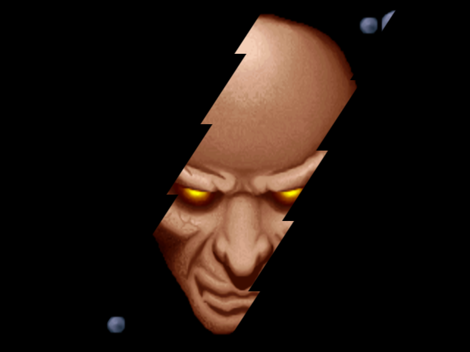

# Lens

| Modern look | 1993 look |
|---|---|
|  |  |

A picture of a bald head is uncovered by a slanted sweep. Then a glass lens drops in from the top,
bouncing along the bottom of the screen, each bounce lower than the last, until it falls away. Through
it the head is magnified and bent, and tinted blue in three rings, deepest at the rim. The rotozoomer
follows. Part 10 of the demo, with the [Rotozoomer](rotozoomer.md).

- **Original:** `LENS/MAIN.C` (`part1`, `part2`, `drawlens`, about 120 lines) and `dorow`, `dorow2`,
  `dorow3` in `LENS/ASM.ASM`, by Psi. The lens's tables were made beforehand by `LENS/CALC.C` from a
  drawn lens shape (`LENS/LENS.U`). Built into `LNS&ZOOM.EXE` with the rotozoomer.
- **This version:** `Sources/SRMetal/Scenes/Lens/` (added 2026-11-24).
- **Length:** on its own 1,090 steps (about 15.6 seconds): 35 black, 300 uncovering and holding, 720 of
  the lens, 35 of the picture again, then it starts again. In Play Demo it waits for the music as the
  original did (black until "music plus" ≥ −6, the picture until "music plus" ≥ −20), then the
  rotozoomer follows.

**This scene uses original artwork:** the lens picture (`artwork/original/rgb/10-lens-picture.png`), and
the lens shape (`10-lens-shape.png`) to work out the lens's tables. One table is kept as original data:
see below.

## How the original did it

1. **Uncovering (part 1, 300 refreshes).** The screen starts black with the picture's palette set.
   Every row has two "sweeps" that start on a slanted line (row b at x = (170·64 + (100 − b)·50) / 64)
   and move apart, the right one by ((23 + b/5) & ~7) / 64 of a pixel per move, the left one by the same
   rounded up to a multiple of 8, the lower rows faster. Each move copies the picture's pixel where the
   sweep is onto the screen: 6 moves a refresh for the first 80 refreshes, after which every pixel is
   uncovered. A sweep's position is a screen ADDRESS (row·320 + x), so one that runs past the right edge
   carries on at the left of the next row. The positions are 16-bit numbers; the bottom rows' right
   sweep overflows near the end (harmless: everything is uncovered by then).
2. **The lens (part 2, 720 refreshes).** The lens's path (715 positions) was recorded into `LENS.EXP`
   by formulas that stay in the source: it starts above the screen, moves sideways one pixel a refresh
   (turning at x = 60 and 256), falls with gravity, and bounces on y = 150 (first bounce keeps 2/3 of
   its speed, later ones 9/10) until refresh 600, after which it falls through the floor.
3. **Drawing the lens.** Every refresh it is drawn over the screen as it is, row by row from four tables:
   - table 1 (`dorow`): every lens pixel, showing the picture pixel the lens bends it to, in colour
     number + 64 (the first tint);
   - tables 2 and 3 (`dorow2`): the outer zones drawn again, bent again, in colour + 128 and + 192 (the
     stronger tints);
   - table 4 (`dorow3`): a ring just outside the lens repainted with the picture, wiping away where the
     lens was a refresh earlier. The screen is never cleared.
   The tints come from three tinted copies of the picture's 64 colours (blue added: 0,5,15; 0,7,26;
   0,9,37). For the first 96 refreshes those copies fade from the tint alone (dark blue glass) to the
   tinted picture, from refresh 32 in 32 steps of 2.
4. **The bend** (`CALC.C`): lens pixel (x, y), measured from the lens centre, shows the picture at
   (x, y) · 250 / (full − x² − (9y/8)²)^0.69 with full = 59² + 50²: magnified in the middle, wildly
   stretched at the rim. Each pixel gets a small random wobble before rounding, a frosted grain.

## This version

**The data.** The path is worked out from the formulas (all 715 positions equal `LENS.EXP`). Tables 1-3
are worked out at start-up by doing `CALC.C`'s steps again from the lens shape, Microsoft C's random
number generator included: they come out byte for byte equal to `LENS.EX1`-`EX3`. Table 4 cannot be:
the demo's `LENS.EX4` was made from an older version of the lens shape (it has a ring on row 0, where
the surviving shape has nothing), so it is kept as the original file in
[Data/Lens/](../../Data/Lens/README.md) (6 KB).

**1993 look:** the original's screen is kept from step to step and changed exactly as the original
changed it: the sweeps with their 16-bit numbers and address wrap, the four row routines with their
16-bit addresses (a lens partly off the left edge shows its left part at the right edge, one row up),
table 1's rows shorter than 4 pixels skipped (as `dorow` does), row 116 of the tables never drawn, and
the palette fades. Shown through `Core/IndexedCanvas.swift`; colour numbers rebuilt from the exported
picture's 64 colours.

**Modern look:** drawn afresh every frame, so nothing needs wiping.

- The picture is the lens picture made 8x by Super-xBR (shared with the rotozoomer).
- The sweeps are worked out per screen pixel from the same formulas, moving smoothly between steps, with
  soft edges; a sweep past a row's end still carries on into the next row.
- The lens is drawn per screen pixel: the same bend formula with unrounded coordinates, the lens's path
  unrounded (its 1/64-pixel values) and blended between steps. The three tint zones come from the lens
  shape made 8x by Super-xBR, so their edges are smooth. The fade-in glides.
- No random wobble: it was there to break up the stair-steps of whole-pixel rounding, which the Modern
  look does not have. Where the bend reaches outside the picture (at the rim), the picture's edge is
  used, where the original read whatever lay at that address.

| | Original | 1993 look | Modern look |
|---|---|---|---|
| Path | recorded, whole pixels | from the formulas, the same | the formulas' 1/64 pixels, blended |
| Bend | tables, rounded, random wobble | the same tables | the formula per screen pixel, no wobble |
| Tints | three palette copies | the same | the same colours, smooth zone edges |
| Screen | never cleared; ring wipes the trail | the same | drawn afresh |

## Checks

- `tools/lens_reference.py` reruns `CALC.C` against the original tables, checks the path against
  `LENS.EXP`, and replays the part from the ORIGINAL table files and `LENS.EXB` (the app calculates its
  own tables 1-3, so this checks those too). It finds every pixel uncovered after part 1 and no lens
  colour left on screen once the lens has gone.
- The self-test compares the app's 1993 pictures with that tool at 28 steps (black, the sweep, the hold,
  the dark glass, the fade-in, bounces, the lens leaving, the loop): all identical. It also checks the
  calculated tables and path against checksums of the original files, and, in a silent Play Demo run,
  that the scene starts each phase on the same step as the demo script (this check found the scene one
  step late when the music cue is already met as the part starts; fixed by telling a scene the music on
  the step it first shows).
- `--motion-check lens modern`: one jump, at the loop back to black (intended).

## Differences and limits

- Modern: no wobble, the rim reads the picture's edge, a lens partly off screen is simply cut off.
- Inside Play Demo the 1993 look starts from a black screen, as the original did (its mode change cleared
  the screen).
- Not compared with the original running.
