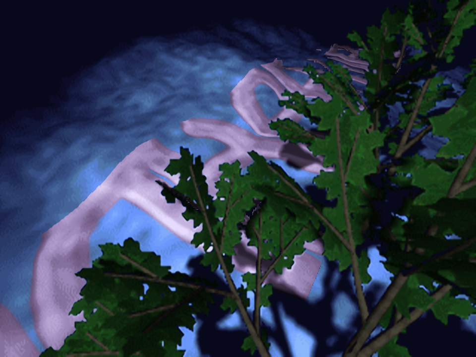
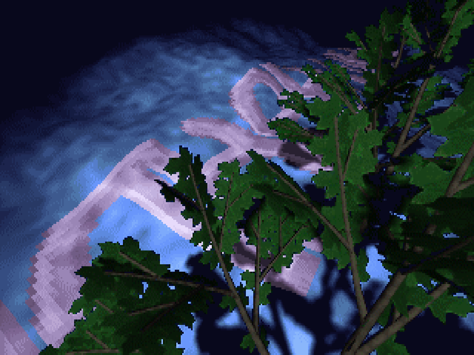
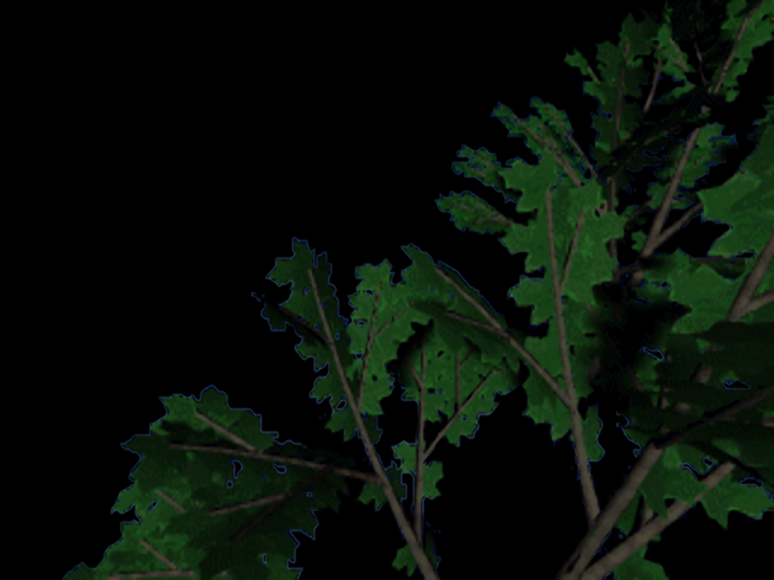

# Mountain Scroller

| Modern look | 1993 look |
|---|---|
|  |  |

A tree's leaves fade in on black. Then moonlit hills appear behind them, and with the hills a line of
huge lilac letters, "ANOTHER WAY TO SCROLL", flowing over the hills' bumps and hollows and passing behind
the leaves. Part 9 of the demo, after the screen switches off and before the lens.

- **Original:** `FOREST/READ2.PAS` (about 220 lines of Turbo Pascal) and `FOREST/ROUTINES.ASM` (one
  routine, `putrouts`, 20 instructions), by Trug. Built into `MNTSCRL.EXE`. `READ.PAS` is an earlier
  version; `READMASK.PAS` made the position tables.
- **This version:** `Sources/SRMetal/Scenes/MountainScroller/` (added 2026-11-25).
- **Length:** on its own 2,036 steps (about 29 seconds): black, 64 steps of leaves fading in, 1,906 of
  scrolling (the hills and text fade in during the first 127), 65 of fading out, then it starts again. In
  Play Demo it follows the music as the original did: the scroll starts on "music plus" ≥ 0 (met at once
  there), the fade-out on "music plus" = −11, which comes on that same 1,906th scroll step.

**This scene uses original artwork and data:** the background picture, the text (a picture, not a font)
and three position tables, in [Data/Mountain/](../../Data/Mountain/README.md) (161 KB). The tables cannot
be calculated; see below.

## How the original did it

1. **The text is a picture.** There is no font and no text string: `O2.SCI` is a painting 640 pixels wide
   and 31 rows tall of the whole sentence, in values 0 (nothing) to 7, hand-drawn with a bevel.
2. **Position tables.** The program keeps a window on that picture, 237 columns by 31 rows. For every
   cell of the window a table lists the screen pixels where it lands on the hills, anything from none to
   17 of them. The tables were made beforehand: the hills were ray-traced with a special surface whose
   red channel was the text column and whose green channel was the text row, and `READMASK.PAS` turned
   those pictures into lists.
3. **Three tables, a third of a column apart.** The hills were traced three more times with the text
   moved a third of a column each time, and each table lists only the pixels that changed from one
   tracing to the next. So the three tables share no pixel. The program draws one table per screen
   refresh (1, 2, 3, 1, ...), and after the third it moves the window one column. The effect: the text
   creeps in thirds of a column, and each refresh only a third of the pixels (about 5,200) are written.
4. **Drawing a pixel** is one addition: screen = background + cell, where a cell is the text's value
   plus 128 (or 0 where there is no text). The palette is laid out for it: the hills and sky use colours
   0...31 (in fact 1...18), and colours 128...159 are the same blues turning lilac and white, so a hill
   pixel with text on it lands a little further up that second ramp the brighter the hill and the text.
   Leaf pixels inside the text's band are not protected: there the addition just shifts them to a
   neighbouring leaf green (colours 160...255 are a copy of 32...127), a faint shimmer on 646 pixels.
5. **The fades are done on the palette.** First everything except colours 0...31 and 128...159 rises
   from black, one level a refresh for 64 refreshes: the leaves appear alone. The program then waits for
   the music ("music plus" ≥ 0). During the first 127 scroll refreshes colours 0...176 rise, one level
   every second refresh: hills and text together. That loop ends one level short (62 of 63) and nothing
   sets the finished palette, so the one colour with a 63 in it stays a shade dark until the fade-out
   begins. On "music plus" = −11 every colour drops one level a refresh, 65 refreshes, while the text
   keeps moving.
6. **The end of the text.** The window starts with the picture's first 133 columns at its right-hand
   end. When the picture runs out, its last column keeps being fed in, and that column has ink (the
   bottom bar of the final L): a lilac streak follows the text for the part's last 6 seconds.

## This version

**The data.** The five original files are loaded as they are. The tables are the one thing in this scene
that could not be worked out again: the ray-traced pictures `READMASK.PAS` read (`mask1-4.mtv`) are not
in the source release. `tools/mountain_reference.py` checks what can be checked: the tables parse
exactly, share no pixel, and agree with the one mask that survives (`GREEN.CLX`, every pixel's text row).

**1993 look:** the original's 320x200 screen, kept from step to step and changed exactly as the program
changed it: one table a step, the window moving after the third, the byte addition, both fades in whole
levels (the 62 included), the streak. Shown through `Core/IndexedCanvas.swift`. Each step shows what the
program had set up before its next wait for the screen (the same rule as the jelly logo).

**Modern look:** drawn afresh every frame.

- The background is the picture made 8x larger by Super-xBR; the text is its own picture made 8x the
  same way (the user's choice, 2026-11-25, over three macOS fonts: it is hand-drawn lettering, and no
  font comes close).
- The text's place on the hills comes from the same tables, turned into a smooth map. A pixel listed in
  table k at window column c covers the third of a column from c + (2 − k)/3, and its cell's row is
  known; where two neighbouring pixels are one step apart, the line between them is where the coordinate
  crosses that step exactly. Every pixel gets the best-fit plane through those crossings nearby (on the
  same stretch of hill), and each screen pixel blends the planes around it. The text then glides instead
  of creeping, with smooth edges.
- Colours: the same palette entries (128 + hill colour + text value), blended between whole values; the
  leaves stay in front through a mask of the hill colours, also made 8x.
- The fades follow the original's rule (each channel rises to its own level, then stops) without the
  whole-number steps.

| | Original | 1993 look | Modern look |
|---|---|---|---|
| Text movement | a third of a column a refresh, a third of the pixels at a time | the same | continuous |
| Text edges | whole pixels | the same | smooth, from the 8x text |
| Leaf pixels under the text | shift to a neighbouring green | the same | untouched |
| Hills' fade | stops at level 62 | the same | reaches the full colour |
| Streak after the text | yes | the same | yes |

## Checks

- `tools/mountain_reference.py` checks the tables' structure, shows which way the three tables order
  (99.7% of neighbouring pixels in order one way, 69% the other), reports the palette facts above, and
  replays the part from the original files, printing checksums at 29 steps.
- The self-test compares the app's 1993 pictures with that tool at those 29 steps (all identical), the
  five data files' checksums, that the tables share no pixel and cover 15,592, that the smooth map keeps
  pixels inside their own third of a column (91%) and row (99%), the loop after 2,036 steps, and, in a
  silent Play Demo run, that the scroll and the fade-out start on the very steps the demo script gets
  past its two music cues and the lens follows 65 steps later. Each was seen to fail with the detail
  broken on purpose: the window moved a draw early, the hills' fade a draw early, the scroll a step early,
  the tables taken in the other order, the fade-out cue loosened.
- `--motion-check mountain-scroller modern`: no jumps over the whole run.

## Differences and limits

- Modern: no shimmer on the leaves under the text; the hills reach their full colour.
- Modern: where one hill hides part of another, the text's edge there follows the 320x200 grid (the map
  cannot know where exactly the nearer hill ends).
- The original drew straight onto the screen being shown; any tearing that caused is not copied.
- Not compared with the original running.
