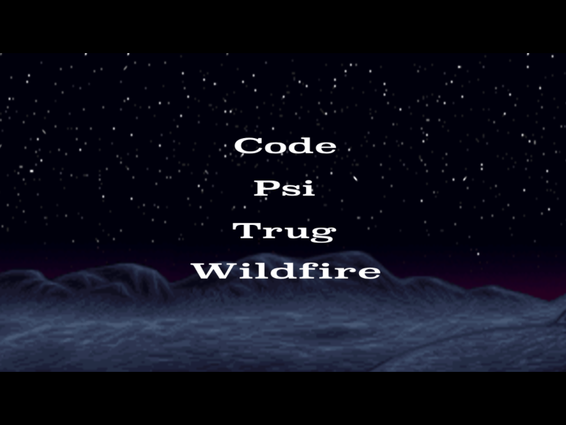
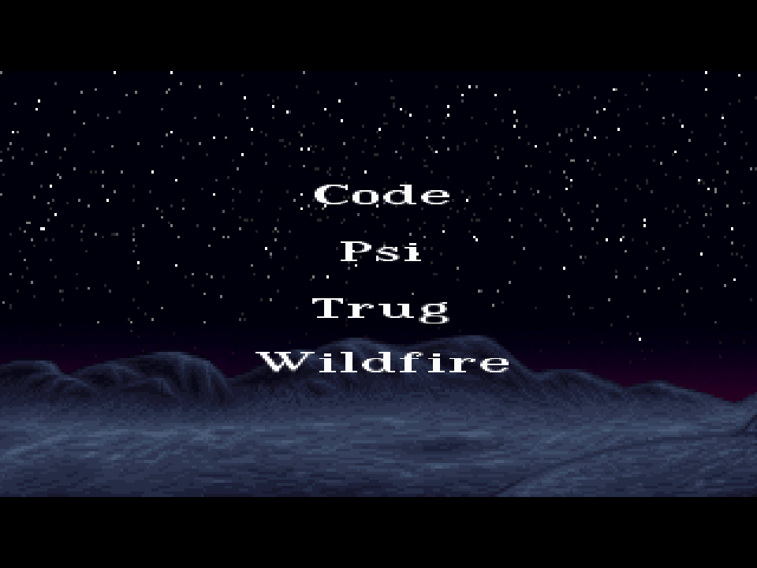

# Opening Credits

| Modern look | 1993 look |
|---|---|
|  |  |

The demo opens on black while the music starts. Three titles fade in and out, each on a beat of the music:
"A Future Crew Production", "First Presented at Assembly 93", and "in" over a Dolby Surround logo. Then a
night horizon fades in and starts to slide slowly sideways, and four pages of credits (graphics, music,
code, additional design) fade in and out over it, each on its cue. The text stays still while the landscape
slides under it. The part ends on the horizon's right half: the very picture the ships part starts on.

- **Original:** `ALKU/MAIN.C` with `TWEAK.ASM`, `ASMYT.ASM` and `COPPER.ASM` (by Wildfire), built as `ALKU.EXE`.
- **This version:** `Sources/SRMetal/Scenes/OpeningCredits/`. First of the scenes in the sidebar.
- **Data:** the RELEASED horizon and font, in `Data/OpeningCredits/`. Reference replay: `tools/alku_reference.py`.
- **Length:** in Play Demo 5,605 steps (1 min 20.1 s) from the start of the music. On its own the scene
  leaves out the 16 seconds of black before the first title: it starts 70 steps before it and runs 4,547
  steps (1 min 5 s), then starts again.

## The released version

The released `MAIN/DATA/ALKU.EXE` is packed twice (PKLITE, with LZEXE inside: `deark -m pklite`, then
`deark -m lzexe`). Compared with the source:

- **Picture:** the same, byte for byte.
- **Font:** 3 pixels added, joining the two pieces of "&"; the source's list of characters had two
  placeholders there. Every letter the part prints is the same.
- **Texts:** the same words. The third title's "logo" is two glyphs of the font, the halves of a Dolby
  Surround logo, drawn 19 lines apart so that they overlap.
- **Code:** compiled differently, with four real differences:
  - an exit check after each wait for the music;
  - the titles draw 29 rows of the font, not 32 (only the logo had ink in the 30th row, and the other half
    covers that line);
  - after the last page the scroll calls stop waiting, and the loop runs while the position is at most
    320 (the source: below 320);
  - **a new ending**: it hides the text's colours, then copies the final screen into the ordinary 320 x 200
    layout the ships part expects, in colours 192 and up, onto three pages. The ships' horizon is exactly
    the right half of this horizon (checked pixel for pixel), so the ships part starts on the same picture.

This version follows the release.

## How the original did it

**A 400-line screen in a wide memory.** The program set up a 256-colour mode in which every one of the
card's 400 lines shows its own row of memory, each row 704 pixels wide (176 bytes a plane). Unlike the
credits at the end of the demo, the routine that drew the text used the same 176 bytes, so the text appears
at its full height: 30 rows of the font are 30 lines.

**Two copies, swapped every step.** The horizon (640 x 150 of the 640 x 200 picture, each picture row on
two lines, lines 50...349) sits in memory twice, 88 bytes apart. The screen scrolls by the card's start
address and fine scroll: position a shows picture columns a...a+319. Every step the program switches to
the other copy, and while one is on screen it updates the other: it copies in the next column of the
picture, and moves that copy's text 2 pixels with a list of XOR changes worked out once per page, so the
text stays still on screen while the landscape moves.

**Text as colours.** The picture uses colours 0...63. The text's three shades are ORed in as 64, 128 and
192. Three palettes make the difference: one where 64...255 repeat 0...63 (text invisible), one where they
are the text's grey over the picture's colour (a "screen" blend: `(grey x 63 + colour x (63 - grey)) / 64`),
and, for the titles, one with only the text's greys and everything else black. Fading between them, 64
steps, is how a page appears and disappears; the copper (a routine run on every screen refresh) adds a
fixed step to every colour each refresh.

**The timing**, steps counted from the start of the music, with the music's cues (DIS's sync values) as the
script's silent run gives them:

| What | When |
|---|---|
| Title 1, 2 | On cues 1 and 2 (steps 1,128 and 1,688): fading in over 63 steps, held to 363, fading out to 427 |
| Title 3 | Cue 3 comes at 2,099, before title 2 has faded out: it starts at 2,115 |
| Horizon | On cue 4 (2,658): fades in over 128 steps; the scroll moves 1 pixel every 9 steps, to 320 |
| Pages 1-4 | Each waits until the last has faded out, then for its cue (5...8) and an even scroll position; 17 more scroll steps later it fades in over 64 steps, holds, and fades out by step 343. They show from 3,388, 3,946, 4,504 and 5,062 |
| A fifth page | Empty; waits for cue 9. (After it the program prepares a "BUG BUG BUG / Timing error" page, a guard that only shows if the timing went wrong; here it never reaches the screen.) |
| End | The scroll reaches 320 at 5,539; a last palette fade (invisible) and the hand-over: 5,605 |

The end is set by the scroll's own length, at 1:20.1, not by cue 9. Nothing after it moves: the ships part waits for a fixed point in the song (1:33.8),
showing the same picture.

**Step pairing.** The program sets the start address and fine scroll together; the copper writes both just
before vertical retrace, and loads palettes at its start. So everything the program sets during a step
shows on the next one, all at once: unlike the credits, there is no lag between the coarse and the fine
scroll (`MAIN/COPPER.ASM` `copper_end`; `ALKU/COPPER.ASM`).

## How this version does it

### 1993 look

`OpeningCreditsModel` works out the schedule above from the music's sync value, step by step, as the
program did: inside Play Demo from the script's music, on its own from the measured cues. Each step it
makes the screen: the horizon at the scroll position on lines 50...349, the title's or page's text ORed in,
and the palette of that moment (the copper's fades in its fixed-point steps).

### Modern look

- **Horizon:** the original through Super-xBR, fading in smoothly and scrolling 1/9 pixel a step rather
  than a pixel every 9.
- **Text:** Superclarendon (comes with macOS), white, capitals 14 lines tall (as the 1993 ones) from the
  1993 glyphs' top line, each line stretched sideways to cover exactly the 1993 line's ink: the original
  letters were very wide, about twice Superclarendon's natural width. Fades glide between steps.
- **The Dolby Surround logo** is a logo, not text: the original pixels through Super-xBR.

### Inside Play Demo

Play Demo shows this scene from the first step of the music, told the
music's sync value each step, for the script's 5,605 steps; then the ships' horizon. The script's waits
(`DemoScript.steps`: each title's cue then 427 steps, cue 4 then 2,947) are the same as the scene's.

## What was checked

- **The 1993 screens** match `tools/alku_reference.py`, which reads the released `ALKU.EXE` itself, at 28
  steps: the titles fading, the logo, the horizon's fade, the scroll, every page fading and held, the end.
  Proven to fail with the pages' text not 2 pixels right, with every other font row, and with the scroll
  stopping at 319.
- **The schedule** from the cues (titles 1,128, 1,688, 2,115; cue 4 at 2,658; pages from 3,388, 3,946,
  4,504, 5,062; 5,605 steps). Proven to fail with titles of 400 steps.
- **Full-height text:** font rows 0 and 1 of a letter are on neighbouring lines.
- **The hand-over:** the last screen is the ships' horizon exactly.
- **On its own:** 4,547 steps from 70 before the first title, then again.
- **Modern text:** Superclarendon, each line's capitals on the 1993 lines and its ink as wide as the 1993
  line: all 19 lines of the 3 titles and 4 pages. Proven to
  fail unstretched, with the lines placed from the wrong point, and with the titles moved down.
- **The Modern logo** is on the 1993 logo's lines, with no Modern text under it. Proven to fail with the
  logo moved 10 lines.
- **The Modern look's pictures** (7 texts, horizon, logo) are made with the scene, not on the frame they
  first show (each first shows on a music cue). Proven to fail with one left out.
- **Play Demo:** the scene shows from step 0 for the script's 5,605 steps, in step with it, the music's sync
  rising on the steps the scene uses on its own, with the same schedule; then the ships part, showing the
  ships' horizon picture. Proven to fail with the music's sync read a step off, and with black shown
  instead of the horizon.
- **The cues** (1,128 ... 5,045) and the part's end (5,605) are also what `tools/demo_timeline.py` prints,
  from its own simulation of the music.
- **The graphics chip matches the 1993 reference** at 17 steps (the generic per-scene check).
- The credits' picture 1 (which shows this part's "Code" page) is captured from this scene, step 3,664
  of its own count (see `docs/scenes/credits.md`).

## What was not checked

- Nothing was compared with the original running.
- The program's own work (drawing the titles, preparing each page) is assumed to fit in the time it had,
  as on a fast 486; on a slow PC a title could start a refresh later.
- The hand-over copies video memory while the screen shows it; on a slow card part of one refresh might
  have shown the copy under way. Not modelled: the screen is held unchanged.
- The music's position is read once a refresh, about a fifth of the way down the screen; which refresh a
  cue is first seen on is taken from the script, as for every part.
