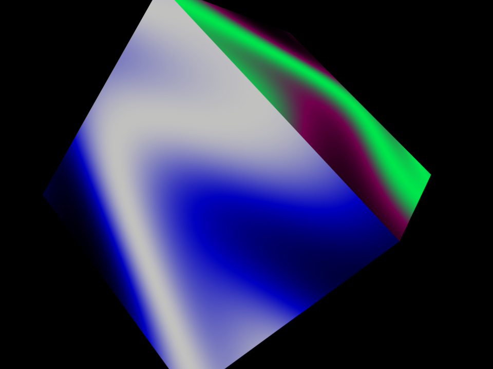
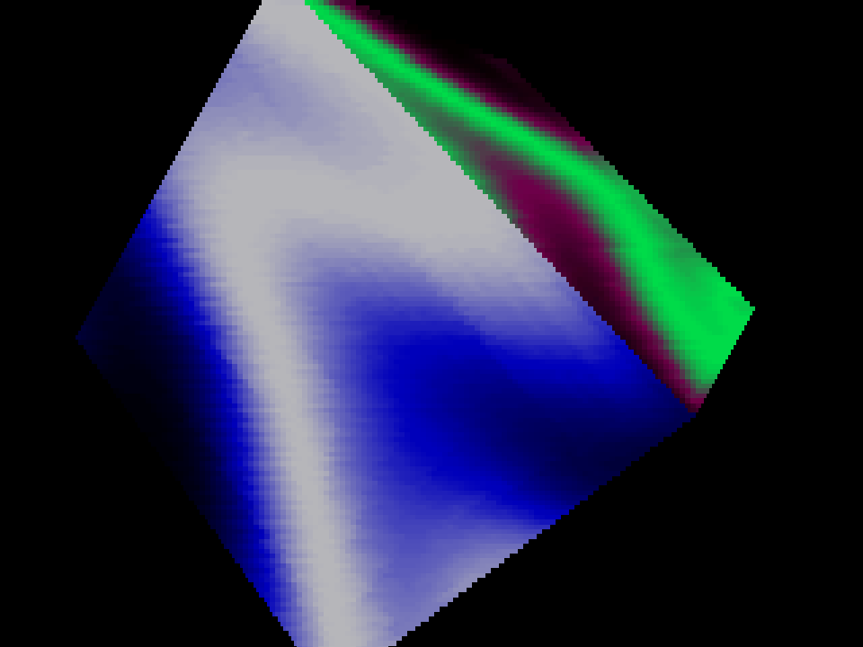

# Plasma Cube

| Modern look | 1993 look |
|---|---|
|  |  |

A cube tumbles up into view from below, comes close enough to overflow the screen, then backs away and
goes dark. Each face carries a flowing, plasma-like pattern: blue and white on one pair of opposite
faces, red and yellow on another, purple and green on the third. A light circles the cube, so faces
brighten and dim as they turn.

- **Original:** the second half of `PLZPART.EXE`, by Wildfire: `VECT.C` (turning, projecting, lighting,
  the main loop), `PLZFILL.C` (texture and palette set-up, walking a face's edges), `PLZA.ASM` (filling
  the lines, erasing, dimming the palette), `SPLINE.ASM` with `RATA.INC` and `SPLINE.INC` (the path),
  `SINIT.INC` (sines), `COPPER.ASM` and `TWEAK.ASM` (screen refresh work and the screen mode).
- **This version:** `Sources/SRMetal/Scenes/PlasmaCube/`, plus `Core/Math3D.swift`.
- **Length:** 2048 steps, about 29 seconds, then it repeats.

## Which original files are live

The project file `PLZPART.PRJ` lists exactly what was built: `ASMYT.ASM`, `COPPER.ASM`, `INCLUDE.ASM`,
`PLZA.ASM`, `TWEAK.ASM`, `SPLINE.ASM`, `PLZ.C`, `PLZFILL.C`, `VECT.C`, `MAIN.C` and the demo's shared
`DISC.OBJ`. `MAIN.C` runs the flat plasma (`plz()`), then the cube (`vect()`). The link map
(`PLZPART.MAP`) agrees.

Things that turned out **not** to be there:

- **`TILE.INC` and `TILEPAL.INC` are not used.** No source file includes them and the link map has no
  trace of them. They are a leftover picture and palette. So this scene uses **no original artwork**:
  the face texture is calculated.
- **The plasma's tables are not used either.** The cube does not touch `psini`, `lsini4`, `lsini16` or
  the plasma routine, nor any of the flat plasma's palettes (only `PLZ.C` uses `pals`). The cube's "plasma" is a separate, much cheaper trick (below). Nothing in `Scenes/Plasma/` is shared or
  was changed.
- **There is no grey floor and no shadow** anywhere in the shipped code. `VECT.C` has room in its data
  layout for lines and more shapes, but only the cube is defined and only faces are drawn. There is a
  commented-out chessboard texture in `PLZFILL.C`.
- **The "doubling"** some descriptions of this part mention is about pixels, not a second cube: see
  "Half a block sideways on alternate frames" below.
- `MAIN.ASM` is just the compiler's listing of `MAIN.C`.

## How the original did it

### The cube and the camera

The cube has eight corners at plus or minus 125 on each axis and six four-cornered faces. Every frame
the eight corners are turned by three angles, moved, and projected. All of it is 16-bit whole-number
arithmetic: sines come from a table about 32767 tall, the nine numbers of the turn are scaled down to
about 256, and each corner costs nine multiplications. Then

```
screen x = 256 * x / z + 160        screen row = 142 * y / z + 66
```

256 and 142 are in the ratio that makes the cube look square on a 4:3 monitor in this screen mode.

### Which faces to draw

For each face the program works out which way it points (the "normal": a cross product of two of its
edges) and compares that with the direction to the eye. Faces pointing away are skipped. A cube is
convex, so the faces that are left can never overlap each other and no sorting is needed. (The routine
is called `sort_faces`, but it sorts nothing.) At most three faces are drawn.

### The path

Where the cube is, how it is turned and where the light is are eight numbers: sideways, down, distance,
three turn angles and two light angles. `RATA.INC` lists hand-typed values for them at 36 moments ("path
points"), 64 frames apart. Between points the values are blended: each frame's value is a weighted mix of
the four nearest path points, with the weights read from a 1024-entry table (`SPLINE.INC`). The weights
are a smooth bump, so the motion never jerks. This is a "spline", a smooth curve steered by a few points.

The path: rise from below the screen; tumble at a distance of 500 while the light swings from below to
behind the viewer; come in to 300, where the cube is bigger than the screen; tumble there through the
same sixteen turns again; back away to 500 and straighten up, while the light goes round behind the
cube. With the light behind it, the face towards the viewer gets light level 1 out of 64, which is
black. So the scene fades itself out. The path file then repeats the same resting point 100 times, as
padding until the music cue that ends the part.

### The texture: a cheap plasma

At start-up the program fills a 256x64 texture with one formula: horizontal bands whose height snakes
up and down across the width.

```
texture[y][x] = wave[ 4*y + wave[2*x] ] / 4 + 32        (wave = 127 * sine, period 512)
```

That picture never changes. What makes it flow is a second table with one number per texture row: how
far to shift that row sideways, itself a sine wave. When a pixel is drawn, the filler first looks up the
shift for the pixel's row, then reads the texture that many places along. Every frame the shift table
is read from one row further down, so the wave of shifts travels through the texture and the bands
appear to flow. Two table lookups per pixel, no arithmetic.

The same texture is stored three times with 64 and 128 added, one copy for each pair of opposite faces.

### Lighting by palette

The three copies use three separate ranges of 64 colours: black to blue to white, black to red to
yellow, black to purple to green. To light a face, the program does not touch its pixels. It rewrites
that range of the palette, every colour multiplied by the light level (0 to 64) and divided by 64. The
level is how squarely the face meets the light. The whole palette is sent to the video card during the
screen refresh (`COPPER.ASM`); that and counting frames is all the "copper" routine does in this scene.

### Filling a face

`PLZFILL.C` finds the face's top corner and walks down its two sides a line at a time, keeping for each
side the screen x and the texture position, all as 16.16 fixed-point numbers (a whole number in the top
16 bits and a fraction in the bottom 16). For each line, `do_block` in `PLZA.ASM` steps the texture
position evenly from the right end to the left.

The screen mode stores four pixels in each memory address, one in each of four "planes". Writing with
all four planes switched on paints four pixels at once. That is the speed trick: **the texture is only
looked up once per four pixels**, so the texture is drawn in blocks four pixels wide. Only at the two
ends of each line does the code switch planes off, so the outline of the cube is still exact to the
pixel. The inner loop is written out 200 times, and the code jumps into the middle of it according to
the line's length.

Two accidents in that loop are faithfully kept here because they change pixels: the fraction of the
texture column starts from a value left over in a reused register, not from the edge's own fraction;
and the register that holds the column step also holds the two pixels just read, which get added in.
Also, the sideways shift is a signed number that the code reads as unsigned, so a shift to the left also
lands one texture row lower.

### The screen mode

The flat plasma leaves the card in a 320x400 mode. The cube changes two settings: each picture row is
shown on three monitor lines (so 134 rows fill the 400 lines), and each row of video memory is 640
pixels long. There are three pages of 640x136; the screen shows a 320-wide window starting 160 pixels
in, so a cube that overflows the screen is simply drawn past the window's edges without any clipping
sideways. Up and down, rows off the screen are skipped.

### Erasing only what is needed

Clearing a page every frame would cost more than drawing the cube. Instead, while drawing, the filler
notes the leftmost and rightmost pixel on every row. After drawing, `do_clear` compares those with the
notes from the frame that was last drawn on this page (three frames ago) and blanks only the parts the
old cube covered and the new one does not.

### Half a block sideways on alternate frames

Every other frame the whole cube is drawn two pixels to the right, and the video card is told to slide
the picture two pixels left. The cube's outline stays put, but the four-pixel texture blocks land half a
block apart on alternate frames. At 70 frames a second the eye mixes the two, which doubles how fine
the texture appears. The flat plasma before it does the same thing with its chessboard.

### Timing

The program counts screen refreshes and reads the path at "frames so far", so the cube moved at the
same speed on any PC; a slow PC just showed fewer pictures. The part starts and ends on cues from the
music.

## How this version does it

**The tables.** The texture, the shift table and the palettes are calculated at start-up exactly as
the original calculated them. The 36 path points are written out in the model (they are hand-made).
Two tables are **kept as the original's numbers**, in `PlasmaCubeTables.swift`: the sine table and the
blend-weight table. Neither follows a formula that reproduces it exactly: the sine table differs from
a true sine by up to 2.4 in ways no rounding rule explains (about 500 of 1024 entries differ for the
best candidate), and the blend table is not a standard spline curve (it is not made of polynomial
pieces, and is close to but not exactly a sum of cosines).

**1993 look: replayed on the processor.** A polygon filler that steps fixed-point numbers, leaves
carries in registers and erases by remembering earlier frames is exactly the kind of thing that has to
be replayed, not recalculated. `PlasmaCubeModel` does the path, turn, projection, face test and
lighting with the original's 16- and 32-bit arithmetic. `CubeVideoCard` models the card's four planes
and three pages and is a step-for-step port of the edge walker, the line filler (the processor's
registers are mirrored one for one) and the eraser. The finished picture of colour numbers goes to the
graphics chip through `IndexedCanvas`, which looks the colours up.

Two replays run side by side, half a cycle apart, so that at every step there is a picture for each of
the two sideways shifts. The 1993 look shows the even mix of the two (see "Deliberate differences").

**Modern look: real 3D triangles.** The graphics chip is used the way it is normally used for 3D. Each visible face is sent as two triangles with its position in front of the
camera; `Core/Math3D.swift` builds the matrix that reproduces the original's projection, and the chip
does the divide by distance itself. For every screen pixel the chip then works out the texture from the
same two wave formulas, in floating point, so there are no four-pixel blocks and no 64-level steps. The
path is read between its table entries, so position, turn, light and the flow of the pattern all glide
between steps.

Edges are smoothed without any extra machinery: each face is drawn slightly oversized, and the pixel
program fades it out over the last screen pixel beyond its true edge. Where two faces meet, the later
one fades in over the earlier one, so there is no dark seam.

## 1993 versus this version

| | Original (1993) | 1993 look here | Modern look here |
|---|---|---|---|
| Geometry | 16-bit whole numbers, table sines | Same | Floating point, 3D triangles on the graphics chip |
| Projection | Divide per corner | Same | The chip's own perspective, same picture |
| Texture | One lookup per 4 pixels | Same | Formula per screen pixel |
| Texture across a face | Stepped evenly along each line (slightly wrong in perspective) | Same | Correct in perspective |
| Lighting | Palette range times level 0...64 | Same | Colour times a smooth level |
| Outline | Exact to the pixel | Same | Smoothed |
| Alternating 2-pixel shift | Alternate frames, mixed by the eye | Both shown mixed | Not needed |
| Erasing | Only where the old cube showed | Same | Whole screen each frame |
| Motion | One path reading per refresh | One per step | Glides between steps |

## What was checked

- **The picture against the original's own code.** `tools/plasmacube_reference.py` (Python) reads
  `PLZA.ASM` and `SPLINE.ASM` as text, expands their macros, and carries out the instructions one at a
  time in a small x86 interpreter with a model of the card's planes (`tools/x86interp.py`, shared by the other
  reference tools). That covers the line filler, the
  eraser, the palette dimming and the path blending, with the original `RATA.INC`, `SPLINE.INC` and
  `SINIT.INC`. The C parts are re-written in Python in the tool. The Swift replay produces **identical
  screens (every colour number) and identical palettes** at steps 16, 60, 100, 416, 800, 1200, 1600,
  1916, 2010 and 2047, for both sideways shifts. Because each page depends on what earlier frames left
  on it, that in effect covers the frames in between. The checksums are in the self-test.
- **Tables against the original files.** The sine and blend tables match `SINIT.INC` and `SPLINE.INC`,
  and the path points match `RATA.INC` as the assembler lays it out (checksums in the self-test).
- **Limits of the path.** Over the whole run the cube's page coordinates stay within x 50...587 and its
  distance never drops below 86. So the cases the original did not guard (a corner behind the eye, a
  line starting left of the page) never arise.
- **The display path.** The self-test draws the 1993 look on the graphics chip at eleven moments and
  compares every pixel with the processor's version.
- **Looping.** The first and last steps are black and step 2048 equals step 0 (self-test).
- **By eye.** Pictures of both looks at steps 60, 416, 800 and 1600 show the same cube in the same
  place with the same pattern and colours. The modern pattern sits slightly differently across a
  steeply angled face, which is the perspective correction.
- **The modern look is the same cube, by program.** At every one of
  the 2048 steps the self-test compares the modern look's cube with the 1993 replay's: the same faces
  are drawn (except at 16 steps where a face is almost exactly edge-on and one look draws it a step
  before the other), every corner is within 4.3 units of the 1993 position (the cube is 250 across;
  the difference is the 1993 arithmetic cutting angles and turn numbers to whole steps), and each
  face's light is within 2 of the 64 levels (3632 comparisons).
- **Motion, by program.** `--motion-check plasma-cube modern` over the whole loop and across the loop
  point (steps 1990 to 2100) finds no jumps; the most pixels that appear for one picture only is 58
  of 172,800, along thin edges while the cube rises into view.

- **The C parts, read a second time independently** (`VECT.C` and `PLZFILL.C`, line by line against
  `PlasmaCubeModel.swift` and `PlasmaCubeFiller.swift`; no difference found):
  - `VECT.C`: the order of the eight path values; the light direction; the nine turn numbers, including
    C's rule that `>>15+7` means "shift by 22" and where the 32-bit and 16-bit cut-offs fall; the corner
    arithmetic and the two divides; the face test and its sign; the light level and the
    remember-by-drawing-position rule; the page counter, which page is drawn and which shown, and that
    the 2-pixel offset of a drawn page matches the 2-pixel slide when that page is shown.
  - `PLZFILL.C`: the wave table, texture, shift table and three colour ranges; finding the top corner;
    the edge set-up (16.16 numbers, the +0.5 start, "a height of 0 counts as 1"); the order in which the
    two edges are replaced; the eraser's choice of "three frames ago".
  - The cosine table: the original reads cosines 256 entries further along its sine table, past entry
    1023. `SINIT.INC` holds 1287 entries and they repeat exactly from 1024 on, so wrapping the index,
    as this version does, reads the same numbers.
- **The modern look has no state of its own:** every picture is worked out from "step plus fraction",
  so nothing can be glided across a jump. The pattern's scroll wraps from 64 to 0, where the wave it
  drives repeats exactly. At the loop point both looks are black. (The modern cube's last steps are 1
  brightness level out of 255 above black, because its light is not rounded down to a whole level as
  the 1993 one is.)

## What was not checked

- Nothing was compared with the original program running, or with a recording. The interpreter proves
  the assembly is replayed correctly. The C code around it (`VECT.C`, `PLZFILL.C`) was ported by
  reading, into the Python tool and into Swift, and then read a third time independently, which found no
  difference. That is three readings and no running original: a misreading
  shared by all of them would still not show up.
- The texture and shift tables were calculated by the original at start-up, so there is no file to
  compare with. They depend on the 1993 compiler's `sin()` agreeing with today's to within rounding
  to a whole number, which is very likely but not proven.
- When the part starts and ends comes from `VECT.C`'s two music cues ([demo-timeline.md](../demo-timeline.md);
  see "Inside Play Demo" below). Viewers in 1993 did see the cube go fully dark: the loop ran for
  1,999 refreshes and the cube is black from frame 1995.
- Which moment of the refresh the palette and the page flip took effect was not modelled (see below).
- The modern look's texture (the pattern on the faces) and its edge smoothing were checked by eye only.
  Its geometry, light and motion are checked by program (see above).
- That the PC kept up with 70 pictures a second is an assumption; on a slower PC the original showed
  fewer pictures of the same motion.

## Inside Play Demo

The scene follows the part's two music cues there (`VECT.C` 114-120):

- **An empty screen for 48 steps.** The part cleared the screen (`tw_opengraph`) and waited for "music
  plus" >= 13, with the plasma's band already fallen away. The step that meets the cue is still empty:
  the loop first shows its empty page for one refresh and counts it. (The wait is this short because
  the released plasma ends on its third fall: see [plasma.md](plasma.md), "The released program".)
- **Then the original's frames, one a step:** the n-th step after the cue shows frame n, from a fresh
  start. This version's 16-step lead-in (which starts the cube below the screen, for the loop) is not
  used, so the cube appears with the tip of a corner already in view, as it did.
- **It runs until the script's end cue** ("music plus" from -4), 1,999 steps after the first: frames 1 to
  1,998 show, the last four of them black. No second run.

The self-test runs Play Demo silently from this scene and compares the empty steps, every frame number
and the cut with the script's own cues; proven to fail with the cue moved by one.

On its own the scene is unchanged (the lead-in, 2,048 steps, then it repeats).

## Deliberate differences

- **The alternating shift is shown mixed.** The original alternated at 70 frames a second. On a 60 or
  120 Hz display that would beat and shimmer, so the 1993 look shows the even mix of the two shifts for
  the same moment, which is what the eye made of it. The Plasma scene does the same. Each of the two
  pictures on its own is pixel-exact.
- **The start.** The original's first frame already shows the tip of one corner at the bottom of the
  screen. This version begins 16 steps earlier on the same path, where the cube is wholly out of sight,
  and does not wait for the music.
- **The ending and the loop.** The original was cut by a music cue. Here the scene runs until the cube
  has gone black (the original's frame 1995) plus a short pause, then starts again from the black
  screen. Nothing was added to or removed from the path.
- **One picture per step, shown at once.** The original showed each picture one refresh after drawing
  it, with the palette possibly a refresh ahead of the picture. Here each step shows its own picture
  with its own palette.
- **Three monitor lines per row.** The canvas is 320x400 and each of the 134 rows is drawn three lines
  tall, as the card did; the last row shows only one of its three lines, as on the real screen.
- **Modern look:** the texture is correct in perspective (the original's was not); the "shift left also
  moves one row down" accident and the two register accidents are left out; the light level is not
  rounded to whole steps, and the stale-colour quirk below does not exist.

## Kept quirks

- **Stale colours.** To save time the original skipped re-dimming a face's colours when the light level
  had not changed, but it remembered the last level per drawing position (first, second, third face
  drawn), not per face. When a different face takes over a position at the same level, its colours
  stay as they were last set. Kept in the 1993 look.
- The three accidents in the line filler described under "Filling a face".
- The texture blocks are four pixels wide and the texture is not perspective-correct, so the pattern
  swims slightly on a steeply angled face.
