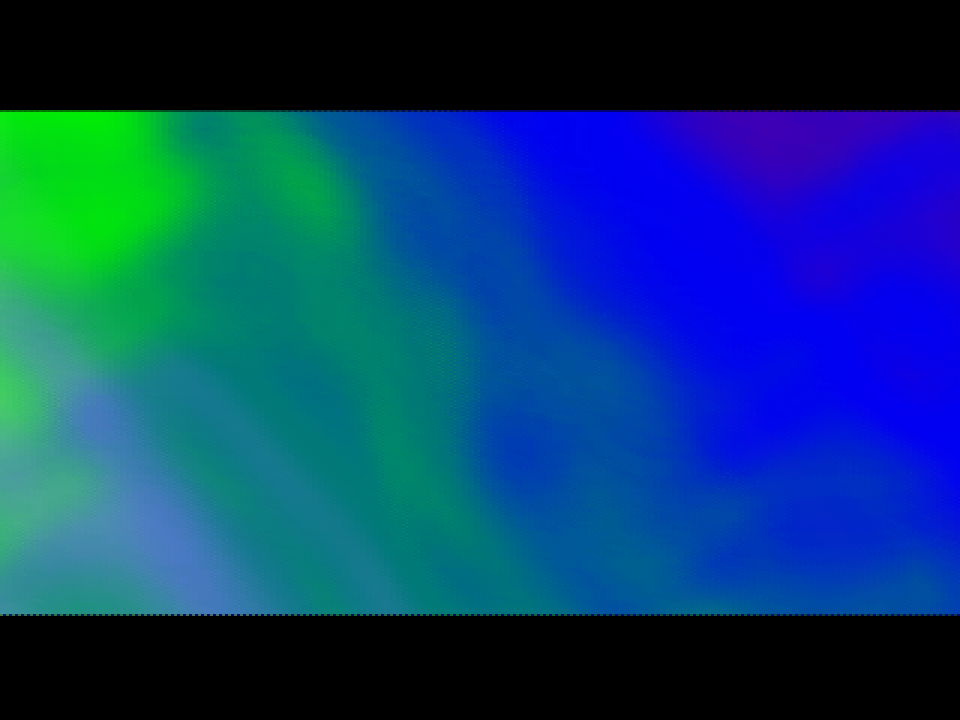

# Plasma

| Modern look | 1993 look |
|---|---|
|  |  |

Soft, flowing clouds of colour in a wide band across the middle of the screen. Four times the band falls
off the bottom of the screen like a dropped object, and comes back at once in new colours fading up from
black: red and blue, then a blue-green rainbow, then grey smoke, then pastel blue and pink.

- **Original:** `PLZPART/PLZ.C` (main loop, tables, palettes), `ASMYT.ASM` (the per-line drawing routine),
  `COPPER.ASM` (everything timed to the screen refresh) and `TWEAK.ASM` (the screen mode), by Wildfire.
  The plasma-covered cube that followed it in the demo is a separate, later scene.
- **This version:** `Sources/SRMetal/Scenes/Plasma/`.
- **Length:** 2323 steps, about 33 seconds, then it repeats.

## How the original did it

### What a plasma is

A plasma is a picture where every pixel's colour number comes from adding up a few smooth waves. Because
the waves are smooth, neighbouring pixels get neighbouring numbers, and a palette of smoothly changing
colours turns that into clouds. Slide the waves along a little every frame and the clouds flow.

### The formula

The program had three tables of wavy numbers, made in advance from sines (a big slow wave with two small
fast ones riding on it): `psini`, `lsini16` and `lsini4`. For a column `c` (0 to 83) on row `y` (0 to 279),
with four numbers `p1` to `p4` that say where the plasma currently is:

```
bend1 = lsini16[ y + p2 + 4*(80 - c) ]
bend2 = lsini4 [ y + p4 + 16*c ]
value = psini[ 8*c + bend1 + p1 ]  +  psini[ 2*y + bend2 + p3 + 4*(80 - c) ]
```

So it is two table lookups added together, but the place each lookup reads from is itself pushed around
by another wavy table. That "wave bent by a wave" is why this plasma looks like smoke and not like a
regular pattern. The four numbers move by 1 to 3 places every frame, each at its own speed.

### Code that rewrites itself

The drawing routine has no loop over columns. The same four instructions are written out 84 times, once
per column, and before each pass another routine goes through all 84 copies and overwrites the addresses
inside the instructions with the current `p1` to `p4` already added in. The processor then just runs
straight through. This "self-modifying code" was the fastest way to do it on a 486.

### The screen mode, and two plasmas at once

Even so, working out one value per pixel was far too slow. So:

- The screen was set to an unusual mode: 320 pixels across and **400** lines down (twice the usual 200),
  with video memory arranged as four interleaved layers ("planes"). Pixel 0 of every group of four is in
  plane 0, pixel 1 in plane 1, and so on. One byte written to memory can go to several planes at once.
- Only **84 values per line** were calculated. Each was written to two planes at once, so it covers two of
  every four pixels.
- **Two different plasmas** were drawn, call them K and L, each with its own four numbers. On even rows K
  went into pixels 1 and 3 of each group and L into pixels 0 and 2; on odd rows the other way round. The
  result is K and L interleaved like the black and white squares of a chessboard, one pixel per square.
- Every frame the video card was told to start the band one line lower or higher than the frame before
  (line 60, then 61, then 60 ...), and to shift it 2 pixels sideways on alternate frames. Moving a
  chessboard by one square swaps black and white. So at any spot on the screen, K and L alternate 70 times
  a second, and the eye sees them **mixed**. The sideways shift also hides the 4-pixel-wide columns.

The viewer sees one rich, smooth plasma. The program only ever computed two coarse ones.

### The band, the fall and the fade

The plasma is 280 lines tall, placed in the middle of the 400-line screen using a video card feature
called "line compare": at a chosen screen line, the card jumps back to the start of video memory. The
part of the screen above that line shows empty memory (black); the plasma starts below it.

To make the band fall, a routine that runs once per screen refresh simply raises that line number each
frame, by amounts that grow with the square of time, as a falling object's distance does. After 64 frames
the line is past the bottom of the screen. No pixel is moved; the card does it all.

While the band is out of sight the four numbers are reset for the next section. It then reappears in place
immediately, with a black palette that is brightened in 31 equal steps to the new colours.

## How this version does it

| | 1993 | This version |
|---|---|---|
| Sine tables | Three tables made in advance, stored in the program | Calculated at start-up from the original's own formulas |
| Per-pixel work | 84 values per line, each 4 pixels wide | Every pixel, on the graphics chip |
| Speed trick | Code that rewrites its own addresses | Not needed |
| Mixing the two plasmas | Chessboard that flips every frame; the eye mixes | The shader works out both and averages them |
| Band position and fall | Video card's line-compare register | The shader offsets the band |
| Palette fade | 31 additions per colour, sent to the card each frame | The same arithmetic (1993 look); glides between steps (modern) |

### 1993 look

The canvas for this scene is 320x400, not the 320x200 the other scenes use, because that was the original
screen. It is still shown at 4:3.

The three tables are handed to the graphics chip. For every pixel the shader does the original's lookups
with whole numbers, following the chessboard rule to pick plasma K or L. It does that for both of the two
alternating frames and shows the **average** of the two (see the differences below for why).

So in this look you can still see the 1993 construction if you look closely: values are 4 pixels wide and
staggered, and the very first and last line of the band are dotted, because there only one of the two
alternating frames has plasma.

### Modern look

No tables. For every pixel of your display the shader evaluates the sine formulas the tables were made
from, with fractional positions, for both plasmas, looks each up in the palette (blending between
neighbouring palette entries) and mixes the two half and half. There are no columns and no chessboard. The
four numbers, the fall and the fade all glide between steps.

It is the same plasma: the same waves, the same motion, the same colours.

## What was checked

- **The tables match the original's data files.** `psini`, `lsini16` and the brightness ramp `ptau` come out
  identical to `PSINI.INC` (16,384 values), `LSINI16.INC` (8,192) and `PTAU.INC` (129) from the formulas in
  `PLZ.C`, provided the original's own 11-digit value of pi is used. `lsini4` matches `LSINI4.INC` in 8,190
  of 8,192 places. At the other two (entries 3072 and 7168) the exact answer is the whole number 24 and the
  original file says 23: the 1993 maths library landed a hair below. Those two entries are set by hand. The
  self-test compares all four tables with checksums of the original files.
- **The formula above agrees with the existing C++ port's** reading of the same assembly (compared by
  reading, used as an answer key only).
- **The graphics chip matches the processor** pixel for pixel at 14 moments, including mid-fade, mid-fall
  and each palette (self-test).
- **The scene repeats exactly** after 2323 steps and is black at the point where it repeats (self-test).
- Pictures of both looks were made at several moments and looked at: they show the same shapes and colours.

## What was not checked

None of this has been compared with the original program running. These rest on reading the source only:

- **The per-pixel formula.** It depends on working out which parts of the self-rewritten instructions get
  overwritten. The reading agrees with the C++ port, but no original frame was compared.
- **The chessboard layout** (which planes get which plasma on which rows), and **where the band sits**:
  first plasma row on screen line 61 or 62 of 400, assuming the card starts the band on the line after the
  one it is given.
- **Which sideways shift goes with which line.** The original set the shift and the line number in two
  different routines run at different points in the frame. The piece of the demo that decides when those
  run (its "interrupt server") is in the source release only as a version that says it does not support
  this, so the order could not be read off. Here the 2-pixel shift is paired with
  line 60. If the real pairing was the other way, the averaged picture differs by a pixel-level detail.
- **That a "music frame" in the timetable is one screen refresh.** The section times (723, 1491, 1875, 2259)
  are assumed to be in 1/70 second steps.
- **The palettes' section order and fade arithmetic** were ported from `PLZ.C` and `COPPER.ASM` by reading.

## Differences from the original, on purpose

- **The 1993 look shows the two alternating frames averaged, not one after the other.** On a 70 Hz monitor
  the flipping chessboard blurred into a smooth mix. A Mac display refreshes at 60 or 120 Hz, and showing 70
  alternating frames per second on that produces a slow, ugly flicker. So each picture is the average of
  the two, which is what the viewer saw. Both frames use the same moment's numbers.
- **No white fade at the start.** The original began with the whole screen white (left by the previous
  scene) and faded down to the first palette over 127 frames. Here the first palette fades up from black in
  31 steps, exactly like the other three. The increments for it are chosen so it ends on the original's
  exact first palette.
- **It loops.** In the original the fourth fall was the end: the plasma cube followed. Here that fall leads
  back to the first section. The loop point is a black screen, so nothing jumps.
- **Drawing is instant.** The original program drew as fast as the PC could, not once per refresh, while
  the four numbers moved on every refresh regardless. On a slow PC the picture was therefore built from
  slightly different moments. This version draws every frame complete, as an infinitely fast PC would.
- **Sections 2 to 4 stay at 31/32 of full brightness.** That is not a change: the original's fade stopped
  one step short, and this version keeps that.
- A fifth palette the original prepared was only ever shown by the plasma cube, so it is not here.
