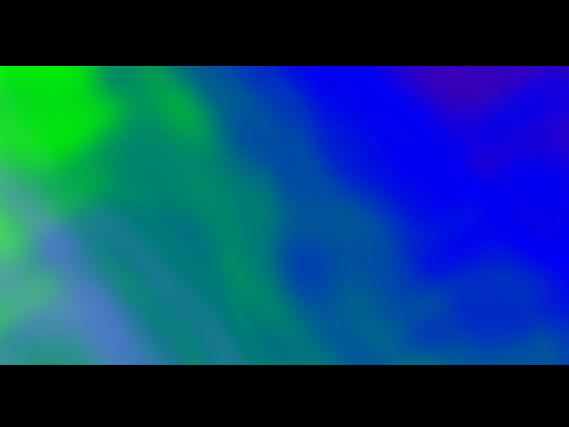

# Plasma

| Modern look | 1993 look |
|---|---|
|  |  |

Soft, flowing clouds of colour in a wide band across the middle of the screen. Three times the band falls
off the bottom of the screen like a dropped object. After the first two falls it comes back at once in
new colours fading up from black: red and blue, then a blue-green rainbow, then grey smoke. The third
fall was the part's end (here, on its own, it leads back to the red and blue).

- **Original:** `PLZPART/PLZ.C` (main loop, tables, palettes), `ASMYT.ASM` (the per-line drawing routine),
  `COPPER.ASM` (everything timed to the screen refresh) and `TWEAK.ASM` (the screen mode), by Wildfire.
  The plasma-covered cube that followed it in the demo is a separate, later scene.
- **This version:** `Sources/SRMetal/Scenes/Plasma/`.
- **Length:** 2,588 steps, about 37 seconds, then it repeats. The sections last as long as in the demo:
  the falls come at steps 976, 2,009 and 2,526 (see "The released program" below).

## How the original did it

### What a plasma is

A plasma is a picture where every pixel's colour number comes from adding up a few smooth waves. Because
the waves are smooth, neighbouring pixels get neighbouring numbers, and a palette of smoothly changing
colours turns that into clouds. Slide the waves along a little every frame and the clouds flow.

### The formula

The program had three tables of wavy numbers, made in advance from sines (a big slow wave with two small
fast ones riding on it): `psini`, `lsini16` and `lsini4`. For a column `c` (0 to 83) on row `y` (0 to 279),
with four numbers `p1` to `p4` that say where the plasma currently is:

```
bend1 = lsini16[ y + p2 + 4*(80 - c) ]
bend2 = lsini4 [ y + p4 + 16*c ]
value = psini[ 8*c + bend1 + p1 ]  +  psini[ 2*y + bend2 + p3 + 4*(80 - c) ]
```

So it is two table lookups added together, but the place each lookup reads from is itself pushed around
by another wavy table. That "wave bent by a wave" is why this plasma looks like smoke and not like a
regular pattern. The four numbers move by 1 to 3 places every frame, each at its own speed.

### Code that rewrites itself

The drawing routine has no loop over columns. The same four instructions are written out 84 times, once
per column, and before each pass another routine goes through all 84 copies and overwrites the addresses
inside the instructions with the current `p1` to `p4` already added in. The processor then just runs
straight through. This "self-modifying code" was the fastest way to do it on a 486.

### The screen mode, and two plasmas at once

Even so, working out one value per pixel was far too slow. So:

- The screen was set to an unusual mode: 320 pixels across and **400** lines down (twice the usual 200),
  with video memory arranged as four interleaved layers ("planes"). Pixel 0 of every group of four is in
  plane 0, pixel 1 in plane 1, and so on. One byte written to memory can go to several planes at once.
- Only **84 values per line** were calculated. Each was written to two planes at once, so it covers two of
  every four pixels.
- **Two different plasmas** were drawn, call them K and L, each with its own four numbers. On even rows K
  went into pixels 1 and 3 of each group and L into pixels 0 and 2; on odd rows the other way round. The
  result is K and L interleaved like the black and white squares of a chessboard, one pixel per square.
- Every frame the video card was told to start the band one line lower or higher than the frame before
  (line 60, then 61, then 60 ...), and to shift it 2 pixels sideways on alternate frames. Moving a
  chessboard by one square swaps black and white. So at any spot on the screen, K and L alternate 70 times
  a second, and the eye sees them **mixed**. The sideways shift also hides the 4-pixel-wide columns.
  (The frame that starts on line 60 is the one with no shift, and line 61 goes with the 2-pixel shift:
  the program picks them the other way round, but the shift reaches the card one frame late. See
  "What was checked" below.)
- That alternation of lines only happens while the plasma is flowing normally. While the band falls and
  while a new palette fades in, another routine sets the line and both frames use the same one, so for
  those moments K and L are **not** mixed: each pixel shows only one of them, as a fine chessboard.

The viewer sees one rich, smooth plasma. The program only ever computed two coarse ones.

### The band, the fall and the fade

The plasma is 280 lines tall, placed in the middle of the 400-line screen using a video card feature
called "line compare": at a chosen screen line, the card jumps back to the start of video memory. The
part of the screen above that line shows empty memory (black); the plasma starts below it.

To make the band fall, a routine that runs once per screen refresh simply raises that line number each
frame, by amounts that grow with the square of time, as a falling object's distance does. After 64 frames
the line is past the bottom of the screen. No pixel is moved; the card does it all.

While the band is out of sight the four numbers are reset for the next section. It then reappears in place
immediately, with a black palette that is brightened in 31 equal steps to the new colours.

## How this version does it

| | 1993 | This version |
|---|---|---|
| Sine tables | Three tables made in advance, stored in the program | Calculated at start-up from the original's own formulas |
| Per-pixel work | 84 values per line, each 4 pixels wide | Every pixel, on the graphics chip |
| Speed trick | Code that rewrites its own addresses | Not needed |
| Mixing the two plasmas | Chessboard that flips every frame; the eye mixes | The shader works out both and averages them |
| Band position and fall | Video card's line-compare register | The shader offsets the band |
| Palette fade | 31 additions per colour, sent to the card each frame | The same arithmetic (1993 look); glides between steps (modern) |

### 1993 look

The canvas for this scene is 320x400, not the 320x200 the other scenes use, because that was the original
screen. It is still shown at 4:3.

The three tables are handed to the graphics chip. For every pixel the shader does the original's lookups
with whole numbers, following the chessboard rule to pick plasma K or L. It does that for both of the two
alternating frames and shows the **average** of the two (see the differences below for why).

So in this look you can still see the 1993 construction if you look closely: values are 4 pixels wide and
staggered, and the very first and last line of the band are dotted, because there only one of the two
alternating frames has plasma.

### Modern look

No tables. For every pixel of your display the shader evaluates the sine formulas the tables were made
from, with fractional positions, for both plasmas, looks each up in the palette (blending between
neighbouring palette entries) and mixes the two half and half. There are no columns and no chessboard. The
four numbers, the fall and the fade all glide between steps.

It is the same plasma: the same waves, the same motion, the same colours.

## What was checked

- **The tables match the original's data files.** `psini`, `lsini16` and the brightness ramp `ptau` come out
  identical to `PSINI.INC` (16,384 values), `LSINI16.INC` (8,192) and `PTAU.INC` (129) from the formulas in
  `PLZ.C`, provided the original's own 11-digit value of pi is used. `lsini4` matches `LSINI4.INC` in 8,190
  of 8,192 places. At the other two (entries 3072 and 7168) the exact answer is the whole number 24 and the
  original file says 23: the 1993 maths library landed a hair below. Those two entries are set by hand. The
  self-test compares all four tables with checksums of the original files.
- **The formula, against the original's machine code.** The drawing routine overwrites the addresses
  inside its own instructions, so the formula depends on exactly which bytes get overwritten.
  `ASMYT.OBJ`, the assembled original, is in the source release: each of the four instructions per
  column is 4 bytes, two of instruction and two of address, with nothing in front, and the rewriting
  routine stores to exactly those two address bytes (its first four targets are 4 bytes apart). So the
  whole address is replaced, the `ccc*32` and `ccc*64` written in the source never take effect, and the
  formula at the top of this page is what the processor ran. The table positions it adds (0, 4000h,
  8000h plus 280h, plus 140h) match too.
- **The chessboard.** `PLZ.C` switches on planes 1 and 3 (value 0Ah), draws K on even rows and L on odd
  rows, then planes 0 and 2 (05h) and draws K on odd rows and L on even rows. That is the layout used
  here.
- **Which shift goes with which line.** `pompota` chooses "line 60 and a 2-pixel shift" or "line 61 and
  no shift". It runs in the routine the demo's interrupt server (`DIS/DISINT.ASM`, `MAIN/COPPER.ASM`)
  calls *during* the retrace (the pause between two screen refreshes), and sends the line number to the
  card at once, so the line applies to the frame about to be drawn. The shift is only stored; another
  routine (`copper1`), called *just before the next* retrace, sends it. So every frame is drawn with its
  own line and the *previous* frame's shift: line 60 with no shift, line 61 with 2 pixels. The
  self-test checks the pairing.
- The parameter speeds and wrap-around, the fall table, the order of work in each refresh (palette, then
  move, then fall or fade), the 31 fade steps and their 16-bit arithmetic including the half that is
  not cleared between sections, the palettes, the section order and starting numbers.
- **The graphics chip matches the processor** pixel for pixel at 17 moments (self-test: steps 0, 1, 2,
  17, 33, 400, 975, 991, 1038, 1051, 1600, 2025, 2084, 2300, 2542, 2570 and 2587): the first fade, the
  plasma flowing, and each of the three falls (just before, half-way down, the band gone, the next
  palette fading in). With the band's fall broken in the drawing only, six of them fail.
- **The scene repeats exactly** after 2,588 steps and is black at the point where it repeats (self-test).
- **The modern look glides without a jump** through the whole loop: the end of every step's glide is where
  the next step starts, for the band's position, the eight plasma numbers and the palette (self-test, and
  `--motion-check` over steps 0 to 2,588: no jumps, no one-picture-only pixels). On the step a fall
  starts the original's fall counter goes from 0 straight to 2, and the modern look glides into it.
  Nothing is glided across a jump: the plasma numbers are reset and the palette swapped only while the
  band is hidden (fall counter 64 and 65), and the loop point is black in both looks.
- In the 1993 look, `--motion-check` reports large one-picture-only changes during each fall and a jump
  where a fade ends. Those are the original's behaviour described above (K and L not mixed while falling
  or fading, so the fine chessboard swaps as the band moves a line), not a fault.

## What was not checked

None of this has been compared with the original program running.

- **Where the band sits.** First plasma row on screen line 61 or 62 of 400. This rests on the documented
  behaviour of the VGA card (the split starts on the line *after* the one it is given), not on a
  measurement. The C++ port puts it one line higher, at 60, and does not alternate lines or shift at all.
- **The palettes and the fade** were ported from `PLZ.C` and `COPPER.ASM` by reading (twice).

## The released program

The released `PLZPART.EXE` (in `MAIN/DATA`; packed twice: `deark -m pklite`, then `deark -m lzexe`) was
read against `PLZ.C`. Three things were found; videos of the original agree with the first (three
plasmas, the grey one last, the cube right after).

- **It ends on the third fall.** The loop leaves when `curpal` is 4 (`cmp word [curpal],4` at 1181Ch of
  the unpacked image); `PLZ.C` as published says 5, and so does the `PLZ.OBJ` in the source folder, which
  is a different build. The timetable (723, 1491, 1875, 2259, 2778) and the palette code are the
  source's. So the fourth section and its palette ("RB-white": red through white to blue) were never
  shown, and are not here.
- **The counter counts music ticks** (52 a second; see [demo-timeline.md](../demo-timeline.md), "Two
  questions the source could not answer"). The timetable is "64 rows x 6 ticks x 2, 4 and 5 patterns, less 45":
  song 2 has exactly five patterns between the plasma's "+++" mark and the next, and the three falls
  start on row 56 of the second, fourth and fifth. The band is gone on the first row after the "+++".
- **The fade's memory starts as zeros.** `fadepal` is declared without a starting value (`db 768*2
  dup(?)`), and in the released image it is 1,536 zero bytes. The first fade adds (target - 63) x 2 / 256
  a refresh for 127 refreshes: from zero that goes below zero at once, the card keeps only the low six
  bits of a level (so the screen is white again on the first step), and it ends ONE LEVEL ABOVE the
  palette: 0 shows as 1, 62 as 63 (none of the first palette's levels is 63). Too small to see.

## Inside Play Demo

The scene follows the released part there (`PLZ.C` 68-95, `COPPER.ASM` `do_drop`):

- **White for 74 steps.** The part waited for "music plus" >= 0 with the screen as the rotozoomer left
  it: every colour set to white. The step that meets the cue is still white (`init_plz` sets its new
  screen mode's 256 colours white as well), and the music's frame counter is set to 0 there: the n-th
  step after the cue is the part's n-th refresh.
- **The first palette fades DOWN from white** over 127 refreshes (`cop_drop` starts at 128 and the fade
  runs while it is 129 to 255; the card is given the result a refresh later), to one level above the
  palette, as above. Colour 0 fades with the rest, so the borders above and below the band go from
  white to (almost) black too. The band is in place from the start; it does not drop in.
- **The falls follow the music's tick counter:** the band starts to fall a refresh after the counter
  passes 723, 1491 and 1875 (`PlasmaModel.timetable`): 975, 2,008 and 2,525 steps after the cue in a
  full run. After the first two the next palette fades up from black as on its own. The third fall is
  the end: the band is gone 64 refreshes later and the screen stays empty for the one step left before
  the plasma cube's part begins (and for 48 more there, until the cube's cue). No second run.

The self-test runs Play Demo silently from this scene and compares the white steps, the three falls, the
end and the cube's start with the script's own numbers (0, 1875, 65) and the timetable's, and the first
fade with the levels it must end on. Proven to fail with the cue moved by one, the fade's length changed,
the third fall not the end, a fall a tick or a step early, the script waiting for 2259, the fade memory
started at white, and the card keeping all eight bits.

On its own the first palette fades up from black (a deliberate difference, below) to the exact palette.

## Differences from the original, on purpose

- **The 1993 look shows the two alternating frames averaged, not one after the other.** On a 70 Hz monitor
  the flipping chessboard blurred into a smooth mix. A Mac display refreshes at 60 or 120 Hz, and showing 70
  alternating frames per second on that produces a slow, ugly flicker. So each picture is the average of
  the two, which is what the viewer saw. Both frames use the same moment's numbers.
- **No white fade at the start**, on its own. The original began with the whole screen white (left by the previous
  scene) and faded down to the first palette over 127 frames. Here the first palette fades up from black in
  31 steps, exactly like the other two. The increments for it are chosen so it ends on the original's
  exact first palette.
- **It loops**, on its own. In the original the third fall was the end: the plasma cube followed. Here that fall leads
  back to the first section. The loop point is a black screen, so nothing jumps.
- **Drawing is instant.** The original program drew as fast as the PC could, not once per refresh, while
  the four numbers moved on every refresh regardless. On a slow PC the picture was therefore built from
  slightly different moments. This version draws every frame complete, as an infinitely fast PC would.
- **The second and third palettes stay at 31/32 of full brightness.** That is not a change: the
  original's fade stopped one step short, and this version keeps that.
- `PLZ.C` prepares five palettes; the released part shows only the first three (it ends on the third
  fall), so the fourth and fifth are not here.
