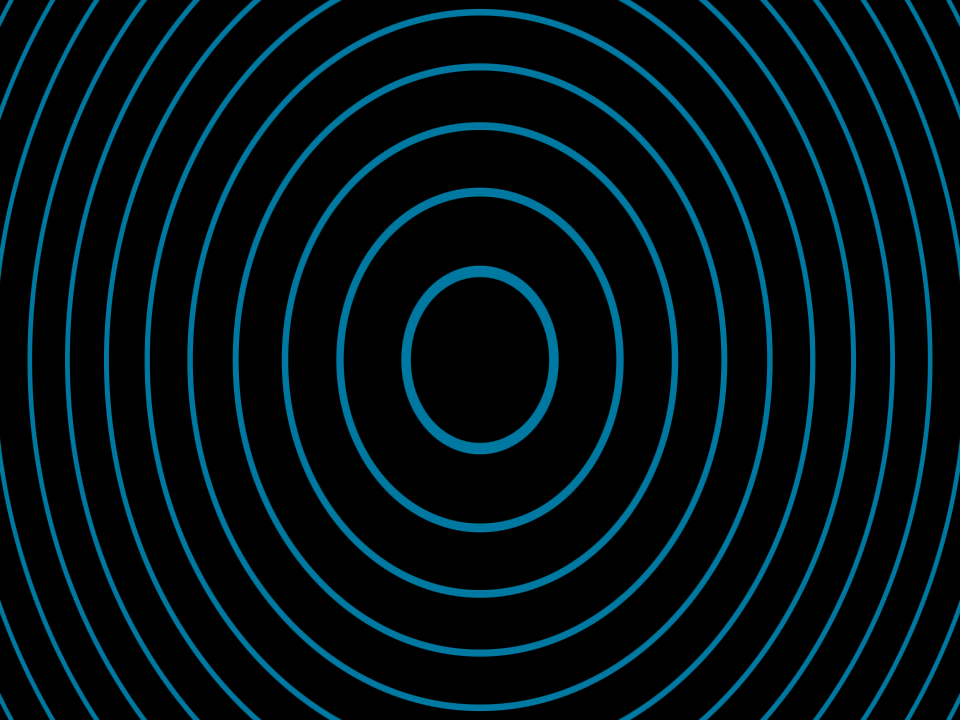
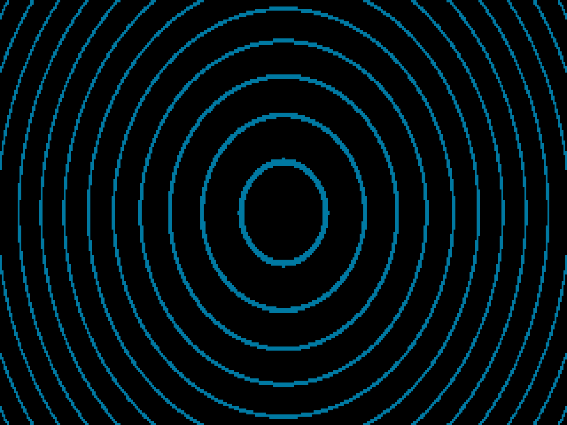
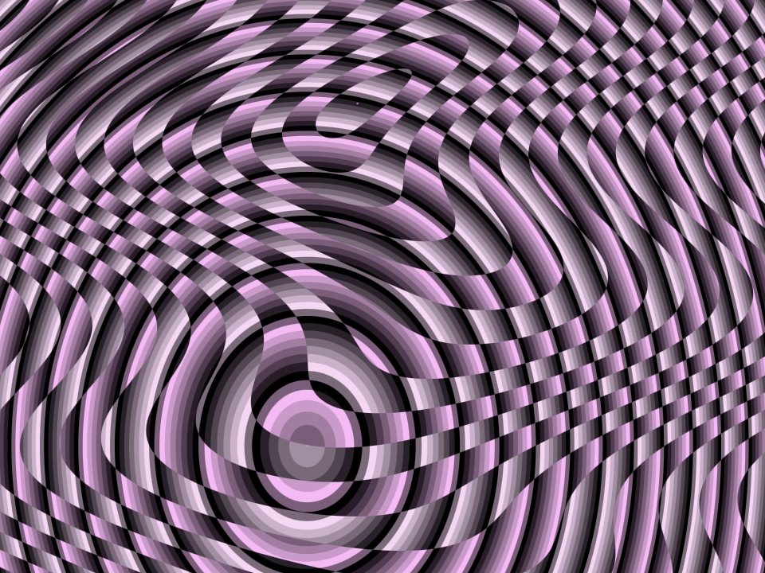
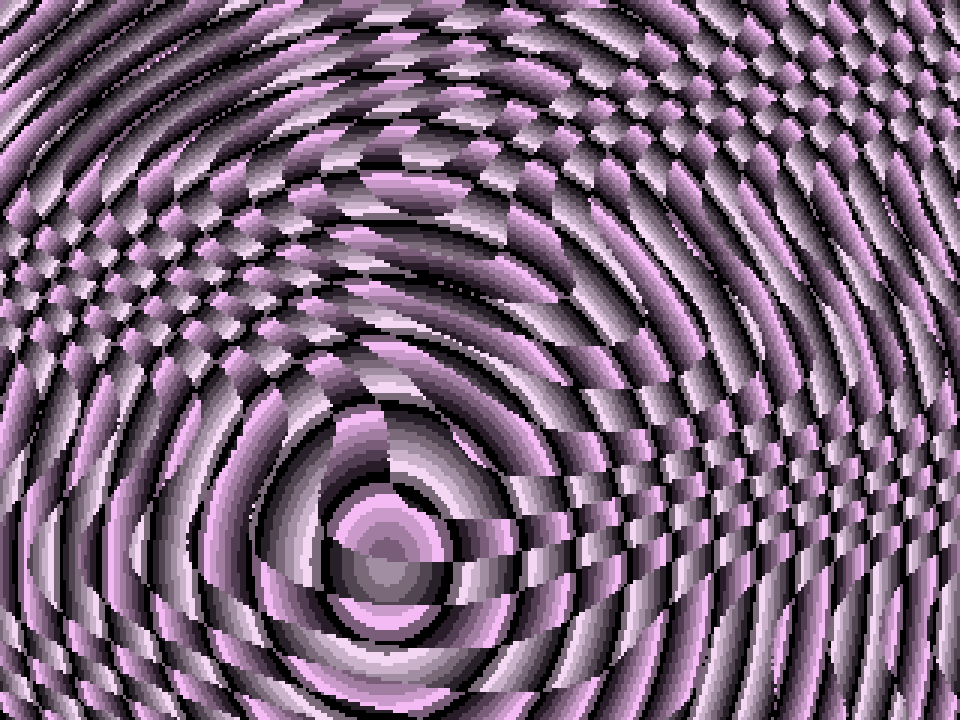

# Rings and Interference

| | Modern look | 1993 look |
|---|---|---|
| Rings |  |  |
| Interference |  |  |

Two scenes that share the same ring pictures:

- **Rings:** thin teal rings flowing outward on black.
- **Interference:** two sets of purple-grey rings sliding over each other, colours flowing outward, with a
  sideways wave that grows until the picture looks like it is melting.

In the original these ran back to back as the opening of the techno part. Here they are separate scenes.

- **Original:** `TECHNO/KOEB.ASM` (Rings) and `TECHNO/KOEA.ASM` (Interference), assembly by Psi.
- **This version:** `Sources/SRMetal/Scenes/Interference/` (one model and one shader serve both scenes).
- **Length:** Rings fades in over 128 steps and then runs indefinitely. Interference runs 1024 steps, about
  14.6 seconds, and loops seamlessly.

## How the original did it

The program never calculated a ring. It had two pictures of concentric rings, each 640x400, four times the
area of the screen:

- an **8-colour picture** whose rings get thinner further from the centre, and
- a **1-bit picture** (each pixel just on or off) of plain rings 12 pixels wide.

Each was stored on disk as one quarter and mirrored into a full picture when the part started.

### Sliding

The video card was told to show a 320x200 window onto the 8-colour picture, and the window's position was
moved in a circle every frame. The card does that for free: no pixel is copied.

### The fourth layer

The video mode stored each pixel as four separate on/off layers (bit planes). Three layers hold a number
from 0 to 7, which is all the 8-colour picture needs. That left one layer spare.

Every frame, the program copied the 1-bit picture into that spare layer, at a different offset that moved
in its own circle at a different speed. Wherever that layer is on, the pixel's number is 8 higher. So the
video card ends up choosing from colours 0 to 7 where the second picture is off, and colours 8 to 15 where
it is on, and those two groups were given different colour ramps. The interference pattern is the card
combining two pictures by itself.

### Shifting a picture by one pixel

Memory is addressed in bytes, and one byte holds 8 pixels of a 1-bit picture. Copying a picture to a
position that is not a multiple of 8 pixels would mean shifting every byte, which is slow. So when the part
started, it made eight copies of the 1-bit picture, each shifted one pixel further than the last. At run
time it picks the copy with the right shift and does a plain, fast copy.

### Flowing colours

The rings flow because the 16 colours are rotated by one place every frame. No pixel changes.

### The wave

Each row of the 1-bit picture is copied with a small extra sideways shift taken from a sine wave. The
strength of that shift is zero for the first five seconds, then grows one notch every 16 frames.

### Rings

The Rings scene is the same 8-colour picture held still and centred, with only one colour in eight lit
(teal). The colours rotate to make the rings flow, and the palette fades up from black.

## How this version does it

The first surprise was that both pictures follow exact formulas:

- 8-colour picture: ring number = distance to the power 1.4, divided by 16, rounded down. The colour is
  that number's remainder when divided by 8.
- 1-bit picture: distance divided by 12, rounded down. The pixel is on if that is odd.

So the pictures are calculated when the app starts, and no data files are needed.

The second was that the original's layer-copying, with its eight pre-shifted copies, boils down to one
plain rule: the second picture's pixel at screen position (x, y) is the 1-bit picture at
(x + offset + wave - 7, y + offset). The -7 falls out of how the shifted copies were chosen.

| | 1993 | This version |
|---|---|---|
| Ring pictures | Drawn in advance, stored on disk | Calculated from formulas |
| Sliding | The video card shows a moving window | The shader adds an offset |
| Combining the two | A spare bit plane, combined by the card | The shader reads both and picks a colour |
| One-pixel shifts | Eight pre-shifted copies | Not needed; a shader can read any pixel |
| Flowing colours | Rotate the palette | Rotate the palette (1993 look) or shift the ring number (modern) |

### 1993 look

The two calculated pictures are held on the graphics chip. For every pixel the shader looks both up at
the right offsets and picks from 16 colours, exactly as the VGA card did.

### Modern look

No pictures at all. For every pixel of your display, the shader measures the distance to each centre and
works out the ring from that, using the same formulas. The 1993 code could never have afforded that much
maths per pixel; a graphics chip does it without effort.

- Ring edges are softened over one screen pixel.
- The offsets, the wave and the colour flow all glide between steps.
- The ring shades stay as 8 distinct bands, as in the original, not blended into a gradient.

## What was checked

- **The ring formulas are exact.** Both reproduce the original data files (`_CIRCLE.OBK`, `_CIRCLE2.OBK`)
  with zero differences across all 64,000 pixels each. The self-test confirms this by checksum.
- **The simplified copying rule is right.** The original's layer copy, with its eight shifted pictures, was
  emulated byte for byte and compared with the plain rule above: zero mismatching pixels at five moments,
  with and without the wave.
- **The sine table is exact.** `sine x 256, rounded toward zero` reproduces the original `SIN1024.INC`.
- **The graphics chip matches the processor** pixel for pixel at several moments in each scene (self-test).

## Differences from the original, on purpose

- **Two scenes instead of one sequence.**
- **No white-out in Rings.** The original faded the rings in, then carried on adding brightness until the
  whole screen was white, and ended after 256 steps. Here Rings stops at full brightness and keeps flowing.
- **Interference loops seamlessly.** The original ran about 980 steps and cut away on a music cue. Here it
  runs 1024 steps. The two pictures' paths advance 5 and 7 places per step through a 1024-place sine table,
  so after 1024 steps both are exactly where they started, as are the wave and the colour rotation. The
  wave also shrinks back to nothing over the last 240 steps, which the original did not do. The self-test
  checks that the scene returns to its exact first frame.
- **The colour flow starts immediately.** The original waited for a beat in the music.

One thing that is not a difference: the circles are round in pixels, and the canvas is shown at 4:3 as on a
VGA monitor, so they appear as slightly tall ovals. They did in 1993 too.
