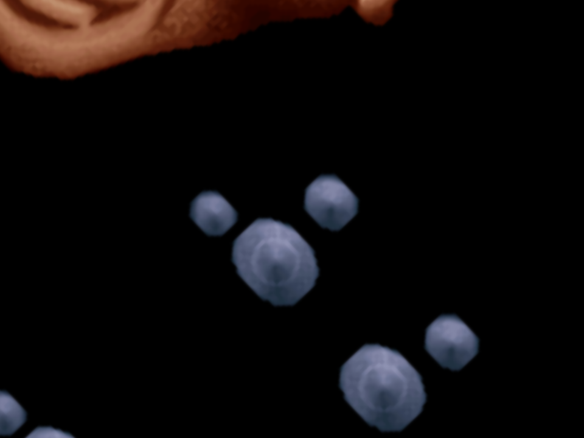
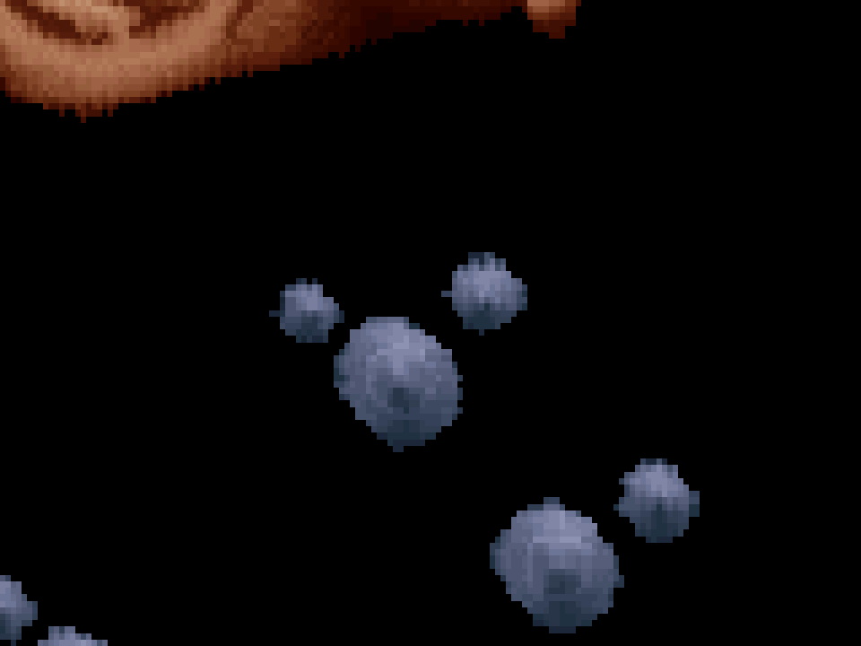

# Rotozoomer

| Modern look | 1993 look |
|---|---|
|  |  |

The bald head from the lens part, repeated like wallpaper in every direction, turning and zooming:
first slowly, then faster, diving into a close-up and out again before it fades to white. It follows
the lens in part 10 of the demo.

- **Original:** `LENS/MAIN.C` (`part3`, about 80 lines) and `_rotate` in `LENS/ASM.ASM` (about 140
  lines), by Psi. Built into `LNS&ZOOM.EXE` together with the lens.
- **This version:** `Sources/SRMetal/Scenes/Rotozoomer/` (added 2026-11-24).
- **Length:** 2,000 steps (about 28.6 seconds), then 35 white steps and it starts again. In Play Demo it
  stops (white) as soon as the music reaches its cue ("music plus" above −4), as the original did.

**This scene uses original artwork:** the lens picture (`artwork/original/rgb/10-lens-picture.png`).

## How the original did it

1. **The picture.** At start-up it makes a 256x256 tile from the lens picture: columns 32 to 287, each
   row stretched 11/10 (tile row `y` shows picture row `y·10/11 − 18`). The rows that fall outside the
   picture, at the top and bottom of the tile, show the picture's first row. It also makes a copy of the
   tile turned a quarter.
2. **The screen.** A tweaked VGA mode (set up by writing the card's registers directly) shows 160x100 big
   pixels, each 2 pixels wide and 4 lines tall on the 320x400 screen, so 4:3 like every other part.
3. **The camera.** Every step it calls `_rotate(x, y, xa, ya)`: the tile position of the top-left corner,
   and how far one screen pixel moves across the tile (`xa`, `ya` in 1/1024ths of a tile pixel). The
   2,000 steps were recorded into a file (`LENS.EXP`) by formulas that stay in the source behind
   `#ifdef SAVEPATH`: a circling centre, a turn that speeds up, and a zoom that shrinks, settles, then
   dives in and flips through.
4. **`_rotate`** works only with whole numbers:
   - It first works out 160 offsets along one row (x grows by `ya`, y by `−xa`, each an 8-bit whole part
     with its own 16-bit fraction) and writes them into its own instructions (self-modifying code: the
     program changes its own machine code while it runs).
   - Each of the 100 rows starts `(xa, ya)·307/256` further on (the 307/256 makes up for the pixel
     shape); only the whole part of the start is used.
   - A pixel is the tile at (row start + offset), added as one 16-bit number: when x passes 255 it carries
     into y, so at the tile's left/right edge the picture shifts by one row.
   - When the picture lies more than 45 degrees over (`|xa| > |ya|`) it reads the turned copy with the
     camera turned to match. That shows the same picture.
5. **Palette.** Each step draws, waits for the refresh, then sets the palette for the frame counter
   `f` = step + 1: below 16 every colour is brightened by `(15 − f)·5` levels (a flash in from white);
   above 1,872 every colour moves `(f − 1872) / 2` of 63 towards white. After the last step it sets the
   whole palette white.

## This version

**The camera path** is worked out at start-up from the `SAVEPATH` formulas, with Microsoft C's rules (a
double stored in an int is cut off, not rounded). That gives all 2,000 steps of `LENS.EXP` exactly, so
no data file is needed. The self-test checks it against a checksum of the original file.

**1993 look:** `RotozoomerModel.rotate` does `_rotate`'s whole-number sums exactly, the turned copy and
the carry at the tile's edge included, and the screen is shown through the faded palette
(`Core/IndexedCanvas.swift`). The colour numbers are rebuilt from the exported picture's 64 colours.

**Modern look:** a shader works out, for each screen pixel, its point on the tile from the camera
WITHOUT rounding (the formulas' unrounded values, blended between steps), so the turning and zooming
glide. It samples the lens picture made 8x by Super-xBR (the same copy the Lens scene uses),
mapped through the same tile rules. How fast the picture is crossed per screen pixel is worked out from
the unbroken coordinates, so the smoothing does not flicker at the tile's edges. The flash and the fade
glide too.

| | Original | 1993 look | Modern look |
|---|---|---|---|
| Screen | 160x100 | the same | full resolution |
| Camera | recorded whole numbers | the same, from the formulas | the formulas unrounded, blended between steps |
| Picture | 256x256 tile of the lens picture | the same | the lens picture 8x by Super-xBR, same tile rules |
| Row shift at the tile's edge | yes (16-bit carry) | yes | no |
| Fades | palette, whole numbers | the same | smooth |

## Checks

- `tools/rotozoom_reference.py` works out the camera from the formulas and compares all 2,000 steps with
  `LENS.EXP` (all equal), builds the tile from the original `LENS.EXB`, and carries out `_rotate`
  register by register. It is a second working of the assembly, not the assembly run: the project's x86
  interpreter cannot run code that rewrites itself.
- The self-test compares the app's 1993 pictures with that tool at 19 steps (flash, middle, turned copy,
  close-up, fade): all identical. Without the 16-bit carry, 14 of the 19 differ, so the check would catch
  it. The graphics chip's picture is also compared with the processor's at 20 steps (all identical).
- `--motion-check rotozoomer modern`: no jumps. Around steps 1,850 to 1,870 the camera dives into an
  extreme close-up and moves fast, so much of the picture changes between neighbouring pictures there,
  in both looks.

## Differences and limits

- The step pairing: step `s` shows path `s` with the palette set right after it is drawn (frame `s + 1`).
  The original drew straight onto the screen being shown, so for part of a refresh the old picture and
  the new one were both on screen; this version shows whole pictures.
- Modern leaves out the one-row shift at the tile's edge (a by-product of 16-bit sums).
- Not compared with the original running.
