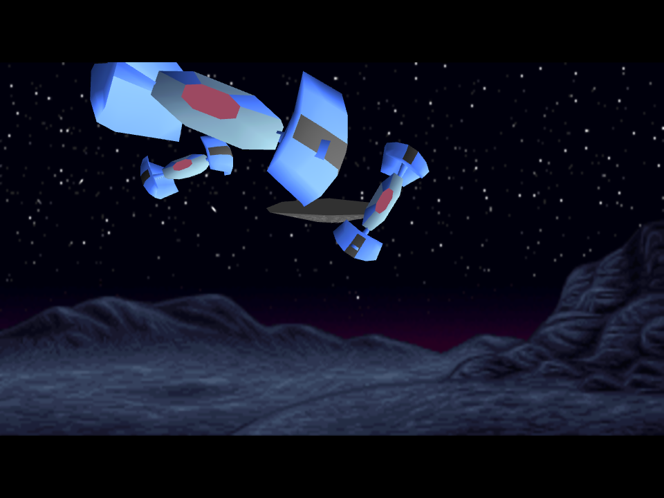
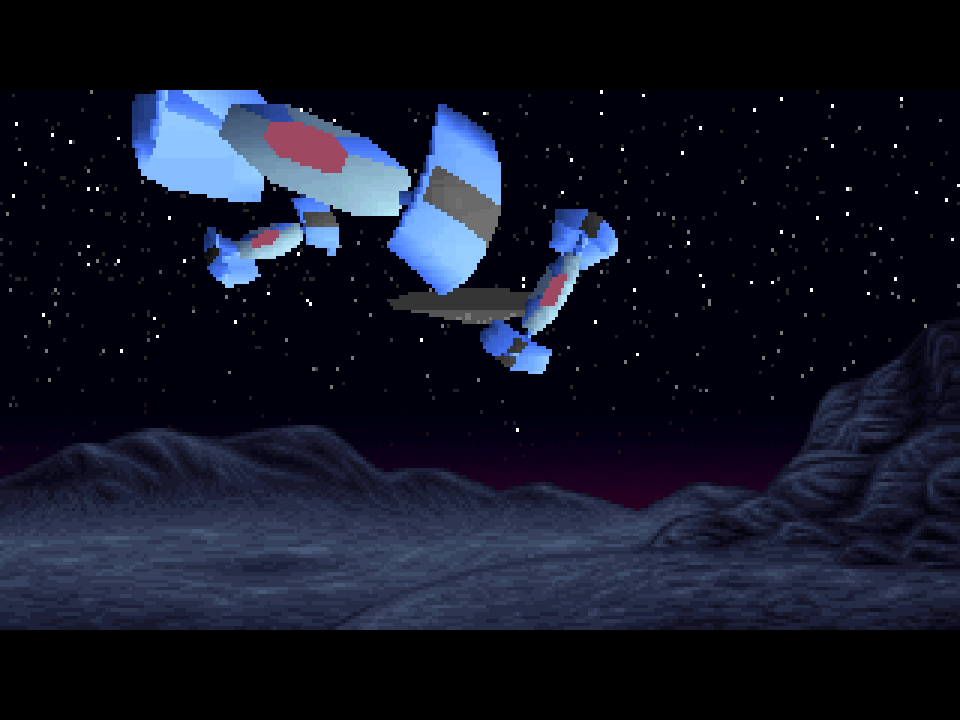
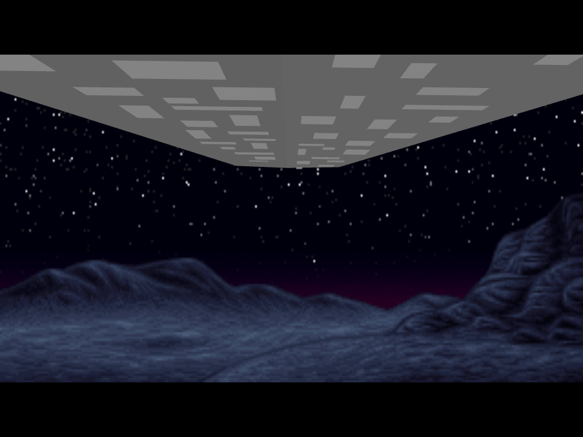
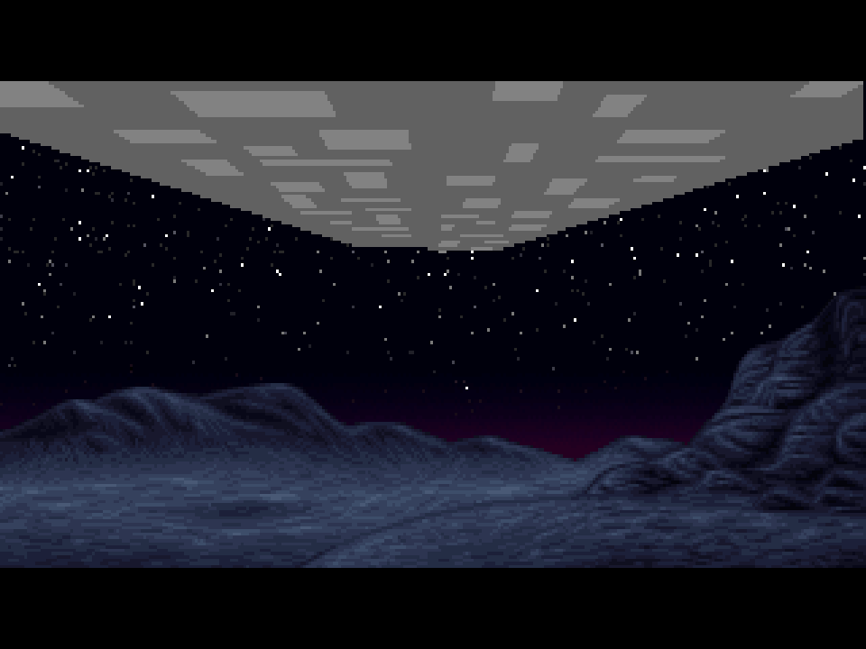
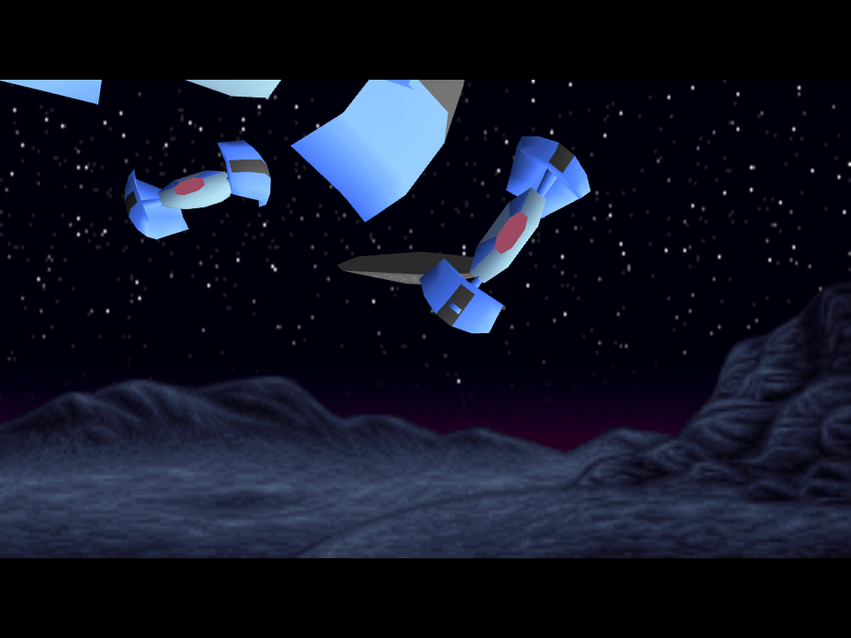
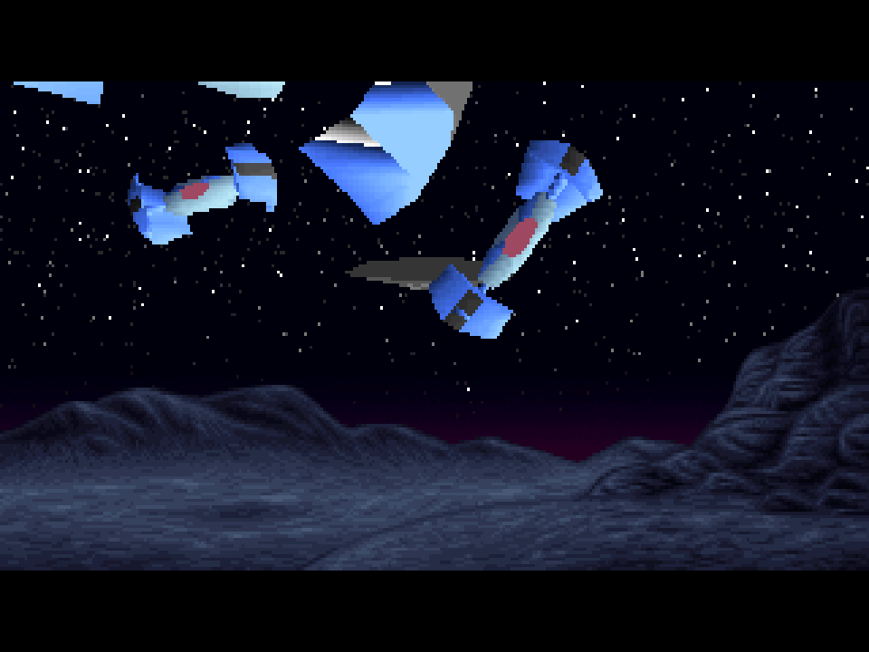

# Ships Fly-by

| Modern look | 1993 look |
|---|---|
|  |  |
|  |  |
|  |  |

A night sky over a dark landscape. A huge grey ship slides in over the top of the picture, passes
overhead and shrinks into the distance. Three small blue fighters then swoop in from behind the
viewer, close enough to fill the picture, and chase after it until all four are specks.

- **Original:** `U2A.EXE` ("Alkutekstit II", "opening titles II"), by Psi: the scene program
  `VISU/C/U2A.C`, the shared 3D engine `VISU` (see [the engine's page](../visu-engine.md)), the scene's
  data files `U2A.*` and the background picture `U2ABG.UH`.
- **This version:** `Sources/SRMetal/Scenes/ShipsFlyby/`, on the engine in `Sources/SRMetal/Core/Visu/`.
- **Length:** 592 steps, about 8.5 seconds, then it repeats.

**This scene uses original artwork and original 3D data.** Nothing you see in it is calculated from a
formula:

- The **background** is a hand-painted picture from the 1993 demo (`U2ABG.UH`, the horizon from the
  demo's opening), kept at the user's request because the ships were made to fly over it.
- The **ships** are the original's 3D models, and their **flight** is the original's recorded
  animation, made by Future Crew in 3D Studio. Models and animation cannot be calculated.

All of it is in `Data/Visu/` (public domain, like the rest of the original; see that folder's README),
copied into the app when it is built.

Words used below are explained on the engine's page: vertex, polygon, flat and Gouraud shading,
clipping, depth buffer.

## Which original files are live

`VISU/C/MAKEFILE` builds `u2a.exe` from `u2a.obj`, the engine library `visu.lib`, the demo's shared
`disc.obj`, and `_bg.obk` (the background picture, turned into a linkable file). The data files are in
`VISU/C/SCENE/`. The engine's page lists what is live inside the engine and shows that the data and
the program are byte for byte what the shipped demo carried.

Not live: `U2AOK.C`, `U2AOLD.C`, `U2ABBK.C`, `U2A.BBK` (older versions of the scene program), and
`U2A.LBM` / `U2ABG.LBM` (the artist's working pictures).

## How the original did it

### What is in the scene

| Object | Model file | Shape | Shading | In the animation |
|---|---|---|---|---|
| Big ship (`"Sippi"`) | `U2A.002` | 75 polygons, 285 vertices | flat: each polygon one shade of grey | switched on at frame 17, first seen at frame 23, never switched off |
| Three small ships (`"s01"`, one model used three times) | `U2A.001` | 124 polygons, 159 vertices | Gouraud: shades blended across each polygon | two switched on at frame 260, the third at 271; switched off at 515, 520 and 518 |
| An engine (`"moottori"`) | `U2A.003` | 20 polygons | Gouraud | never switched on, so never seen |

The animation (`U2A.0AB`, 16 KB) holds 521 frames. Each frame says, for the camera and every object
that moved, how its position and its nine turn numbers changed since the frame before. So the flight
is not worked out by the program at all: it is played back, like a film of positions.

A curiosity in the data: the very last frame switches one small ship back on. It is far away by then
and the program stops at once, so nothing comes of it.

### One picture

Everything here except the first step is the engine, described on [its page](../visu-engine.md):

1. **Copy the background picture over the whole screen page** (`vid_clearbg`). This both wipes the
   last picture and puts the scenery back, in one go: 64,000 bytes copied 70 times a second, which was
   affordable only because the picture is stored in the same arrangement as the video memory. (The
   screen mode keeps every fourth pixel together in one of four "planes"; the program re-orders the
   picture that way once, when it starts.)
2. Work out where each switched-on object is relative to the camera.
3. Sort the objects farthest first, by one point each, and draw them in that order with the engine:
   turn, project, drop the polygons facing away, light, clip, fill.

The picture is drawn only in a band of the screen, rows 25 to 174, with black bars above and below
(a letterbox). The background picture has scenery only in that band, and the engine is told to draw
only there.

### Colours

The palette comes from the scene's file: 16- and 32-step ramps of grey and blue for the ships. The
background picture brings its own 64 colours, which the program copies into palette entries 192 to
255; the picture's pixels already use those numbers. So ships and scenery share the 256 colours without
either knowing about the other.

### Timing

The animation is tied to the screen's refresh, 70 times a second, not to how fast the PC could draw.
An interrupt routine (`copper2`) runs at every refresh and counts it. After each picture the program
works out how many refreshes behind it is and reads that many animation frames before drawing again
(averaging, so the pace does not jitter). Finished pictures wait in a queue of four screen pages, each
shown for as many refreshes as it took to draw.

So on any PC the fly-by lasted the same 521/70 = 7.4 seconds. A fast PC showed every frame; a slow
one skipped frames. **The speed did not depend on the PC.**

### Start, end and the music

- **Start.** The program loads its data, then waits for the music to reach a certain place (order
  above 10, row above 46). Only then does it set the screen mode and palette and start drawing. The
  part before it in the demo (the opening credits) shows the same horizon picture, so to the viewer
  the ships simply appear in a scene that was already there. There is no fade.
- **End.** The loop stops when the animation's end marker is read, or earlier if the music reaches
  another place (order above 11, row above 54). Then all four screen pages are filled with the plain
  background. Again no fade: the ships have flown away and the horizon stays for the next part.

## How this version does it

**The model** (`ShipsFlybyModel.swift`) is small, because the engine does the work. It holds the
background picture, the palette (built as the original built it), the engine's scene loader
(`VisuWorld`) and 1993 drawing replay (`VisuEngine`), and the timetable:

| Steps | What shows |
|---|---|
| 0 to 70 | the empty horizon (the pause; animation frame 0, nothing switched on) |
| 71 to 591 | animation frames 1 to 521, one per step |
| 592 | = step 0 again |

The pause is one named number, `ShipsFlybyModel.pauseSteps` (70 steps, one second). The animation
itself shows nothing for its first 22 frames and only a far-off speck for about its last second, so
the horizon looks empty for roughly two seconds between passes.

**1993 look: replayed on the processor.** Each step the model copies the background into a 320x200
screen of colour numbers and has the engine replay draw the ships over it, exactly the original's
loop. `IndexedCanvas` shows the result through the palette, scaled up with hard-edged pixels. The
picture is drawn on every step whichever look is showing, because the engine carries a little state
from one picture to the next (see "Kept quirks").

**Modern look.**

- The **background** is the same picture, made 8 times larger by Super-xBR (a pixel-art scaler, see [how-it-works.md](../how-it-works.md#pictures-in-the-modern-look)) when the scene starts, then
  drawn first, scaled smoothly to the screen. Edges such as the hill line become clean curves instead of
  pixel steps; it is still somewhat softer than the sharp ships. The band's top and bottom edges are kept
  crisp. (Until 2026-11-24 it was the original picture smoothly stretched, which looked blurrier.)
- The **ships** are drawn by the engine's modern renderer (`VisuModernRenderer`): real triangles at
  the display's resolution, a depth buffer between objects, the original's own back-to-front order
  within an object, the original's lighting rule without rounding to whole colour numbers, smoothed
  edges. It draws into a picture of its own, which is then laid over the background.
- **Motion** glides between animation frames. The model keeps a second copy of the animation one
  frame ahead, so it always knows where everything will be at the next step, and draws the blend
  of "now" and "next" for the moment in between. Exactly on a step, the modern look shows the same
  frame as the 1993 look.

**Swapping in a better background later.** If a file called `U2ABG-modern.png` is put in `Data/Visu/`
(and the app rebuilt), the modern look uses it instead of the scaled-up original. It must show the
whole 320x200 screen, bars included, so its shape should be 4:3 as displayed (for example 1280x800,
2560x1600, or 1440x1080: any size up to 8192 pixels works, it is stretched to the canvas); the scenery belongs in the
middle three quarters, rows 25 to 174 of 200. The 1993 look never uses it. This was tried with a test
picture; no such file is shipped.

## 1993 versus this version

| | 1993 | This version, 1993 look | This version, modern look |
|---|---|---|---|
| Resolution | 320x200, picture in a 320x150 band | the same | the display's |
| Ships | polygons filled by the engine, whole-pixel corners | the same, replayed | triangles on the graphics chip, corners in decimals, smooth edges |
| What is in front | objects sorted by one point each; polygons in prepared orders | the same | depth buffer between objects; the same prepared orders within one |
| Shading | whole colour numbers: bands, and 4-pixel blocks in gentle gradients | the same | smooth |
| Background | picture copied in every frame | the same | the same picture, 8x by Super-xBR, then smoothly scaled (or a replacement file) |
| Motion | 70 animation frames a second; a slow PC skipped frames | every frame, one per step | glides between frames |
| Start | waits for the music, then appears over the previous part's horizon | one second of empty horizon | the same |
| End | on the animation's end or a music cue; horizon stays | loops after 592 steps | the same |

## What was checked

- **The 1993 pictures, against the original's own assembly.** The engine was checked before this
  scene existed: 124 test pictures (109 at first, 15 added by the code review below) identical to
  those from the original assembly run instruction by instruction (see
  [the engine's page](../visu-engine.md)). Fifteen of them are whole frames of this
  animation (frames 20, 60, 100, 140, 180, 220, 262, 275, 300, 340, 380, 420, 460, 500, 520), drawn
  into an empty screen. The self-test now also draws those frames through the SCENE and requires:
  wherever the test picture has a ship pixel, the scene has the same colour number; everywhere else
  the scene shows the background untouched. All fifteen agree.
- **The background picture and the palette.** The picture file in `Data/Visu/` is byte for byte the
  one in the original source, and the engine's page records that it is the one linked into the
  shipped program. The self-test checks the scene's copy of its pixels and the scene's finished
  palette by checksum; the expected numbers were worked out separately, in Python, from the original
  source's own files.
- **The graphics chip against the processor** for the 1993 look at 12 steps (self-test). For this
  kind of scene that only proves the display path.
- **The two looks against each other.** Pictures at steps 110, 170, 250, 330, 345 and 400 were looked
  at side by side: same ships, same places, same background. The self-test also holds the two looks
  together at 5 steps as the app draws them (average difference per colour channel 2.8 of 255 at
  most; nearly all of it is the stars, smooth against hard-edged).
- **Motion, every step of the loop.** All 592 steps were rendered to pictures in the 1993 look, and
  the modern look both on each step and half-way to the next (1,776 pictures), and each picture was
  compared by program with its neighbours, looking for (a) a change much bigger than the changes
  around it, which is what a jump looks like, and (b) "blink" pixels that differ from both neighbours
  while the neighbours agree, which is what flicker looks like. What it found:
  - **No jumps** in either look: no picture's change stands out from the changes around it, anywhere
    in the loop, through the pause or across the loop point.
  - **The glide is even**: with the modern look sampled at half steps, the two halves of each step
    carry the same amount of change (2% apart on average).
  - **No flicker.** The engine's notes predicted trouble where surfaces lie almost on top of each
    other (the big ship's hull panels). None showed: at half-step sampling the big ship's whole
    pass has almost no blink pixels (under 350 of 691,200 in any picture, on thin moving edges).
  - **The one violent moment is the original's own.** Around steps 331 to 346 the fighters burst into
    view from behind the camera, through the nearest drawable distance: for a few frames slivers of
    ship grow to fill a third of the picture. Both looks show the same shapes there (looked at frame
    by frame), so it is the recorded flight, not a drawing fault.
  - **It found a real bug that still pictures could not show.** In the first version the modern look
    did not glide at all: it showed the NEXT frame for the whole step. Every still was perfect. The
    half-step pictures were identical to the following step's, which gave it away. Fixed, and the
    self-test now checks that half-way through a step every object is half-way.
- **The glide.** At every step of the loop, the modern look's blend is half-way at half a step and
  arrives exactly at the next step's positions (self-test), so there is no jerk at step boundaries.
- **The loop.** The first frame is the plain background; every pause step is the plain background;
  the ship enters by sliding over the top edge (first seen at frame 23, about one and a half pixel
  rows a step, not popping in); on the last step only 4 distant pixels of ship remain; and step 592
  is step 0 again (self-test).
- **Restart** returns to the exact first frame, engine state included (self-test).
- **The replacement-background option** was tried once with a tinted 1280x800 test picture: the modern
  look showed it with the ships over it and crisp band edges, the 1993 look was unchanged.

## What was not checked

- **Against a running original or a recording.** Everything above compares with the original's code
  and data, not with a PC running it.
- **`U2A.C` by running it.** The background copy, the palette set-up, the animation reader, the
  object ordering and the pacing were ported by reading, and read again independently in the code
  review below, which found no difference. The C program has never been compiled and run against
  this version.
- **The start and end as the demo showed them.** That the previous part leaves the same horizon on
  screen, and where in the music the scene began and was cut, were read from the source, not seen.
  Whether the music cue arrived before the animation's end is not worked out here; the demo's script
  now has both conditions ([demo-timeline.md](../demo-timeline.md)).
- **Inside Play Demo** the scene is shown on the original's music cue and cut after at most 521 steps, as
  the original was; but it still begins with its own 70-step pause on the empty horizon, so the last 70
  frames of the flight are not reached there.
- **The page queue and frame skipping** are not modelled; every frame is drawn.
- **The modern look by eye in the running app.** The motion check above was done by program on
  rendered pictures, plus looking at samples. The user is the first to watch it move.

## Deliberate differences

- **The pause.** The original appeared when the music reached its cue. This version holds the empty
  horizon for 70 steps (one second) before each pass. The number is a judgement, not from the
  original: change `ShipsFlybyModel.pauseSteps` to taste.
- **It loops.** After frame 521 it starts again. The last frame still has a 4-pixel speck of the big
  ship on the horizon (it never quite vanishes in the recording), which disappears at the loop point.
- **Every frame is drawn**, as on a PC fast enough never to skip.
- **The picture is shown the step it is made.** The original showed each picture one or more
  refreshes after drawing it.
- **Modern look only:**
  - The background is made 8x larger by Super-xBR and then smoothly scaled, not shown as hard-edged pixels.
  - Where two objects overlap, the depth buffer decides pixel by pixel; the original drew whole
    objects in order of one point each. In this scene the two never disagree visibly (the ships do
    not interlock).
  - Shading is smooth, without the bands and blocks, and without the near-plane colour mistake below.
  - Between frames, each object's turn numbers are blended in a straight line. Half-way between two
    frames that leaves an object very slightly smaller than it should be (less than one part in a
    thousand at the turn rates in this animation); it is not visible.
  - An object that is switched on at the next frame appears up to one step early, and one that is
    switched off disappears up to one step early. The ships are switched on while still behind the
    camera and off when they are specks, so neither shows.

## Kept quirks

All in the 1993 look, all from the engine (described on [its page](../visu-engine.md)):

- **Wrong colours when a small ship is cut by the near plane.** As the fighters sweep past the
  camera (around steps 335 to 350), polygons cut off by the nearest drawable distance get wrong
  shades at their new corners: white and dark streaks on the blue hulls. The third picture pair at
  the top shows it. The original's author knew (his `TODO` file says "ZCLIP / gouraud").
- **Blocky gradients.** Gentle Gouraud gradients are filled in runs of 2 or 4 pixels that line up
  with the screen's bytes, which shows as small steps on the fighters.
- **Objects sorted by one point each.**
- **A clip flag that is never cleared**, so a frame's exact pixels could depend on which frames were
  drawn before it. This is why the model draws every step and why restart also resets the engine.
- **The big ship never leaves.** It is still switched on, a few pixels wide, at the last frame.
- **The big ship greys as it shrinks.** The recording does not only move the big ship away, it
  SCALES it down, steadily, to about a fifth of its size by the end. The engine's light uses the
  scaled surface directions as they come, so the light on the ship weakens with its size and its
  shades draw together towards the middle grey. Both looks do this (the modern look since the code
  review below).

## Code review (2026-11-14)

Reviewed with the `/code-review` tool and by hand against `VISU/C/U2A.C` (compared line by line with
`U2E.C`, from which it differs only in start, end, clearing, pacing and ordering) and the engine's
`VISU.C`. The engine's own review is on [its page](../visu-engine.md).

**Found and fixed**

- **Modern look: the big ship was lit differently from the 1993 look.** The modern shader ignored
  the scale that the recording puts on the big ship (see "Kept quirks"), so its light stayed at
  full strength while the 1993 ship greyed. At animation frame 100 the modern ship was on average
  4.5 of 255 brighter than the 1993 one over its 127,000 pixels; now 0.7. The fix is in the engine
  (`VisuModern.swift`); the self-test checks this frame.
- **A damaged data file crashed the program** instead of giving an error. Fixed in the engine's
  loader and tested with 2,466 damaged copies of this scene's files (engine page).

**Confirmed, nothing to fix**

- `U2A.C` against this scene, read independently: the whole 320x200 background copied in before
  every picture; the picture's 64 colours copied to palette entries 192 to 255; the first picture
  drawn is animation frame 0 with nothing switched on (unlike the city, which skips its first
  turn); one animation frame per screen refresh; the animation reader and the sort (shared with
  the city); the test-only ordering rules behind the scene file's flag byte, which is 0, never run.
- `vid_init(3)`, commented "oversample x 4" in `U2A.C`, sets the same numbers as the plain mode.
- The timetable: the look-ahead for the glide starts on the last pause step and stops on the last
  step of the loop, so the modern look never glides across the loop point or towards a frame that
  does not exist.
- One engine drawing every frame of this animation in turn gives exactly the pictures a fresh
  engine gives for each frame alone (self-test, all 521 frames), so the "clip flag that is never
  cleared" changes no pixel here.
- **Motion check re-run after the fixes** (`--motion-check ships-flyby modern` and `classic`):
  the 1993 look's report is identical to before; the modern look still has no jumps, and its count
  of pictures with one-picture-only pixels went from 460 to 459 of 1,185 (9 over 0.1% of the
  picture before and after, the fighters' entry).

**Looked at, not demonstrated, left alone**

- The Modern background (the 8x picture, or a replacement `U2ABG-modern.png`; none is shipped) is shown
  through smaller copies of itself when the window is small, and the band's crisp top and bottom edges
  are only guarded at full size, so shown small it might have slightly darkened edge rows. Not measured.

**Possible tidy-ups** (none is a bug): `ShipsFlybyModel.animationFrames` (521) is written out
though the engine can count the frames; the background is copied (64,000 bytes) on every step
whichever look shows, which is deliberate but could be skipped during the pause.

**Still not verified:** against a running original or a recording; the start and end as the demo
showed them; the modern look by eye in the running app.
