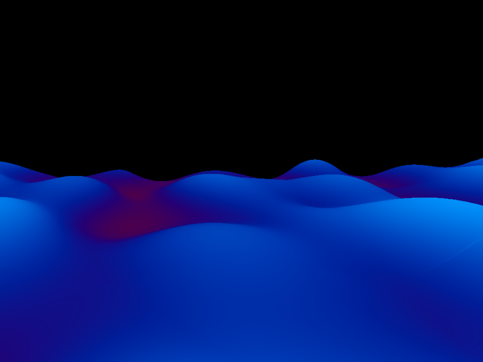
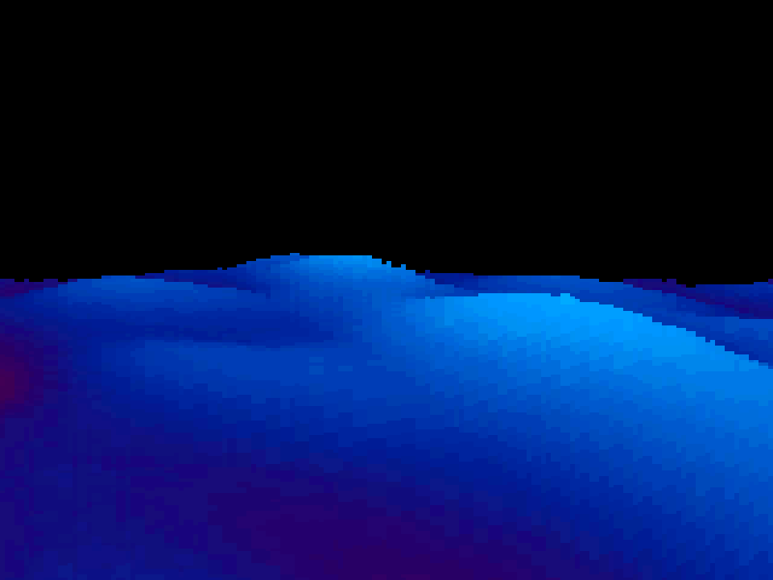

# 3D Sine Landscape

| Modern look | 1993 look |
|---|---|
|  |  |

A low flight over rolling blue hills with purple valleys, under a black sky. The view sways from side to
side as it flies. The hills rise into view from the bottom of the screen at the start and sink away again
at the end.

- **Original:** `COMAN/` by Psi, built as `3DSINFLD.EXE`. The folder name is short for "Comanche", the 1992
  helicopter game whose way of drawing terrain this copies; the demo's notes call the part "3D-Sinusfield".
- **This version:** `Sources/SRMetal/Scenes/SineLandscape/`
- **Length:** 2048 steps, about 29 seconds, then it loops.
- **Canvas:** 320x200, but only 160 columns across: every column is two pixels wide.

**No artwork is used.** The folder contains a background picture, but the finished program never shows it
(see "The background picture that is not there" below).

## Which original files are live

Read from `MAKEFILE`: the program is `main.obj + asm.obj + theloop.obj` plus the two height tables.

| File | Status |
|---|---|
| `MAIN.C` | Live. Start-up, palette, the camera and the main loop. |
| `ASM.ASM` | Live. Screen set-up, `docol` (prepare one column) and `docopy` (column buffer to screen). |
| `THELOOP.ASM`, `THELOOP.INC` | Live. The inner loop: 2,900 lines of assembly that no person wrote (see below). |
| `DOLOOP.C` | Live as a tool: the small program that writes `THELOOP.INC`. One number in it (120) differs from the `THELOOP.INC` that was actually built (140); the built one is followed here. |
| `W1DTA.BIN`, `W2DTA.BIN`, `_W1DTA1/2.OBJ`, `_W2DTA1/2.OBJ` | Live. The two height tables, each split in two halves for linking. |
| `WAVE.H` | Used only to make the height tables (the `CALCW12` switch in `MAIN.C`, switched off in the final build). |
| `KOE.C` | The tool that made `WAVE.H`. |
| `SIN1024.INC` | Live. The shared sine table. |
| `COMBG.LBM`, `COMBG.UH`, `COMBG.X`, `_COMBG.OBK`, `DOPIC.BAT` | Not linked, not shown. A dropped background picture. |
| `MAIN1.C`, `ASM1.ASM`, `DOLOOP1.C`, `DOLOOP2.C`, `DOLOOP.OK`, `DOLOOP.1`, `TMP`, `_W1DTA.OBJ`, `_W2DTA.OBJ` | Earlier versions and scraps. Not built. |

## How the original did it

**A landscape made of two lists.** The ground is not stored as a map. Its height at any spot is one number
from a list for the east-west position plus one number from a list for the north-south position:
`height = wave1[x] + wave2[y]`. Each list has 32,768 entries and holds a few sine waves of different
lengths added together; the first also has a little random roughness mixed in. Because a position is a
16-bit number, both lists wrap round, so the land repeats for ever in every direction. Two lists of
numbers cost 128 KB; a real map of the same area would not have fitted in the machine.

**Drawing by columns.** The picture is built one screen column at a time, from the bottom up. For each
column a ray is sent out along the ground from the eye, a step at a time. At each step the program compares
the height of the ray with the height of the ground there. If the ground is higher, it draws pixels up the
column, raising the ray a little for each one, until the ray clears the ground; then it moves on to the
next step. Nearer ground is therefore drawn first and hides what is behind it, with no sorting. This is
the method the game Comanche made famous a few months earlier, often loosely called "voxels".

A ray takes 128 steps: 64 single steps, then 64 double-length ones (far ground needs less detail).

**Code written by a program.** A loop that tests "which step am I on?" was too slow, so there is no loop.
`DOLOOP.C` is a program whose output is another program: it writes out the assembly for step 0, then
step 1, and so on to step 127, each with its own numbers already filled in (how much a pixel raises the
ray at that distance, how dark that distance is). The result, `THELOOP.INC`, is 128 copies of the same
22 instructions. Programmers call this "unrolling" a loop.

**Fractions in the wrong half.** The ray's height and slope are numbers with a whole part and a fraction.
The loop keeps the fraction in the top half of a 32-bit register and the whole part in the bottom half,
the reverse of normal, so that the whole part can be compared with the ground height directly, with no
shifting. An add then needs a second instruction to carry from the fraction round into the whole part.

**Three touches that give the scene its look.**

- The ray drops one extra unit at every step. That tips the view down at the ground, and because far
  steps are double length it also makes the land seem to curve away.
- A ripple is added to the ground height that depends only on distance from the eye (three waves across
  the visible range). It travels with the camera, so the ground seems to heave as you fly.
- Colour is simply height (halved), made slightly darker with distance. The palette runs from purple in
  the valleys through blue to light blue on the tops.

**Camera.** The heading is a running total of a sine wave, so it swings about 60 degrees to one side and
back, once every 256 frames. Each frame the camera moves forward along the middle column's ray. The two
ground axes are deliberately not at right angles (the second is turned an extra 62 degrees), which hides
the fact that the land is just two lists added together.

**Screen.** VGA "mode X" style: 320x200 with 256 colours, in four separate planes, and two pages shown
alternately so a half-drawn picture is never seen. Columns are drawn into an off-screen buffer arranged so
that it can be copied to the planes four bytes at a time; one column goes to two planes at once, which is
why every column is two pixels wide. Only part of the off-screen buffer is cleared between frames (30 of
its 200 lines), the part where the skyline can be.

**Start and end.** The picture is copied to the screen 160 lines too low at first and one line higher each
frame, so the land rises from the bottom edge. Near the end of its music the original started sinking it
again, and then cut to the next part.

**Speed.** The camera moves once per drawn picture, not once per 1/70 second. A fast PC that could draw a
picture every refresh flew at full speed; a slower one flew proportionally slower.

### The background picture that is not there

`COMBG.LBM` is a 320x90 picture, and `MAIN.C` has code to load its colours and pixels. But:

- the makefile does not link the picture (its object file has been renamed `_COMBG.OBK` so it cannot be);
- `MAIN.C` declares its own 16-byte stand-in called `combg`, so the loading code reads whatever happens
  to lie in memory after those 16 bytes;
- the only code that would put it on screen sits inside `IFDEF PXLSUX` in `ASM.ASM`, and that switch is
  never set. (The name suggests what the coder thought of the picture; "Pixel" was the group's artist.)

The picture itself is a placeholder: 60 blank lines, then 30 lines of two-colour test stripes, with an
all-black palette. So the sky in the finished scene is plain black, and so it is here.

## How this version does it

**The tables are calculated.** `WAVE.H`, `W1DTA.BIN` and `W2DTA.BIN` are all rebuilt at start-up from the
formulas in `KOE.C` and `MAIN.C`. The random roughness in the first table comes out identical because
Microsoft C's random-number generator is simple and well known, and the original used it from its starting
state. The 128 sets of per-step numbers are rebuilt from `DOLOOP.C`'s formulas.

**1993 look: replayed on the processor.** `SineLandscapeModel` does what the unrolled loop did, column by
column, with the same 16- and 32-bit arithmetic and the same off-screen buffer with its partial clearing.
The finished picture of colour numbers goes to the graphics chip through `IndexedCanvas`, which looks the
colours up. This scene could almost have been calculated on the graphics chip instead, but the exact
pixels depend on carries between the halves of those "wrong way round" numbers and on what an earlier
frame left in the buffer, and both are far easier to get exactly right by replaying.

**Modern look: a ray for every pixel.** The graphics chip runs a small program for each screen pixel. It
sends that pixel's own ray out over the same landscape, finds the first place the ground is above it, then
closes in on the exact spot by repeatedly halving the gap. So there are as many columns as the display has
pixels, hills have smooth outlines instead of steps, and the ground has no visible "distance steps". The
colour comes from the original's palette formula worked out directly, without rounding to 128 colours.
The camera glides between steps.

## 1993 versus this version

| | Original (1993) | 1993 look here | Modern look here |
|---|---|---|---|
| Rays | 160, one per 2-pixel column | Same | One per display pixel |
| Steps along a ray | 128 fixed steps | Same | The same 128, then 7 halvings to find the exact spot |
| Height tables | Loaded from the program file | Calculated, identical | Calculated without rounding or roughness |
| Arithmetic | 16/32-bit whole numbers | Same | Floating point |
| Colours | 120 of a 256-colour palette | Same | The palette's formula, stepless |
| Motion | One move per drawn picture | One move and one picture per 2 steps (35 a second) | Glides between moves |
| Sky | Black | Black | Black |

## What was checked

- **Tables against the original files.** `WAVE.H`, `W1DTA.BIN` and `W2DTA.BIN` are reproduced exactly by
  the formulas, every entry (compared in full during development; kept as checksums in the self-test).
  The 128 sets of per-step numbers match those in `THELOOP.INC` (checksums in the self-test).
- **The picture against the original's own code.** A small interpreter, `tools/landscape_reference.py`
  (Python), reads `THELOOP.INC` as text and carries out its instructions one by one, driven by
  `MAIN.C`'s frame logic and the original table files. The 1993 pictures here match its output exactly at
  steps 100, 200, 700, 1300, 1978 and 2046 (and, because each frame depends on what earlier frames left in
  the buffer, in effect at every step up to those). The checksums are in the self-test.
- **That the built program used this code.** The distinctive instruction bytes of `THELOOP.INC` (the
  "140" variant) are present in `THELOOP.OBJ` and in `C.EXE`, the unpacked build; the picture-drawing code
  is absent from `ASM.OBJ` and `C.EXE`.
- **The display path.** The self-test draws the 1993 look on the graphics chip at eight moments and
  compares every pixel with the processor's version.
- **Speed and pictures against a recording.** Four frames of a YouTube recording of the demo
  (`youtu.be/iw17c70uJes`, at 446, 452, 458 and 464 seconds) were compared with 1,900 pictures from the
  reference run. Each matched one picture clearly: numbers 223, 433, 643 and 854. That is 210 pictures
  every 6 seconds, 35 a second, so one picture per two screen refreshes. It also shows the reference run
  produces the pictures the real demo showed, in the same order.
- **The modern look's motion (2026-11-14 review).** `--motion-check sine-landscape modern` over the whole
  loop found no jumps. A self-test follows the camera through one loop and into the next: every glide starts
  exactly where the last one ended, except at the restart, where the land is out of sight on both sides.
- **By eye.** Pictures of both looks at steps 60, 200, 700 and 1300 show the same hills in the same places.

## What was not checked

- Apart from the four recording frames above, nothing was compared with the original program running. The interpreter proves the inner loop
  is replayed correctly; the code around it (`MAIN.C`, `docol`, `docopy`) was ported by reading, and read
  again line by line in the 2026-11-14 review (below), which found no difference. It has still not been run.
- The demo as released runs `3DSINFLD.EXE`, which is compressed. It was not unpacked, so it is an
  assumption that it is the same build as `C.EXE`. `C.EXE` itself is run-length packed by the linker, so
  the height tables could only be found in it in part (about 70% of 1 KB pieces match byte for byte).
- How the original's two video pages behave was simplified (see below), on the strength of reasoning,
  not a test.
- The speed was measured from one recording only. What machine or emulator made that recording is not
  known, and another PC could have run faster or slower.
- The modern look was checked by eye only. It is a smooth re-drawing of the same landscape, not a
  pixel-exact one.

## Inside Play Demo

Since 2026-11-25 the scene follows the music there, as the part did (`COMAN/MAIN.C` 56-62):

- **Black until "music plus" reaches 0** (24 steps in the demo: the part had set its mode, cleared the
  screen and was waiting). The main loop starts on that step; its first picture shows two steps later
  (this version's two refreshes a picture), and the land has risen 160 steps after the cue.
- **The sinking starts on the music.** The part reads "music plus" once at the top of each pass; while it
  is between -29 and -1 the land sinks a line a refresh. In the demo that begins 1,833 steps after the
  cue and lasts 178 steps, so the land is out of sight (160 lines) for the last 18 before the cut. That
  agrees with the recording, where it sinks nearly out of sight.
- **The cut** is the script's: "music plus" at -7. The scene does not start again.

The self-test runs Play Demo silently from this scene and compares the scene's start, first picture and
cut with the script's own cues, and the sinking with the source's -30; both checks were proven to fail
with the cues moved by one.

On its own the scene is unchanged (2,048 steps, its own sink time, then it loops).

## Deliberate differences

- **Speed.** The original's speed depended on the PC. This version draws one picture every 2 steps (35 a
  second), as a PC that needed two screen refreshes per picture would have, and so flies at half the
  speed a very fast PC would. This was measured against a recording of the demo (see "What was checked"):
  the recording shows exactly 35 pictures a second. One picture per step was tried first and was plainly
  too fast. The number is `ticksPerPicture` in the model. The modern look glides between pictures, so it
  is smooth either way.
- **The ending**, on its own. The original started sinking on a music cue; in the recording the land sinks nearly
  out of sight before the next part cuts in (the source alone suggested it would be cut off sooner). Here
  it always sinks all the way out of sight (130 steps), then the scene starts again from a black screen. The
  loop point is therefore invisible. The scene's length (2048 steps, 29 seconds) is this version's choice; the
  original's was set by the music and is about 28 seconds in the recording.
- **The start**, on its own, does not wait for the music as the original did.
- **Video pages.** The original showed each picture one frame late (it drew into the hidden page) and
  relied on 18 cleared lines above the picture to wipe the previous one as it moved. This version simply
  shows black above the picture, which gives the same result as long as the picture moves less than 18
  lines between two uses of a page, which it always does.
- **Unused palette entries.** Colours 240-255 came from stray memory in the original (the missing
  picture) and are never drawn. Here they hold the red ramp the code set just before.
- **Modern look:** no random roughness in the ground (at full resolution it would be a shimmer of
  noise), and the camera's heading turns smoothly instead of in 1/1024-turn notches.

## Kept quirks

- A comment in the generated code says the carry flag is clear at one point; it is not always (it holds
  the result of an unsigned comparison). The replay does what the machine would do, not what the comment
  says. At the six checked steps the pictures come out the same either way.
- The bottom 10 lines of every column are calculated and never shown.
- The lowest 8 colours are black, and heights are wrapped into 8 bits before being halved, so a hilltop
  tall enough and near enough would turn black at its peak.

## Code review (2026-11-14)

**What was reviewed.** Both Swift files against `COMAN/MAIN.C` (`doit` and the palette loop in `main`),
`ASM.ASM` (`docol`, `docopy`) and the start, middle and end of `THELOOP.INC`; `tools/landscape_reference.py`
against the same; a general code review of the folder; and the modern look in motion.

**Found and fixed: nothing.** No difference from the original was found that is not already listed under
"Deliberate differences", and no fault in motion.

**Confirmed correct, by reading:**
- The rise: one line per screen refresh, only while it has not finished (the original also stops it at
  frame 400, long after it has finished).
- The heading: `rot2` first, then `rot`, with C's rounding towards zero, then `rot >> 3`. None of the
  16-bit numbers can overflow over this scene's length, so the larger numbers used here give the same results.
- The column directions and the 16-bit wrap of the position; the camera moving along column 80's ray,
  after that column is drawn.
- `docol`: all four numbers have their lowest bit cleared before the loop.
- `docopy`: column-buffer lines 60-199 go to screen lines 70 + rise and down (the original clears 18 lines
  above them: lines 52-69), anything past line 199 lands in unseen video memory, and lines 68-97 of the
  column buffer are cleared afterwards.
- The palette loop, including which later entries overwrite earlier ones.
- The modern look's shader uses the same geometry as the loop: where the ground is sampled (one step
  ahead, two in the far half), the ray's drop of one unit per step, the slope per pixel, the ripple, and
  the colour offset.
- The glide: one picture is made every two steps and the camera glides across exactly those two steps.
  To have somewhere to glide to, the modern look runs one picture (1/35 second) behind the 1993 look.
  At the end it is fully out of sight from step 2046, two steps before the restart.

**Looked at and left alone.** In the modern look the eight lowest colour numbers are not black as they are
in the 1993 palette, so the "hilltop turns black" quirk does not appear there. It was not seen in any frame.

**Still unverified:** everything under "What was not checked" except as noted there.

**Possible tidy-ups** (not done; for a later `/simplify` pass): `classicReferenceFrame()` converts every
pixel's colour each call instead of converting the 256 palette entries once; `copyToScreen()` clears the
whole screen before overwriting most of it; `tools/landscape_reference.py` has its own small interpreter
instead of the shared `tools/x86interp.py`, and its default folder path does not work from a git worktree
(pass the `COMAN` folder as the first argument).

