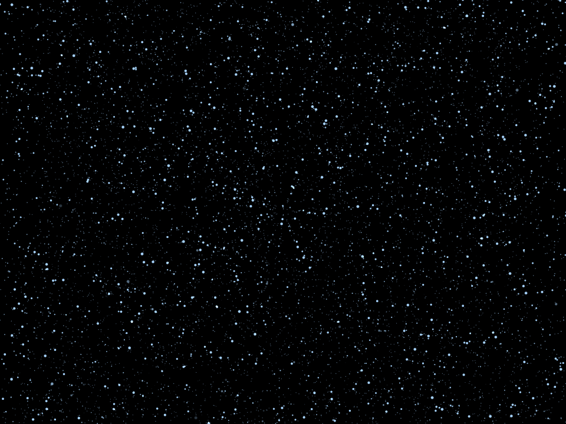
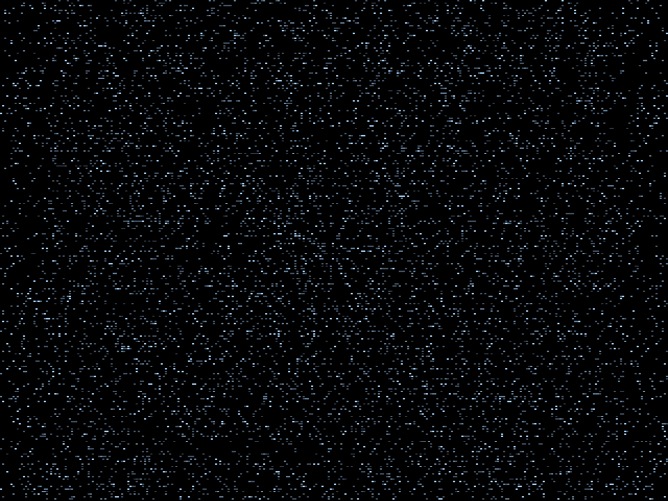

# Hidden Starfield

| Modern look | 1993 look |
|---|---|
|  |  |

Stars streaming towards you out of the middle of the screen, sparse at first and steadily thicker, with the
bottom half of the screen a mirror image of the top.

- **Original:** `DDSTARS/STARS.ASM` by Psi, about 800 lines of assembly, wrapped by the short `KOE.ASM`.
  The demo's part list calls it "Desert Dream Stars": it copies a look from the Amiga demo *Desert Dream*.
  It was a hidden extra, not part of the normal run.
- **This version:** `Sources/SRMetal/Scenes/Starfield/`
- **Length:** 2048 steps, about 29 seconds, then it loops.
- **Canvas:** 320x400, not the usual 320x200 (see below).

## Which original files are live

Only two of the files in `DDSTARS/` make the picture:

| File | Status |
|---|---|
| `KOE.ASM` | Live. Start-up, then calls the star code. |
| `STARS.ASM` | Live. The whole effect. The constants in it (the random-number multiplier, the 1200/1500/3200 step marks, the perspective numbers) are all present in the built program `K.EXE`. |
| `TEXTS.LBM`, `TEXTS.16`, `_TEXTPIC.OBK` | Live. A picture of two panels of text, linked into the program. |
| `POLYEGA.ASM` | Included when building, but nothing calls it. Leftover polygon code. |
| `SIN1024.INC` | Included, never used. |
| `STARS.OK`, `STARS.PRE` | Earlier versions of the star code. Not built. |
| `DOIT1.C`, `DOIT2.C`, `DOIT3.C` | The generators for the Rings/Interference pictures, left here by mistake or habit. Nothing to do with stars. |
| `KR.C`, `TEST/KOE.C`, `FLIP.INC` | Scratch experiments. Not built. |

## How the original did it

**The screen.** The program asks for the old EGA mode with 320x200 pixels and 16 colours, then switches off
the card's line-doubling. That turns 200 fat lines into 400 thin ones. Stars are only ever put on every
second line, so each star is one pixel wide and half a normal pixel high, with a black line under it.

**The trick: a film loop that is never wiped.** A 486 could not move thousands of stars 70 times a second.
So the program moves only 512, and does not draw them on the screen at all:

- It keeps 64 small pictures (320x100, four colours) in spare memory. Spare memory here means EMS, a way
  for DOS programs to reach memory beyond their normal 640 KB.
- Each step it takes the next picture in the ring, adds a dot for each of its stars, and copies that
  picture to the screen.
- **It never clears a picture.** 64 steps later the same picture comes round again, still holding its old
  dots, and gains new ones.

Because every star moves steadily, a dot left 64 steps ago and the dot added now look like two stars
following each other along the same path. So the 64 pictures are a short film loop that plays seamlessly
and gets denser every time round, for the cost of moving 512 stars. After about a minute it would look
like a snowstorm.

**The mirror.** The bottom half of the screen is not calculated. It is the picture from half-way round the
ring (32 steps away), copied upside down. Only stars above the horizon are ever drawn.

**Stars.** Each star has a random place (two numbers from -512 to 511) and a depth held in one byte, 255
far to 0 near. Depth drops by 2 per step. When it runs out, the star gets a new random place and starts
again from the far end. Screen position is "place times 288 (across) or 216 (down), divided by distance",
with distance = 150 + 4 x depth, looked up in two 256-entry tables built at start-up.

**Colour.** Three shades of blue-grey by depth: dim when far (depth 180 and up), medium, and bright when
near (under 110). Two stars landing on the same pixel combine their colour numbers.

**Random numbers.** The program has its own generator. It uses the same two constants as Microsoft C's
`rand()` but returns a different part of the result, so it is not the same sequence.

**Timetable** (in steps; nothing is tied to the music):

| Steps | What happens |
|---|---|
| before 1 | 100 steps are run unseen, so the first picture is not empty |
| 1-33 | The palette fades up from black |
| 1-900 | 512 stars, let in one more per step, are added to the loop |
| 901-1200 | Nothing is added or moved. The finished 64-step loop simply replays. |
| 1201 on | 1024 stars, and each dot is also put into the picture 17 places further on, so density grows four times as fast |
| 1456-2700 | A text panel opens across the middle, then closes |
| 1500 | The stars are switched off and let back in, four per step |
| 3456-4700 | A second text panel |
| until a key is pressed | It never ends by itself |

The text explains that this was "just an experiment we left out", and jokes about why the demo was late.

## How this version does it

| | 1993 | This version |
|---|---|---|
| The 64 pictures | In EMS memory, as two bit planes each | Ordinary arrays, one small number per pixel |
| Getting them on screen | Copied into video memory one colour plane at a time | Handed to the graphics chip with a palette |
| Perspective tables | Built at start-up by integer division | Built the same way, same numbers |
| Modern look | - | Each star's flight is remembered and drawn afresh every frame |

### 1993 look

This is the "replay it on the processor" kind (see [how-it-works.md](../how-it-works.md)). The picture
depends on dots left behind in memory over the whole run, so it cannot be worked out from a formula for one
frame. The model does exactly what the assembly does: the same random numbers, the same integer rounding,
the same 64 pictures that are never cleared, the same mirror. The graphics chip only looks up colours.

Kept quirks: a star is not drawn on the step it is given a new place; overlapping stars combine colour numbers; odd
screen lines stay black; the palette runs one step ahead of the picture.

### Modern look

The pictures cannot simply be scaled up, so the model also keeps a list of "flights": one entry for each
unbroken run of a star being drawn (where it was, when it started, how deep, when it stopped). The shader
asks, for every flight, "which dots of yours are in the picture that is showing now?" and draws them, using
the original's perspective formula without the rounding.

- Stars are soft round points, larger and brighter the nearer they are. The original's were all one size.
- They glide between steps, and the fade glides too.
- Brightness changes smoothly with depth instead of in three bands.
- A star eases in and out over a few steps instead of popping.
- Overlapping stars add their light.
- The mirror, the growing density and the 64-step loop are all kept, because the same rules place the dots.

## What was checked

- **The live source is the built source.** The constants in `STARS.ASM` are present in `K.EXE` (the
  program the makefile builds and copies to the demo as `DDSTARS.EXE`).
- **The original's own code agrees.** `tools/starfield_reference.py` reads
  `STARS.ASM` as text and carries out its star routines one instruction at a time in the project's small
  x86 interpreter: the random numbers, the set-up of the stars and the two perspective tables, `staradd`
  and `staradd2`. The Swift model gives the same perspective tables, the same first stars, and the same
  whole 320x400 screen at 15 steps chosen either side of every mark in the timetable (1, 2, 33, 64, 500,
  900, 901, 1200, 1201, 1217, 1499, 1500, 1501, 1700, 1984; self-test). This does not depend on
  anyone's reading of those routines: the random numbers; the perspective tables; star set-up and the
  100 unseen steps; the let-in limit and its two step sizes; re-placing a star that has flown past; the
  row and column limits; the three colour bands; dots combining; the echo 17 pictures on. (One detail it
  settled: the original takes a star's depth, subtracts 2, and uses the *result* both to place the dot
  and to pick its colour: `movzx bx,[si]` / `sub bl,2` / look up the tables with `bx`.) What the tool does *not* run from the original is listed
  under "What was not checked".
- **Modern against 1993.** In saved pictures at step 1100, about 99% of lit 1993 pixels had a modern star
  within 3 pixels (104 of 14,844 did not).
- **Modern look in motion.** `--motion-check starfield modern` over the whole loop found
  no jumps; the change from one picture to the next stays smooth across steps 1, 33, 900/901, 1200/1201,
  1217, 1500, 1984/1985 and the loop point.
- **The graphics chip matches the processor** pixel for pixel at eleven moments (self-test). For this kind
  of scene that proves only the display path.
- **The loop.** After 2048 steps the model is back at its starting state, and the last frame before that
  is one fade step from black (self-test). The restart shows one fully black step in both looks, then
  the fade-in starts at its second level.
- By reading: the mirror, the timetable, the fade and its one-step lead.

## What was not checked

- **Nothing was compared with the original program running.** No DOS emulator was used. Where each dot
  goes within a picture is now checked against the original's code (above). These parts still rest on
  reading `do_stars` and the video set-up (read twice): that switching
  off line-doubling gives 400 separate lines with stars on the even ones; the order of the palette change
  and the page swap; the step marks (900, 1200, 1500) and which routine runs when; and the EMS page
  arithmetic (that the ring really is 64 pictures and "17 further on" and "32 further on" mean what they
  appear to). The reference tool writes these parts in Python from the same reading as the Swift.
- The palette values and the fade were checked by reading only.
- The third-party C++ port was looked at only to confirm it also uses a 320x400 screen and the same
  timetable marks. It was not run or compared pixel for pixel.
- The perspective tables have no original data file to compare with: the original calculated them too.
- Modern look: the middle of the star field is half a canvas pixel (1/640 of the width) right of the
  1993 look's. Too small to see. When a star's run ends, its leading dot disappears at once (as in the
  1993 look); the ease-out only softens the replayed copies.
- `tools/x86interp.py` stops with an error on a shift by a count of zero held in CL (`shr ch,cl`), which a
  real processor treats as "do nothing". The starfield tool works round it.

## Differences from the original

- **The text panels are left out.** They are exported as `artwork/original/starfield-text-panels.png`
  but not shown.
- **It ends, and loops.** The original ran until a key was pressed, getting ever denser. This version stops
  adding stars after step 1984, plays the finished loop for the last 64 steps while fading to black (the
  original's 33-step fade-in, run backwards), and starts again from black. Step 1984 was chosen by eye:
  dense, but still clearly stars.
- **Each loop is identical.** The random numbers start from the same seed every time round, as they did
  every time the original was started.
- **Modern look only:** the changes listed under "Modern look" above.
