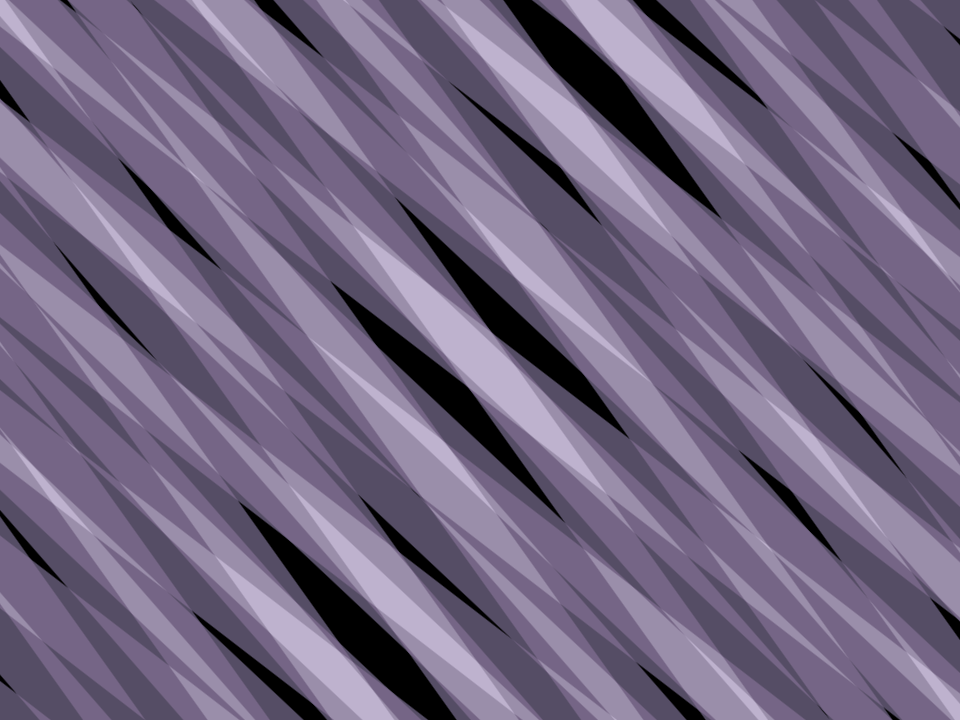
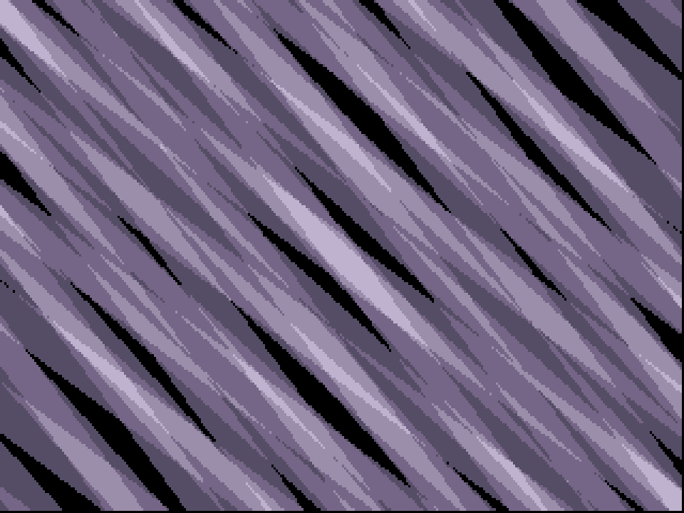

# Techno Bars

| Modern look | 1993 look |
|---|---|
|  |  |

Eleven parallel bars spin about the middle of the screen, their thickness bouncing, leaving ghost trails
that brighten where they overlap. The bars flash on the beat.

- **Original:** `TECHNO/KOE.C` (`doit1`, `doit2`, `doit3`) in C, with the drawing in `TECHNO/KOEA.ASM` and
  `TECHNO/POLYCLIP.ASM`, by Psi.
- **This version:** `Sources/SRMetal/Scenes/TechnoBars/`
- **Length:** about 28 seconds in three sections, then it loops.

| Section | Length | What happens |
|---|---|---|
| 1 | 6 seconds | Steady spin; thickness bounces gently |
| 2 | 12 seconds | Spin keeps accelerating; the bars shrink to nothing and bounce back |
| 3 | about 10 seconds | The same, with the whole set of bars circling the screen, until it slides off to the right |

## How the original did it

### The trails cost nothing

The video mode stored each pixel as four separate on/off layers (bit planes). The program also had eight
screens' worth of video memory ("pages") and could switch which one was shown instantly.

Each frame it:

1. drew the bars as a one-colour picture,
2. copied that picture into just **one** layer of the current page,
3. told the card to show that page, and
4. moved on to the next page. After all eight pages, it moved on to the next layer.

So each page gets a new frame every 8 frames, each time in a different layer. When a page is shown, its
other three layers still hold the bars from 8, 16 and 24 frames earlier. Nobody erased them.

The palette then does the shading: a pixel's colour depends only on how many of its four layers are on,
from black (none) to brightest (all four). Ghost trails and overlap shading are simply old frames showing
through.

Section 3 uses four pages instead of eight, so its ghosts are 4, 8 and 12 frames old.

### Filling shapes by flipping one pixel per row

Filling 11 bars pixel by pixel would be too slow. The original instead:

1. trims each bar to the screen,
2. for each edge of each bar, flips a single pixel on every row the edge crosses, and
3. sweeps every row once from left to right, switching "inside" on at the first flipped pixel, off at the
   next, and so on.

Step 3 fills every shape at once, and is done by table lookup a byte at a time while copying the picture
to video memory. So the only per-bar work is marking the edges.

### The bounce

Thickness behaves like a ball under gravity: a speed is added to it each frame, the speed grows by one
each frame, and when the thickness hits its lower limit the speed is reversed.

### The flash

The palette is swapped for a brighter version on every 8th row of the music, then steps back down over the
next 15 frames.

### The slide-off

In section 3 the bars are drawn into the right half of a double-width screen, and the video card's window
is slid across to the empty left half. The bars leave to the right without being redrawn any differently.

## How this version does it

### 1993 look

The processor replays the original's steps: the same eight pages and four layers, the same edge-marking
fill, the same screen-trimming code, all with the original's whole-number arithmetic. The result is a
picture of colour numbers and a 16-colour palette, which the graphics chip turns into colours.

This is the approach to use when the picture depends on what was left behind in video memory, which is the
whole point of this scene.

### Modern look

No pages, no layers. For every pixel of your display, the shader asks four questions: is this pixel inside
the bars as they are now, as they were 8 steps ago, 16 steps ago, and 24 steps ago? It adds up the answers
and shades by the count. "Inside a bar" is a short calculation: rotate the pixel's position into the bars'
frame, and see whether its distance across the bars falls in a bar or a gap.

- Edges are softened over one screen pixel, so the count changes smoothly at edges.
- The bars glide between steps. To do that, the picture runs one step behind, so that there is always a
  "next" position to glide towards.

| | 1993 | This version (modern look) |
|---|---|---|
| Trails | Old frames left in other bit planes | The bars' recent history, tested per pixel |
| Overlap shading | Palette colours by number of planes on | The shader counts and picks the shade |
| Filling bars | Flip edge pixels, sweep each row | Not needed; each pixel tests itself |
| Trimming to the screen | Hand-written clipping code | Not needed |
| Slide-off | The video card's window moves | The shader adds an offset |

## What was checked

- **The graphics chip matches the processor** pixel for pixel at ten moments across the three sections
  (self-test).
- **The fill routine** fills a plain rectangle with exactly the expected pixels, left and top edges
  included, right and bottom not, which is the original's rule (self-test).

### What was not checked

Unlike the tunnel and the rings, this scene has no data files to compare against. Its 1993 look depends on
the port of the drawing and trimming assembly being right, and that was verified by careful reading, not
against a running copy of the original. The self-test cannot catch a mistake there, because the processor
does all the work and the graphics chip only looks up colours. A bar edge could be off by a pixel somewhere.

## Differences from the original

- **The beat is recreated.** With no music, the flash timing comes from the song file's own settings
  (speed 3, tempo 130), which gives a flash about every half second. It is not tied to anything.
- **Left out:** the original's lead-in (a white flash, then four columns dropping to black on four beats)
  and the picture that scrolls in after the slide-off.
- **It loops.** After sliding off, the scene starts again from section 1.

### Quirks that were kept

These are how the original code behaves, and they affect pixels, so the 1993 look reproduces them.

- The bottom row of the screen is never drawn.
- The second frame of section 3 places the bars far off the screen, giving one blank frame.
- Video memory is not cleared between sections 1 and 2, so section 1's last frames linger as ghosts for a
  moment.
