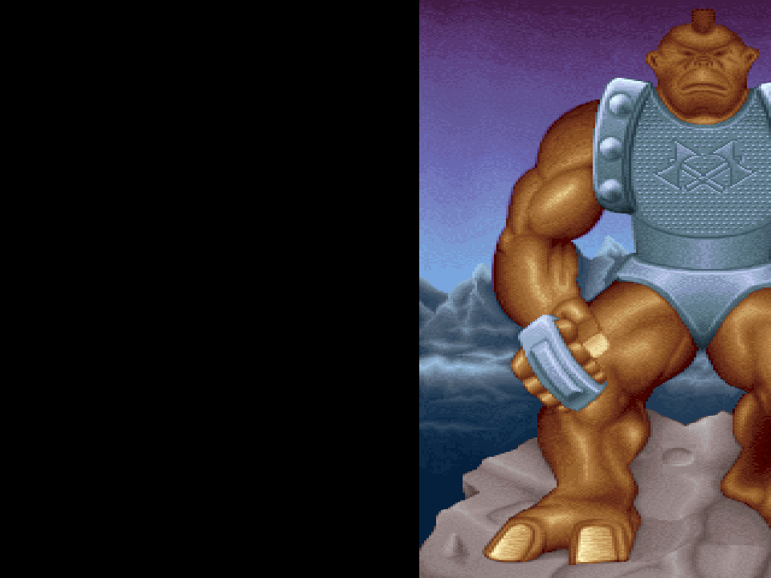
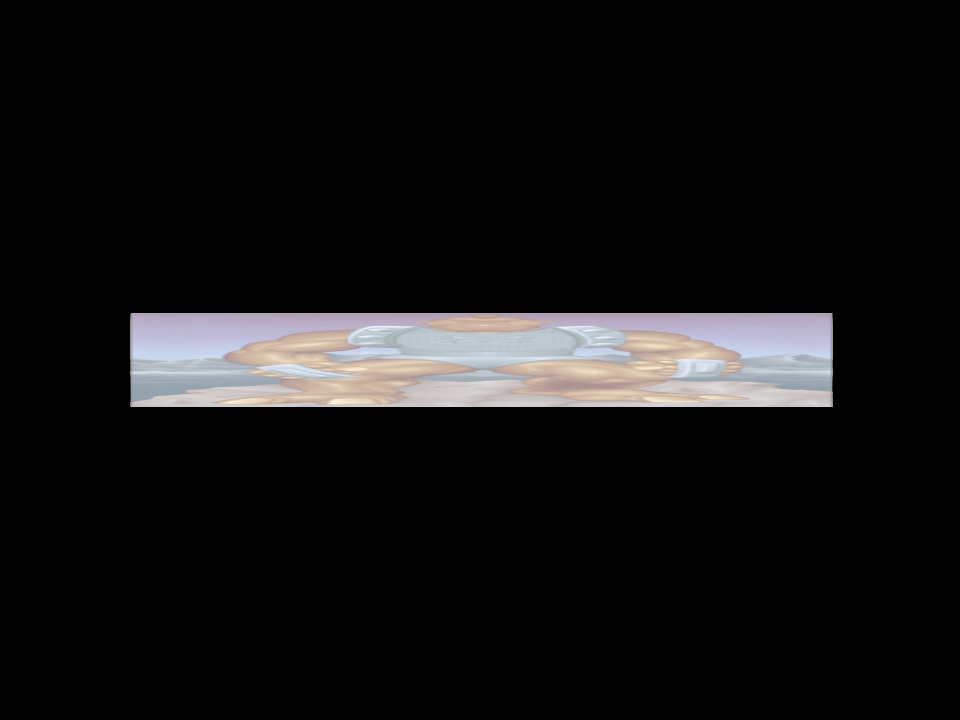
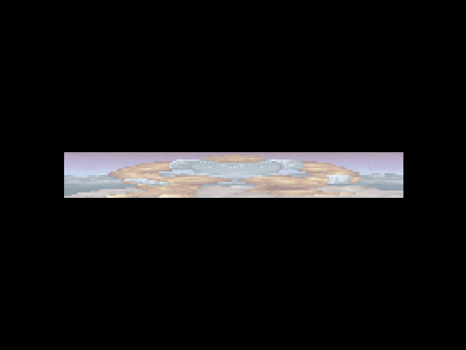

# Troll and Screen Switches Off

| | Modern look | 1993 look |
|---|---|---|
| Troll (scrolling in) |  |  |
| Screen Switches Off (collapsing) |  |  |

The end of the techno part and the part after it. When the techno bars have slid away, a troll scrolls in
from the right, faster and faster, lands with a shake and a flash, and stands there. Then the screen
"switches off" like an old television: the picture squashes into a thin band, then a bright line, which
shrinks to a dot that blinks twice and goes out.

- **Original:** the troll is the last section of `TECHNO/KOE.C` (Psi); the switch-off is
  `PANIC/SHUTDOWN.C` (Wildfire), built as `PANICEND.EXE`. The troll picture is signed by Pixel.
- **This version:** `Sources/SRMetal/Scenes/Troll/` and `Sources/SRMetal/Scenes/SwitchOff/` (added
  2026-11-24). Both are in the sidebar.
- **Length:** the troll waits (35 steps on its own, for the music in Play Demo), scrolls 53 steps, shakes
  50, then holds. The switch-off is 191 steps (2.7 seconds); on its own it shows the troll for a second
  first.

**These scenes use original artwork:** the troll picture, `artwork/original/rgb/07-troll.png` (320x400).

## How the original did it

### The troll

The techno part drew the troll on the right half of a video page twice the screen's width, with the left
half black, and showed the left half. At the music's cue (section 35, row 48) it moved the view right
each refresh by `xpos += xposa / 4`, adding 1 to `xposa` each time, until `xpos` reached 320 and the troll
filled the screen: 53 refreshes, starting slowly. Moving the view was nearly free: the card was simply
told to start reading the screen elsewhere.

Then 50 refreshes of shake: `xpos = 320 + sin(ripple) / ripplep`, the divisor growing by a quarter each
time (to at most 1024), so the shake dies away. During its first 16 refreshes the palette was brightened by
45, 42, 39 ... 0 levels (every colour, black included): a flash. Then the troll held until the music moved
on to the next part.

### The switch-off

The switch-off program found the troll still on screen and played tricks with the card's registers:

| Refresh | What the card was told | What shows |
|---|---|---|
| 0 | nothing yet | the troll |
| 1 | show each memory row twice; start at row 100, where a quarter-height copy had just been made; colour 0 to white; palette 3/64 towards white | the troll squashed to half height on a white screen |
| 2 | also skip every other row; colour 0 black again; 20/64 towards white | squashed to a quarter |
| 3 to 13 | copy rows of the troll into a band of `a` rows (shown twice), a = 32, 26, 21, ... 3 (each 5/6 of the last); black above and below; (63 − a)/64 towards white | thinner and whiter bands |
| 14 | wipe the two rows around the middle | one line: troll row 133, almost white |
| 15 to 61 | each refresh, set 4 pixels at each end of the line to black, moving inwards | the line shrinks to the centre |
| 61 to 190 | one pixel in colour 1 at the centre; its brightness follows a cosine over 60 refreshes; then `sleep(1)` | a dot that blinks twice and fades |

The palette washes towards white except colour 0, which the troll uses (as its only pure black) for the
black on each side, so those stay black. The line's last 20 pixels at each end are never wiped, but they are
in that black border, so nothing shows.

## This version

**Troll** (`TrollModel`): the original's loops, one refresh per step: the same `xpos`, `xposa`, `ripple`
arithmetic (with the shared sine table) and flash values, the flash one refresh after the shake value it
was set with, as in the original. Inside Play Demo it starts on the same music cue (`demoUpdate`). The
self-test checks the scroll takes 53 refreshes and the shake 50, the same as the timing research
(`tools/demo_timeline.py`) worked out.

**Switch-off** (`SwitchOffModel`): for each refresh, which troll row each of the 400 screen rows shows,
how far the palette has washed out, which pixels of the line are wiped and the dot's brightness, all
worked out from what the original told the card (table above). A self-test check holds the numbers: the
bands, the line at refresh 14, the dot from 61, 191 refreshes.

**1993 look:** both scenes are drawn by whole pixels and the original's colour rules; the self-test compares
the graphics chip with the same rules worked out on the processor at 35 moments: all identical.

**Modern look:** the troll is the Super-xBR picture (8x). Its scroll, shake and flash glide smoothly between
refreshes. In the switch-off the picture is squashed smoothly into each band (smoothing only up and down,
so the black sides stay crisp), and the dot is a small soft glow.

## Limits and choices

- The original's very first switch-off refresh may also have shown a sliver of the previous picture,
  depending on exactly when the card picked up each register change; this version shows the intended
  frame for each refresh.
- What lay in the left half of the double-width page before the troll scrolled in is taken to be black
  (the techno bars had just slid off).
- Not compared with the original running.
