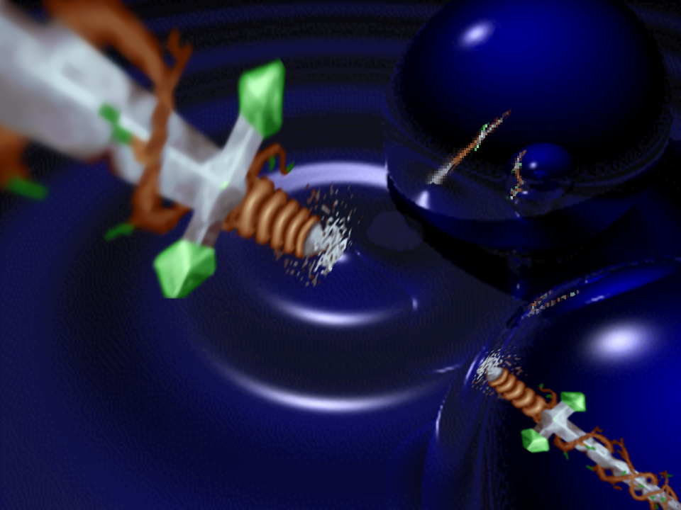
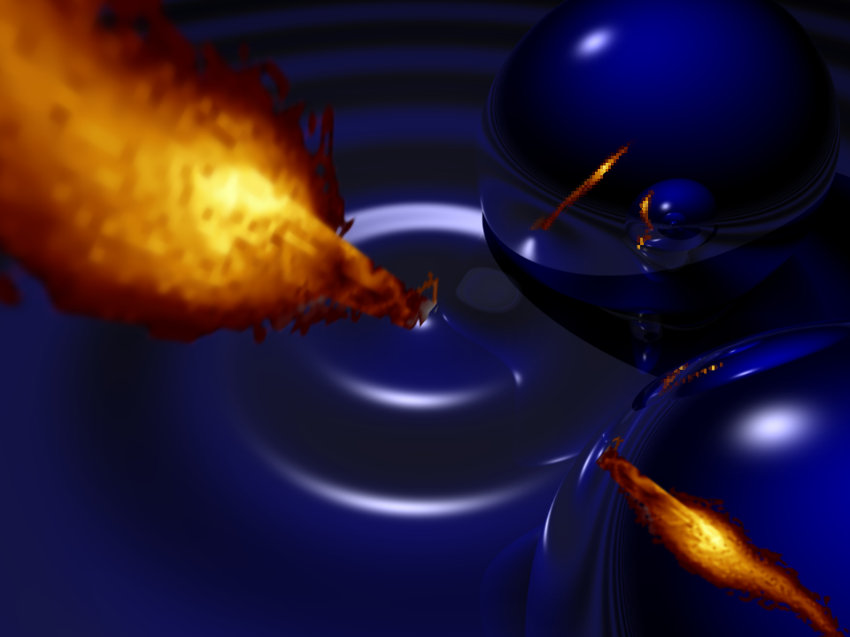

# Water Scroller

| Modern look | 1993 look |
|---|---|
|  |  |

A ray-traced picture fades in: dark blue water with ripples and two chrome balls. After a few seconds
a flame comes skimming over the water towards the viewer, and behind the flame a sword, trailing sparks.
All of it is mirrored, small and bent, in both balls. Part 13 of the demo, after the bouncing dots and
before the 3D sine landscape. It is called a scroller, but there is no text in it.

- **Original:** `WATER/DEMO.PAS` (about 190 lines of Turbo Pascal) and `WATER/ROUTINES.ASM` (one routine,
  `putrouts1`, 20 instructions), by Trug. Built into `RAYSCRL.EXE`. `DATGEN.PAS` made the position
  tables; `TESTI.PAS` and `KOE.PAS` are experiments. The same technique as the
  [Mountain Scroller](mountain-scroller.md), by the same coder.
- **This version:** `Sources/SRMetal/Scenes/WaterScroller/`; the table reader and the
  Modern look's map are shared with the mountain scroller (`Core/ScrollTables.swift`).
- **Length:** on its own 2,044 steps (about 29 seconds): black, 127 steps of fading in, 519 of the still
  picture, 1,332 of the sword passing, 65 of fading out, then it starts again. In Play Demo it follows
  the music as the original did, and the music gives exactly those lengths (see below).

**This scene uses original artwork and data:** the background picture, the sword picture and three
position tables, in [Data/Water/](../../Data/Water/README.md) (154 KB), and for the Modern look the
background rendered again from its original scene file (0.9 MB). The tables cannot be calculated; see
below.

## How the original did it

1. **Nothing is ray-traced while it runs.** The background is a finished picture (made with POV-Ray; some
   of its scene files are still in `WATER/`). The sword is another finished picture, `MIEKKA.SCI`
   ("miekka" is Finnish for sword): 400 pixels wide and 34 rows tall, with a flame at its front and
   sparks behind.
2. **Position tables.** The program keeps a window on the sword picture, 158 columns by 34 rows. For every
   cell of the window a table lists the screen pixels where it shows: on the water, and again in each
   reflection. Near the viewer one cell covers up to 24 pixels; in the small reflections most cells
   cover none. The tables were made beforehand: the scene was ray-traced with a special surface on the
   water whose red channel was the sword column and whose green channel was the sword row, and
   `DATGEN.PAS` turned those pictures into lists. The ray tracer did the mirroring; the program only
   reads lists.
3. **Three tables, a third of a column apart.** The scene was traced again with the sword moved a third
   of a column each time, and each table lists only the pixels that changed from one tracing to the
   next, so the three share no pixel. The program draws one table per screen refresh (1, 2, 3, 1, ...)
   and after the third moves the window one column. The sword creeps in thirds of a column, and each
   refresh only about a third of its 20,858 pixels are written.
4. **Drawing a pixel** is a choice: the cell's colour number if the cell has sword in it, otherwise the
   background's own pixel again (which is how the sword is wiped off behind itself). The sword has its
   own colours, 192...255; the background uses 0...191. (The mountain scroller adds numbers instead.)
5. **The fades are done on the palette**, and they have a slip in them. The fade-in loop runs 127
   refreshes and raises every colour one level on every second one. But its inner loop steps through
   four bytes per colour instead of three, and the fourth byte is the next colour's red. So red rises
   two levels a round, green and blue one: the picture comes in with pink highlights that turn white as
   green and blue catch up. The fade-out has the same slip the other way: red leaves first, and the
   picture goes out in blue. (The loop also ends one level short, so green and blue stop at 62 of 63
   until the fade-out's first pass sets them.)
6. **Three music cues.** The part starts black and waits for "music plus" ≥ 0 (20 refreshes in the
   demo), then fades in. Then it sits in a loop with only the picture showing until the music is in its
   next section at row 16 or later: 519 refreshes, 7.4 seconds. The sword then runs until "music plus" =
   −11, and the part fades out over 65 refreshes while the sword keeps moving.
7. **The window starts empty**, and the sword comes in at its far end. The sword's last 40 columns are
   empty, so (unlike the mountain scroller's text) nothing is left smearing when it has passed.

## This version

**The data.** The five original files are loaded as they are. The tables could not be worked out again:
`DATGEN.PAS` read four ray-traced pictures (`k1`, `k2`, `k3`, `k5.mtv`) that are not in the source
release. One such picture is there, `MASK.MTV`, but it is from an earlier trial and fits the tables
nowhere; even `GREEN.CLX` is not quite the one used (78 of its 20,858 addresses disagree with the
tables). The files are the released version: the built part in the source release (`RAYSCRL.EXE`,
unpacked) contains all five whole. (`MIEK.OBJ` in the source folder is an older sword; `MIEKKA` is the
one used.)

**1993 look:** the original's 320x200 screen, kept from step to step and changed exactly as the program
changed it: one table a step, the window moving after the third, both fades in whole levels with red
running ahead. Shown through `Core/IndexedCanvas.swift`. Steps are paired with the screen as in the
mountain scroller.

**Modern look:** drawn afresh every frame.

- The background is ray-traced again from the original scene file, at 8 times the size (2560x1600): see
  "The background, rendered again" below. The sword is its own picture made 8x by Super-xBR (as for the
  mountain scroller's text), as two pictures: its colours on black, and
  its outline.
- The sword's place comes from the same tables, turned into the smooth map the mountain scroller uses:
  every pixel gets a best-fit plane through the places where its neighbours' sword coordinates step, and
  each screen pixel blends the planes around it. The sword then glides instead of creeping.
- The small reflections (regions of fewer than 1,000 pixels, 437 pixels in all) are different: there a
  whole stretch of sword falls inside one pixel, and no plane can be fitted. Each of those pixels keeps
  its own cell and shows the average of the stretch of sword it covers.
- A mask of where the sword may show, also made 8x, gives it a smooth edge where a ball is in front.
- The fades follow the original's rule, red twice as fast, without the whole-number steps.

| | Original | 1993 look | Modern look |
|---|---|---|---|
| Sword movement | a third of a column a refresh, a third of the pixels at a time | the same | continuous |
| Sword near the viewer | blocks up to 24 pixels | the same | smooth but soft (see below) |
| Background | 320x200, 190 colours, dithered | the same | ray-traced again at 2560x1600, full colour |
| Fades | red twice as fast, whole levels | the same | red twice as fast, smooth |
| Green and blue after the fade-in | stop at level 62 | the same | reach the full colour |
| Still picture before the sword | 7.4 s (waiting for the music) | the same, also on its own | the same |

## The background, rendered again

The scene file that made the background is still in the source release: `WATER/KK.POV`, for POV-Ray 1.0
(1992). `tools/water_background.py` renders it with POV-Ray 3.7 at 2560x1600 with smoothed edges, and
the result ships as `Data/Water/BACKGROUND-POVRAY.png`. POV-Ray is needed only to make that file again;
the app and `build.sh` never run it. Rendering takes about two seconds (in 1993, at a guess, a day).

Two things had to be put right before 3.7 gave the 1993 picture, both found by measuring:

- **The fog.** The scene has black fog, which is what makes the picture so dark. POV-Ray 3.7 leaves fog
  out while the camera is inside a solid object, and the scene's sky, a plane high above, counts
  everything below it as its inside. One added word, `hollow`, on that plane brings the fog back.
- **Half a pixel.** POV-Ray 1.0 took each pixel's sample at the pixel's lower left corner, 3.7 at its
  centre. The tool writes the camera out as plain vectors and nudges it half an original pixel left and
  half down. Each original pixel is then exactly the middle of an 8x8 block of the new picture, which is
  where the sword's map and masks expect it.

That nothing else is needed is known from `WATER/DATA.TGA`: a raw 160x100 POV-Ray 1.0 output of the same
scene, left in the folder. Its pixel (x, y) equals the shipped background's pixel (2x, 2y+1) to within
the palette's steps, so Future Crew did not retouch the picture, and the darkness is the renderer's.

With both fixes, the new picture scaled back down is within 8 (of 255) of the original at 92% of pixels
and within 32 at 99.4%. What still differs: the highlights on the ripples sit up to a pixel differently
and are up to a fifth brighter or dimmer (cause not found); the original's checkerboard dither and colour
bands are gone (they came from reducing the picture to 190 colours); and the speckled rims of the balls
turn out to be fine reflected rings that one sample per pixel could not show.

`R1.POV` to `R5.POV` and `RGB.TGA` are the scene with mirror surfaces and a colour-ramp strip, the way
the position tables were made, but not the versions that made the shipped tables: the tables still
cannot be made again.

## Checks

- `tools/water_reference.py` checks the tables' structure (each parses exactly, they share no pixel,
  20,858 pixels in 14 regions), compares them with `GREEN.CLX` and `MASK.MTV`, shows which way the three
  tables order (67% of neighbouring pixels within a third of a column one way, 52% the other), reports
  the palette facts above, and replays the part from the original files, printing checksums at 35 steps.
- The self-test compares the app's 1993 pictures with that tool at those 35 steps (all identical), the
  palette at three moments of the fades, the five data files' checksums, that the tables share no pixel
  and cover 20,858, that the smooth map keeps the large regions' pixels inside their own third of a
  column (95%) and row (99.9%) and the 437 small ones on their own cell, and the loop after 2,044 steps.
- In a silent Play Demo run it checks, against the demo script's own numbers, that the fade-in, the
  scroll and the fade-out start on the very steps the script gets past its three music cues, that the
  sine landscape follows 65 steps later, and that the scene on its own uses the same lengths.
- The Modern background: the file's checksum, and the still picture as the Modern look DRAWS it (at
  320x200) against the original background: 90% of pixels or more within 8 of 255, and a better fit in
  place than moved one pixel in any direction. Seen to fail with the background drawn one pixel off,
  with a picture rendered without the half-pixel nudge, and with one rendered without the fog.
- Each was seen to fail with the detail broken on purpose: red not doubled, the scroll a step early, the
  tables taken in the other order, the section cue a row early, the fade-out cue a row early, the new
  column put straight into the window's last cell.
- `--motion-check water-scroller modern`: no jumps while the sword moves; it marks the three half-steps
  where the fade-out begins (red starts dropping two levels a step).

## Differences and limits

- Modern: near the viewer one sword pixel is stretched over about 25 screen pixels, more than any
  scaler can fill in, so the sword's near end looks out of focus where the 1993 look shows big blocks.
  (Scaling the sword 16x instead of 8x made no visible difference.)
- Modern: the small reflections are still drawn one 320x200 pixel at a time (each an averaged colour)
  and stay coarse.
- Modern: green and blue reach their full colour after the fade-in.
- Modern: the background is a new rendering, so its ripple highlights differ slightly from the
  original's and its dither is gone (see above). The sword on it is still the 1993 picture scaled up.
- The original drew straight onto the screen being shown; any tearing that caused is not copied.
- Taken from the original, not from the C++ port: the port runs 126 fade waits, not 127, and fixed the
  red slip (both fades loop `pf := 0 to 3`, so each colour's red moves twice per round); this version
  keeps both as the original has them.
- Not compared with the original running.
