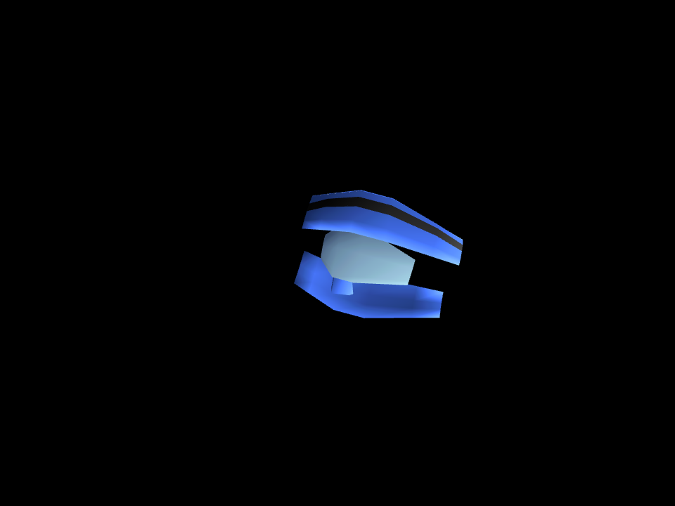
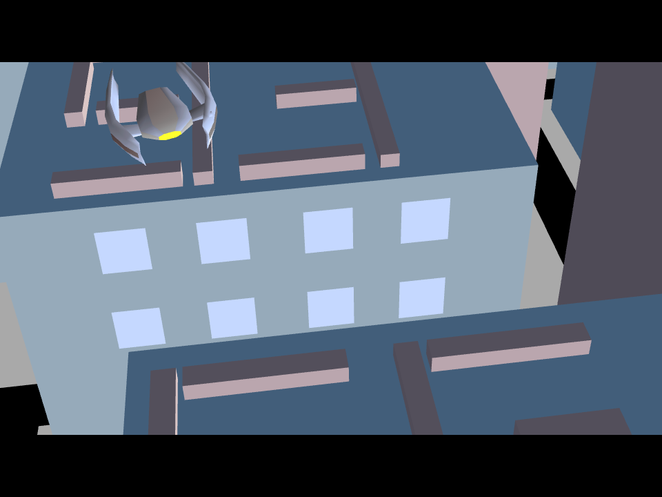
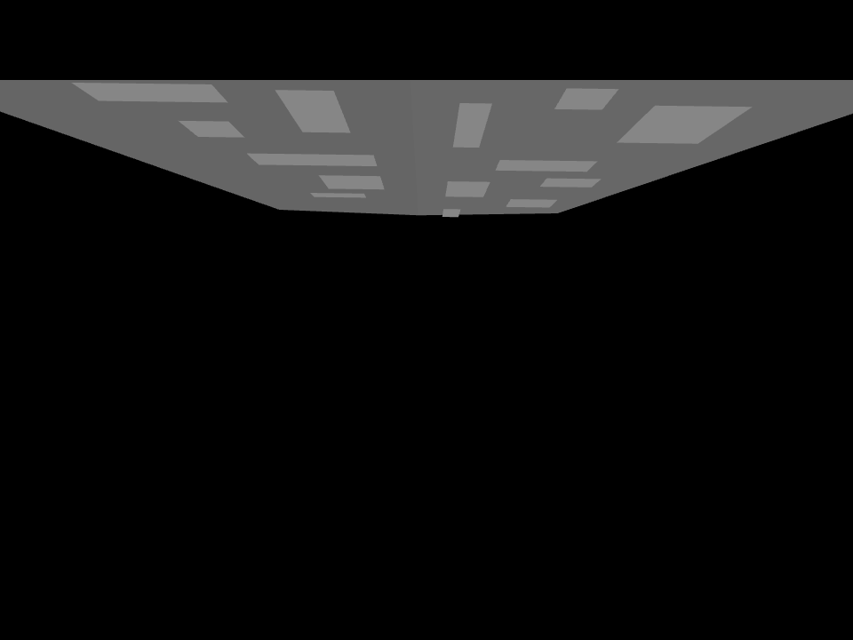
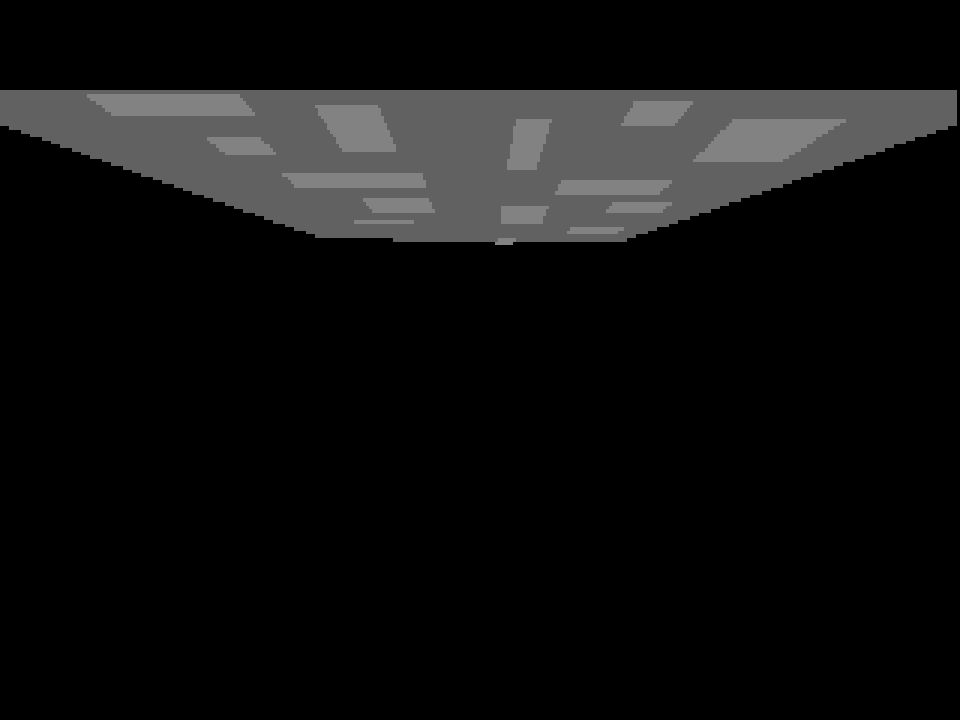
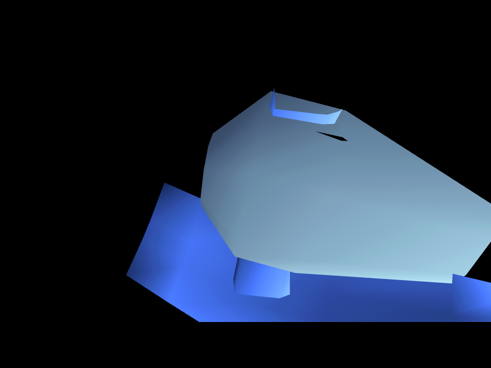
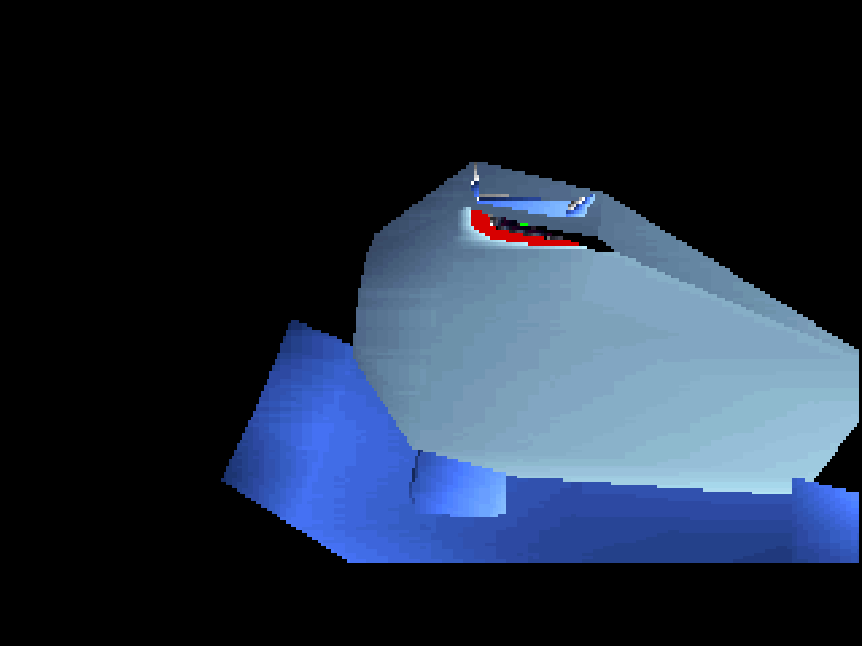

# The VISU 3D engine

| | Modern look | 1993 look |
|---|---|---|
| A small ship alone |  |  |
| City, animation frame 800 |  |  |
| Ships, animation frame 60 |  |  |

Two parts of Second Reality are real 3D: the **ships fly-by** near the start (`U2A.EXE`) and the **3D
city** near the end (`U2E.EXE`). Both are the same program with different data. The shared part is a
small 3D engine its author (Psi) called **VISU**, about 4,000 lines of assembly and a little C.

This page describes that engine, the data it reads, and this project's version of it. The engine is
checked by itself, apart from the two scenes that use it
([scenes/ships-flyby.md](scenes/ships-flyby.md), [scenes/city-3d.md](scenes/city-3d.md)), so a wrong
picture can be traced to either the engine or the scene. What the engine consists of:

- `Sources/SRMetal/Core/Visu/`: the engine, for both looks.
- `Data/Visu/`: the original models and animation, 52 files, 257 KB (see "The data" below).
- `tools/visu_reference.py`: runs the ORIGINAL assembly, to check the engine against.
- A command-line option to look at it (the pictures above were made this way):

      build/SRMetal.app/Contents/MacOS/SRMetal --visu-test list
      build/SRMetal.app/Contents/MacOS/SRMetal --visu-test city-0800 modern picture.png
      build/SRMetal.app/Contents/MacOS/SRMetal --visu-test city-0800 classic picture.png
      build/SRMetal.app/Contents/MacOS/SRMetal --visu-test damaged

Some words used below. A **vertex** is a corner point in 3D. A **polygon** is a flat shape with
three or more corners. A **normal** is an arrow of fixed length pointing straight out of a surface;
it says which way the surface faces. A **matrix** here is nine numbers that turn a point, plus three
that move it. **Clipping** is cutting away the part of a polygon that falls outside the picture.
**Flat shading** gives a polygon one colour; **Gouraud shading** (after its inventor) works out a
colour at each corner and blends between them. **Fixed point** means storing fractions in whole
numbers by agreeing that, say, 16384 stands for 1.

## Which original files are live

All paths are inside the released source, `VISU/`.

- **The engine** is a library, `VISU.LIB`. Its `MAKEFILE` builds it from `visux.obj visu.obj
  amain.obj adata.obj acalc.obj avid.obj adraw.obj`, and the listing `VISU.LST` agrees. `AVID.ASM`
  pulls in `AVIDM1.ASM` (320x200 mode), `AVIDM2.ASM` (640x400 mode), `ATEXT.ASM` (a debugging font) and
  `AVIDFILL.ASM` (the polygon fillers). `ADRAW.ASM` pulls in `ADRAWCLP.ASM` (clipping). `ADATA.ASM`
  pulls in three tables: `ADATASIN.INC`, `AVISTAN.INC`, `AFILLDIV.INC`.
- **The two scene programs** are in `VISU/C/`: `U2A.C` and `U2E.C`. `C/MAKEFILE` links each with
  `visu.lib` and the demo's shared `disc.obj`; `U2A.EXE` also links `_bg.obk`, a background picture.
  Both are copied to the demo's data folder. The two sources differ only in how they start, end, clear
  the screen, pace themselves and order a few objects (compared line by line).
- **The data** is in `VISU/C/SCENE/`: `U2A.*` and `U2E.*`. Every one of these files, and both
  `.EXE` files, is byte for byte the same as the copy in the shipped demo's data folder
  (`MAIN/DATA/`), so this is the data the demo ran.
- **Not live:** `AVIDFILL.OK`, `ADRAWCLP.OLD`, `AVIDPOLY.OLD`, `AVIDTIMR.OLD`, `*.CUT`, `DOFILLT.C`,
  `DOFILL.1` (older versions and cuttings); `KOE.ASM` (a scratch file); in `C/`: `U2AOK.C`, `U2AOLD.C`,
  `U2ABBK.C`, `U2EOLD.C`, `CITY.C`, `CPLAY.C`, `SRVEC.C` (older players), and `MAIN.C` with
  `READASC.C`, `READVUE.C`, `OSORT.C`, `SAVE.C` ... which is the CONVERTER (`C.EXE`), not part of the demo.
- **Linked but never used by the two scenes:** the 640x400 mode, the font, the sky and dot routines,
  `calc_rotate16`, `calc_project16`, `calc_sftranslate`, `calc_mulrmatrix`, `calc_invrmatrix`,
  `calc_setrmatrix_camera` and the three `calc_setrmatrix_rot...` routines (the scenes' turns come
  ready-made from the animation data).

One check on the source itself: the shipped `U2A.EXE` and `U2E.EXE` contain the light direction
numbers from `ADRAW.ASM`, the field-of-view table, and three runs of exactly 641 seven-byte
instruction pairs where `AVIDFILL.ASM` says the Gouraud fillers are (`tools/visu_reference.py
--check-exe`). So at least those parts of the source are what was shipped.

### Where the data came from

The models were made in 3D Studio (the top-level `3DS/` folder holds project files such as
`UUSALKU.3DS`, "new beginning", and `CITY.ASC`). `C.EXE` (`VISU/C/MAIN.C`, "3DS converter V2.0")
read a text export of the model (`.ASC`), a frame-by-frame export of the camera and object moves
(`.VUE`), a materials list (`.MAT`: for each material a first colour, a fade length of 8, 16 or 32
colours, and `G` for Gouraud) and a two-line settings file (`.INF`), and wrote the engine's files.
`CALKU.BAT` and `CCITY.BAT` show the calls: `c -s10.0 u2a`, `c -s10.0 u2e` (scale 10). The converter
also worked out, for every object, eight back-to-front polygon orders, by actually drawing the object
from eight directions (`OSORT.C`).

## The data

The files are in `Data/Visu/` and are loaded when needed (`Core/Visu/VisuData.swift`). All
numbers are little-endian (lowest byte first). "word" = 2 bytes, "long" = 4 bytes.

| Scene | Files | Bytes |
|---|---|---|
| Ships | `U2A.00M`, `U2A.001`-`003`, `U2A.0AA`, `U2A.0AB`, `U2ABG.UH` | 35,529 + 64,784 (background) |
| City | `U2E.00M`, `U2E.001`-`042`, `U2E.0AA`, `U2E.0AB` | 157,009 |

**How the app carries them.** The data is too big and too binary for Swift source files, so
`./build.sh` copies the folder into the app (`SRMetal.app/Contents/Resources/Visu/`) and the program
reads the files from there. If it is run from somewhere else (for example `.build/release/SRMetal`),
it looks for a `Data/Visu` folder next to or above itself, then in the current folder (`Core/DataFolder.swift`). No new build tools are involved.

**If a file is missing or damaged.** A missing file stops the scene from starting with a message
that names it (`VISU data file not found: U2A.002 ...`). The files are full of counts and positions
that the loader has to trust ("this block holds so many corners", "this polygon starts here"), and
the engine then follows them without looking, as the original did. So the loader checks every one
against what the file really holds, once, when the file is read, and turns a file that does not add
up away with a message saying what is wrong (`VisuError.badFile`). A damaged animation file cannot
be checked without playing it, so the animation simply ends where the damage is. See "Robustness and other checks"
below for how this is tested.

### Object file (`NAME.001` ...)

A run of blocks. Each block: 4 letters, a long length, then that many bytes.

| Block | Contents |
|---|---|
| `VERS` | word 0x0100 |
| `NAME` | the object's name as text ending in a zero byte. The name INCLUDES its quote marks: `"s01"`. |
| `VERT` | word: number of vertices. word: unused. Then per vertex 16 bytes: long x, long y, long z, word index of this vertex's Gouraud normal, word unused. |
| `NORM` | word: number of normals. word: how many of them (the first ones) are face normals; the rest are vertex normals for Gouraud. Then per normal 8 bytes: word x, word y, word z (length 16384), word unused. |
| `POLY` | a zero word, then polygon records (below). |
| `ORD0` | an order list: every polygon, unsorted. |
| `ORDE` | eight more order lists, each a back-to-front order for one viewing direction. |
| `END ` | length 0 |

A polygon record is `6 + 2n` bytes: byte n (number of corners), byte flags, byte colour, byte unused,
word index of its face normal, then n words: vertex indices.

An order list is words: the list's length in words; a vertex index; then polygon positions (byte
offsets from the start of the `POLY` block); then 0. In `ORD0` the vertex is the object's centre point.
In each `ORDE` list it is a "direction" vertex placed far out in the direction that list was sorted
for. These extra vertices sit at the end of the `VERT` block: the small ship has 159 vertices, of which
150 belong to polygons, one is the centre and eight are directions.

Flag bits of a polygon (the same bits, moved up 8 places, exist for objects):

| Bits | Meaning | In the two scenes' data |
|---|---|---|
| 0x01 | flip | defined, never read by the engine |
| 0x02 | two-sided (skip the hidden-face test) | never set |
| 0x0C | shade range: 0 none, 0x04 = 8 colours, 0x08 = 16, 0x0C = 32 | 16 and 32 only |
| 0x10 | Gouraud | 484 of 1,206 polygons |
| 0x20 | texture | defined, never implemented |

Polygons have 3 to 12 corners (the engine allows 16).

### Scene file (`NAME.00M`)

| Offset | Contents |
|---|---|
| 0 | 16 header bytes. Byte 15 switched on special object ordering in `U2A.C` if it was `C` or `R`; it is 0 in both files. The long at offset 4 is where the object list starts (784). |
| 16 | the palette: 256 colours, 3 bytes each (red, green, blue, 0...63) |
| 784 | word: number of objects INCLUDING the camera (ships 6, city 58). Then one word per object: its file number. A number that has appeared before means another copy of that object (the ships scene has three copies of ship 001). |

Object 0 is the camera. Every object starts switched off, with all twelve matrix numbers zero.

### Animation (`NAME.0AA`, `NAME.0AB`)

`NAME.0AA` is a list of animations: pairs of words, ending with -1. Both scenes list one animation,
number 1, which means the file `NAME.0AB` (the number written with letters, 0 = A).

`NAME.0AB` is a stream of bytes read once from start to end. It holds, frame by frame, only what
CHANGED, and each change as a difference from the frame before, in as few bytes as it needs:

- a byte `c`. If `c` is 0xFF: the next byte `d` ends the frame when `d` is 0x7F or less (and sets
  the field of view to `d * 256`), or ends the whole animation when it is 0xFF.
- otherwise, if the top two bits of `c` are both set, `c` holds the upper part of an object number
  (`(c & 0x3F) * 16`) and the real `c` follows.
- object number = upper part + `c & 0x0F`. Top two bits of `c`: 10 = switch the object on, 01 = switch
  it off. Bits 0x30 say how many "what changed" bytes follow (0 to 3).
- the "what changed" bits: bits 0-1, 2-3, 4-5 give the size of the change in x, y, z (0 = none,
  1 = one byte, 2 = a word, 3 = a long, all signed). Bit 6: matrix changes are words rather than
  bytes. Bits 7 to 15: which of the nine matrix numbers changed.
- then the changes themselves, in that order, each ADDED to the object's current numbers.

The ships animation has 521 frames, the city 1,801. The field of view never changes: 8704 for the
ships, 7168 for the city.

### Background picture (`U2ABG.UH`, ships only)

16 header bytes, 768 palette bytes, then 320x200 pixels, one byte each, row by row. `U2A.C` copies
the picture's first 64 colours into palette entries 192...255; the pixels already use the numbers
192...242 (and 0). It is a starry sky over a dark landscape, drawn only in rows 25...174.

## Numbers and conventions

- The camera is at (0, 0, 0) looking along +z; x runs right, y runs down.
- A matrix ("rmatrix") is nine longs for the turn, in which **16384 means 1**, and three longs for
  the position.
- Angles are 0...65535 for a full turn. The sine table has 4096 entries of height 16384.
- Screen positions are 16-bit whole pixels. Edge positions while filling are 16.16 fixed point.
  Gouraud colours while filling are 8.8 fixed point: the colour number is the upper byte.
- All three tables are calculated here from the formulas in `DOSIN.C`, `DOTAN.C` and `DOFILL.C` and
  match the original files exactly.

## One picture, step by step

### What the scene program does

1. **Read animation.** One or more frames of the stream are read (see "Timing"). This changes
   the camera's and the objects' matrices and switches objects on or off.
2. **Clear** the page being drawn: the ships copy the background picture in, the city fills it
   with colour 255.
3. **Field of view** (`vid_cameraangle`): the projection multipliers are set from the angle through
   the tangent table: `mulX = (half the window's width) * table[angle / 128] / 256`, `mulY = mulX *
   225 / 256` (225 is the mode's pixel shape). For the ships this gives 360 and 316, for the city 446 and 391 (views about 48 and 40 degrees wide, the "fov" numbers in the converter's settings files).
4. **Each switched-on object** gets its matrix multiplied by the camera's (`calc_applyrmatrix`), so
   that it takes the object's points straight to camera space. The depth of the object's centre point
   is measured (`calc_singlez`).
5. **Order.** The objects are sorted farthest first by that one depth (a plain insertion sort).
   `U2E.C` overrides it in two cases: objects whose name starts with an underscore (the ground
   plates) count as infinitely far, so they are drawn first; and during animation frames 901...1099
   the ship counts as nearest, so it is drawn last.
6. **Draw** each object (`vis_drawobject`).

### What the engine does for one object

1. **Turn and move** every vertex (`calc_rotate`): for each coordinate, three 64-bit products are
   added, shifted right 14, and the position added. It reads only the low 16 bits of each matrix number.
2. **Turn the normals** (`calc_nrotate`), entirely in 16-bit arithmetic.
3. **Project** every vertex (`calc_project`): `screen x = addX + mulX * x / z`, the same for y. A
   vertex nearer than the near plane is flagged NEAR and projected as if at the near plane; each
   vertex also gets flags for being off the left, right, top or bottom of the window. Only 16 bits of
   each screen position are kept.
4. **Whole-object test:** if every vertex has some flag in common, the object is off-screen and skipped.
5. **Choose an order list:** of the eight direction vertices, the one that ended up nearest the
   camera names the list to use. That list is the object's polygons back to front for a viewer in
   that direction. There is no other sorting inside an object.
6. **Each polygon** in that order (`draw_polylist`):
   - **Hidden-face test:** the face normal against the direction to the polygon's first corner
     (three 64-bit products). Facing away: skipped.
   - **Light** (`calclight`): the normal against a fixed light direction (12118, 10603, 3030) gives a
     brightness 0...255, which is divided down to the polygon's shade range (by 8 for 32 shades, by
     16 for 16) and held to 1...30. A flat polygon gets one shade from its face normal, added to its
     colour number. A Gouraud polygon gets one per corner from the corner's vertex normal.
     The turned normal is used at whatever length the object's matrix gives it. The recordings
     SCALE a few objects (the ships scene's big ship shrinks steadily to about a fifth of its size
     as it leaves; one city building, `"talojota"`, is stretched to twice its depth), and on those
     the light is weaker or stronger than on an unscaled object: the big ship's shades draw
     together towards the middle grey as it shrinks.
   - **Trivial reject:** if all its corners share an off-window flag, skipped.
   - **Clip** if any corner has a flag (next section).
   - **Edge list** (`poly_nrm` / `poly_grd`): starting from the topmost corner, the polygon's
     outline is walked down both sides at once and written out as "a new left edge starts here, a new
     right edge starts here, now fill this many rows". The original's `DOC` file describes this stream.
   - **Fill** (`drawfill_nrm` / `drawfill_grd`).

### Clipping

`newclip` runs up to five cutters in turn, each only if some corner needs it, passing the polygon
back and forth between two records:

- **Near plane** (`clipnear`), in 3D: where an edge crosses the nearest allowed distance, a new corner
  is worked out and projected. A new corner simply takes the Gouraud colour of the corner written
  before it; the author's `TODO` file reads "ZCLIP / gouraud", so this was known and never finished.
- **Top, bottom, left, right** (`newclipup` and friends), in screen pixels with 16-bit arithmetic: the
  crossing point is found with a multiplier from 0 to 16384, and Gouraud colours are blended by the
  same multiplier.

Each cutter drops a new corner that equals the one before it.

### The two fillers

Both step the two edges FIRST and then fill the row, from the smaller position up to but not
including the larger.

- **Flat** (`drawfill_nrm`): the span in one colour.
- **Gouraud** (`drawfill_grd`): the colour runs evenly from one edge's colour to the other's. For
  speed the row is treated as two end pixels plus a middle of 2-pixel blocks; the colour step per
  block is found by multiplying with a table of 65536 / length; and then, depending on how fast the
  colour changes along the row, the middle is filled with a new colour every pixel, every 2 pixels,
  or every 4 pixels (three unrolled loops, `gouraud1`, `gouraud2`, `gouraud4`). The 4-pixel steps line
  up with the screen's 4-pixel bytes rather than with the polygon, which is where the blocky banding
  in the 1993 pictures comes from.

## Video mode, pages, palette, timing

- **Mode.** "Mode X" 320x200, 256 colours: video memory in four planes, one byte per four pixels in
  each (see docs/original-demo.md). Four pages, 16,384 bytes apart. The engine has a 640x400 mode
  and "oversampling" switches too, but both scenes use the plain 320x200 mode with oversampling off.
- **Window.** Both scenes call `vid_window(0, 319, 25, 174, 512, 9999999)`: a 320x150 band in the
  middle of the screen (black bars above and below), projection centre (159, 99), nothing nearer than
  512.
- **Pages.** The ships draw into a free page while an interrupt at each screen refresh shows
  finished pages in turn, each for as many refreshes as it took to draw (a queue of four). The city
  does the same, more simply.
- **Timing.** The animation is tied to the screen's 70 refreshes a second, not to how fast the PC
  draws: after each picture, the program reads as many animation frames as refreshes have passed.
  For the ships one animation frame is one refresh (521 frames: 7.4 seconds). For the city one
  animation frame is TWO refreshes (1,801 frames: 51.5 seconds). A slow PC simply showed fewer of
  the frames.
- **Palette.** Ships: the scene file's 256 colours with the background's 64 copied into 192...255.
  City: the scene file's colours with 255 and 252 set to black and 253 and 254 to white.

## The two scenes

| | Ships fly-by | 3D city |
|---|---|---|
| Original program | `U2A.C` | `U2E.C` |
| Scene name for `VisuWorld` | `U2A` | `U2E` |
| Objects | 5: three small ships (`"s01"`), one big ship (`"Sippi"`), and an engine (`"moottori"`) that is never switched on | 57: buildings, ground plates, trees, cars, one ship, the "Future Crew" logo |
| Animation | 521 frames, one per 1/70 s | 1,801 frames, one per 2/70 s |
| Field of view | 8704 | 7168 |
| Screen cleared to | the background picture | colour 255 (black) |
| Extra ordering rules | none (the scene file's flag byte is 0) | underscore names first; ship last in frames 901...1099 |
| Starts | waits for the music (order above 10, row above 46), shows the background | fades the previous part to white, wipes to a letterbox, fades to the city's palette, waits for the music (order above 18); the first picture is skipped |
| Ends | when the music reaches order above 11, row above 54, or the animation ends; then all pages are filled with the background | when the animation ends: a 16-step fade to white |

First appearances, in animation frames. Ships: the big ship at 17, two small ships at 260, the
third at 271. City: the first building at frame 1, the ship at 14, the logo at 1455.

## This version

### The 1993 look

| File | What it is |
|---|---|
| `VisuMath.swift` | the three tables; the matrix routines of `ACALC.ASM` |
| `VisuData.swift` | finds and reads the data files |
| `VisuObject.swift` | an object file parsed (`VisuMesh`), and an object in a scene (`VisuObject`) |
| `VisuWorld.swift` | a scene: object list, the animation stream, ordering the objects (`U2A.C` / `U2E.C`) |
| `VisuEngine.swift` | one object to pixels: turn, project, hidden faces, light, clip, edge lists, fill |
| `VisuPlayback.swift` | what the two scenes share: playing the recording, a second copy kept one frame ahead for the modern look's glide, restarting |
| `VisuTest.swift`, `VisuTestCases.swift` | the test cases (the list is written by the reference tool) |
| `VisuDamagedFiles.swift` | makes the deliberately damaged data files for the self-test and `--visu-test damaged` |

`VisuEngine` draws into a plain 320x200 array of colour numbers, which `IndexedCanvas` can show
through the palette. It was ported step for step from the assembly: the same 16-, 32- and 64-bit
arithmetic, the same order of operations, the same table lookups. The planes of Mode X are not
modelled, because a pixel's plane and byte follow directly from its x position; the fillers' plane
masks are folded into plain "set pixels x1 to x2".

### The modern look

`VisuModern.swift` (`VisuModernRenderer`) draws the same objects as real triangles on the graphics
chip. Every polygon is cut into triangles fanning out from its first corner. What differs from the
1993 look:

- **Resolution and smoothness.** Corners stay in decimals instead of snapping to whole pixels of a
  320x200 grid, and edges are smoothed by taking four samples per pixel.
- **What is in front.** Between objects, a **depth buffer** decides pixel by pixel (the graphics chip
  keeps the distance of what it has drawn at every pixel, and a new pixel only shows if it is nearer).
  The original instead drew whole objects back to front by ONE depth each, so one object could wrongly
  cover another. Within an object, polygons are still drawn back to front in the original's own
  order lists. This is deliberate: the models rely on it. The big ship's panels float just off its
  hull and in places dip slightly inside it; with a depth buffer alone, half of them vanish.
- **Light.** The original's rule, worked out for each corner on the graphics chip without rounding to
  a whole colour number; the colour is then blended between neighbouring palette entries. So shading
  is smooth where the original shows bands and blocks. Like the original, it lets an object's scale
  weaken or strengthen the light (see "Robustness and other checks").
- **Near plane.** Cut exactly by the graphics chip, with correct colours, where the original shows
  wrong colours on Gouraud polygons (see "Kept quirks").
- **Motion.** A scene keeps the pose (where every object is) of the last two animation frames and
  draws the blend of the two (`VisuPose.blended`), so movement glides between frames.

Because the app's main drawing pass has no depth buffer, the renderer draws into a picture of its
own first and then lays that over whatever the scene has drawn (its background). For this, scenes now
have an optional `prepare` step that runs before the main pass (`Core/DemoScene.swift`).

Depth is stored as `near / distance` (`Math3D.perspectiveNearOverZ`), not the usual way round,
because the city's distances run from 512 to millions and the usual arrangement runs out of
precision far away.

One small, measured difference in placement: the modern picture sits about a third of a 1993 pixel
LOWER than the 1993 one (measured on 13 test cases; nothing consistent sideways). That is the
original filler's doing, not a mistake in the modern look: it steps its two edges before drawing
each row, so every row shows the shape as it is half a row further down.

### Kept quirks (1993 look)

- **Wrong colours at the near plane.** When a Gouraud polygon is cut by the near plane, the new corners
  get the colour of the corner before; the first new corner of a polygon gets whatever was left in
  memory. This shows as stray red or white patches on a ship that is very close:

  | Modern look | 1993 look |
  |---|---|
  |  |  |

- **A flag that is never cleared.** The near-plane cutter notes which window edges its new corners
  fell outside, in a variable (`clipvisfl`) that is never set back to zero. So after the first such
  corner, every later near-clipped polygon is also run through that edge's cutter, for the rest of
  the scene. This usually changes nothing visible.
- **Crossed angles.** `calc_setrmatrix_rotyxz` and its two siblings turn about the y axis by the z
  angle and about z by the y angle (the routine takes its saved angles off the stack in the wrong
  order). The scenes never call them; only this project's test cases do.
- **16-bit screen positions.** A vertex very far off the side of the screen wraps round.
- **Objects sorted by one point each**, with the city's two overrides.

## What was checked, and how

**Against the original's own assembly.** `tools/visu_reference.py` reads `ACALC.ASM`, `ADRAW.ASM`,
`ADRAWCLP.ASM`, `AVID.ASM`, `AVIDM1.ASM`, `AVIDFILL.ASM` and `ADATA.ASM` as text and carries the
instructions out one by one in the small x86 interpreter shared with the Plasma Cube and Glenz tools
(`tools/x86interp.py`), on the original data. The C parts are re-written in Python. It draws 124 test
cases; `VisuTestCases.swift` (written by the tool) holds the cases and the checksum of each picture,
and the self-test draws every case with the Swift engine and expects the same checksum:

| Cases | What |
|---|---|
| 15 | whole frames of the ships animation |
| 31 | whole frames of the city animation, including both sides of the ship-ordering rule |
| 4 | runs of 40 to 65 consecutive pictures by ONE engine (so leftover state is tested too) |
| 14 | more whole frames of the city animation, chosen to reach what the cases above did not (see "Robustness and other checks") |
| 1 | ships frames 22 and 261 drawn by one engine, for the same reason |
| 59 | single objects: 6 turns of the small ship; the ship across each window edge, two corners and the near plane; different fields of view; the big ship from outside, inside and below; flat-shaded buildings, Gouraud trees and cars, the logo, polygons with 10 and 12 corners; a second window setting |

All 124 are identical, and the engine met nothing the original would have crashed on (a division
whose result does not fit, a pixel outside the picture). `--coverage` shows what the cases reach:
both fillers (9,021 flat and 20,997 Gouraud polygons), all three Gouraud loops (32,000 to 62,000 rows
each), the near-plane cutter (246 polygons), each edge cutter (1,241 to 2,277), Gouraud colour
blending while clipping (2,914), hidden-face rejects (68,346).

**Both whole animations, every frame** (self-test). All 2,322 frames (521 ships, 1,801 city) are
drawn by the Swift replay on every self-test run, and two things are required: no faults anywhere;
and one engine drawing every frame in turn gives exactly the picture that a fresh engine gives for
each frame alone. So what the engine carries over from picture to picture (the never-cleared clip
flag and the left-over bytes in its polygon records, see "Kept quirks") changes no pixel in either
animation when every frame is drawn. This compares the Swift replay with itself, not with the
assembly; the assembly comparison is the 124 cases.

**The tool from a git worktree.** The tool finds the original source next to this project
(`../secondreality`). From a worktree that path does not reach it; set `SR_ORIGINAL` to the
folder instead: `SR_ORIGINAL=/path/to/secondreality python3 tools/visu_reference.py`.

**Departures of the tool from running the text exactly** (none changes a result): the two block
copy / fill helpers, written as 512 hand-encoded instructions that are jumped into, are replaced by
plain loops; the Gouraud loops' jump into the middle of 641 repeated instruction pairs is done by
counting pairs (and the shipped programs were checked to have exactly such runs, 7 bytes a pair);
the C calling wrappers are replaced by direct calls; video set-up (BIOS, VGA registers other than the
plane mask) is not run.

**Tables and data.** The three tables match the original files. The data files match the shipped
demo's copies. The background picture file matches the one linked into `U2A.EXE`.

**The modern look** has nothing exact to compare with. It was looked at next to the 1993 picture
for sixteen cases, and the self-test holds it loosely: the average difference per colour channel
between the two looks stays under 8 out of 255 in seven cases (measured over all 124: 5.2 at most).
In motion, every step of both scenes was rendered and compared with its neighbours by program (see the
scenes' pages), and both scenes were watched in the running app. Objects that sit almost on top of
each other (roads 10 units above ground plates) and city frames 901...1099, where the original forced
the ship to be drawn last, show no trouble: drawing every city frame with its objects in reverse order
changes at most 2 pixels, so the depth buffer separates all objects cleanly.

### What was NOT checked

- **Against a running original or a recording.** Everything above compares with the original's CODE,
  not with a PC running it.
- **The C parts by running them.** `vis_loadobject`, `vis_drawobject`, the animation reader and the
  object ordering were ported by reading, twice (Python and Swift), and
  read a third time, independently, against `VISU.C`, `U2A.C` and `U2E.C` (no difference found; see
  "Robustness and other checks"). That is still reading: the C code has never been compiled
  and run against this version.
- **Whole scenes.** Nothing on this page covers how the scenes start, end, fade, or keep time with
  the music; the table above is from reading `U2A.C` and `U2E.C`. Each scene's own page says what was
  checked for it ([scenes/ships-flyby.md](scenes/ships-flyby.md), [scenes/city-3d.md](scenes/city-3d.md)).
- **Paths the data never takes:** two-sided polygons, polygons with no shading, 8-shade ranges.
  They are ported but no test reaches them.
- **Mode X page flipping and the screen-refresh queue**: not modelled at all.
- **Which pictures a real PC drew.** A 1993 PC skipped animation frames when it was slow; this
  engine can draw every one. Because of the never-cleared flag above, the exact pixels of a frame
  could in principle depend on which frames were drawn before it. The self-test now shows that
  they do not at the two ends of that range (every frame drawn in turn by one engine, against each
  frame drawn alone by a fresh engine: identical in all 2,322 frames). A PC that drew only SOME of
  the earlier frames is in between and was not tried.

## Not ported

`calc_mulrmatrix`, `calc_invrmatrix`, `calc_setrmatrix_camera` (used only by the converter),
`calc_rotate16`, `calc_project16`, `calc_sftranslate`, the dot, sky, sight, picture-copy and text
routines, the 640x400 mode, and the oversampling switches (always off in the two scenes).

## Robustness and other checks

The engine was also read against the original source (`VISU/VISU.C`, `ACALC.ASM`, `ADRAW.ASM`,
`ADRAWCLP.ASM`, `AVID.ASM`, `AVIDM1.ASM`, `AVIDFILL.ASM`, `VISU/C/U2A.C`, `U2E.C`) for what the
picture comparisons cannot show.

### Guards

- **Damaged data files are turned away**, not crashed on. Every count and position is checked when
  a file is read (a corner or normal count larger than its block; an order list naming a corner that
  does not exist or pointing outside the polygon block; a scene file whose object list is outside the
  file, empty, or claims more objects than the file holds; an empty list of animations or one with no
  file name; an animation cut off inside a record), with a message saying what is wrong
  (`VisuObject.swift`, `VisuWorld.swift`). The real files pass every check.
- **Clipping is limited to 32 corners.** Each cut can add corners; real polygons are convex and gain
  at most one per cut (16 at most in either animation), but a 16-corner zig-zag can be cut into more
  than 40. The original had room for 16 and would have overwritten what came next. Growth ends at 32
  and counts as a fault (`VisuEngine.mostClippedCorners`).
- **The modern look lights scaled objects as the original does:** turned normals are not brought
  back to length 1 (the recordings scale some objects; see "Light" above). On the big ship this keeps
  the modern look within 0.7 of 255 of the 1993 look's brightness.
- **`--visu-test compare`** says which case could not be drawn and why, and reports failure (for
  example with the data folder missing).
- **A missing data file** stops the scene with a message naming the file, in `--snapshot`,
  `--visu-test` and the self-test. The data is found when the app is started by full path from
  another folder, by a relative path, through a symbolic link, and as the bare program in `.build/`.

### Coverage

- **15 of the 124 cases were chosen from the animations** so that the cases reach every branch the
  animations reach: a Gouraud polygon cut by the top, bottom and right edges at once (city frame 417,
  a tree); a flat polygon cut by the near plane and the bottom edge (frame 1176); an edge list that
  ends on its right side (frame 1571, the logo); an object dropped for being off the left side only
  (frame 1247); the left-over clip flag sending a polygon through two or three extra cutters at once
  (city frame 498, and ships frame 261 after frame 22); and 32 pairs of object and order list no
  other case drew. `tools/visu_reference.py` records which frames and why.
- **Self-test:** both whole animations without a fault and without a pixel depending on carried-over
  state; 2,466 damaged files (17 object files and 15 scene files damaged in one named way each, the
  rest cut short at many lengths or with one number changed, the same on every run), none of which
  may crash, plus 401 scribbled polygons; the modern look's light on the scaled big ship; and the two
  scenes built and stepped on four threads at once. `--visu-test damaged` runs the damaged files by
  themselves and lists the named cases.

### Confirmed by reading

- **The C parts:** `vis_loadobject` (block walk, one order list per `ORD` block, default flags),
  `vis_drawobject` (which normals are turned, the order-list choice by nearest direction vertex), the
  animation reader (byte for byte: the object number carried over within a frame, the three sizes of
  signed number, word or byte matrix changes, the two-byte frame end and end mark), the insertion
  sort, and `U2E.C`'s two ordering rules including its frame counter (`currframe` counts in twos, so
  "over 1800 and under 2200" is frames 901 to 1099). The scene files' special-ordering byte is 0 in
  both, so `U2A.C`'s test-only rules never ran.
- **`vid_init(3)`**, which `U2A.C` calls with the comment "oversample x 4", sets the same numbers as
  the ordinary mode (`m1o_init` in `AVIDM1.ASM`: oversampling shift 0). So "oversampling off" holds
  for the ships too.
- **Threads.** The sidebar builds scenes on a background thread while the main scene runs. Each scene
  has its own world, engine and renderer; the only things shared are tables, the data folder's place
  and the picture scaler that makes the ships' 8x background (one per graphics chip, behind a lock).
  Four scenes built and stepped at once draw exactly what one alone draws (self-test). That is a
  test, not a proof.
- **Depth, the near plane and hidden faces in the modern look** (the shader and
  `Math3D.perspectiveNearOverZ`): the near plane cuts exactly at the engine's distance, an object's
  own polygons never hide each other, and a hidden face collapses to nothing in both passes.
- **Nothing that matters is rebuilt every frame:** each model's triangles are made once and kept,
  and the off-screen pictures are remade only when the window changes size.

### Small risks, not seen

- **The modern renderer's palette** is one buffer shared by all frames. If the graphics chip ever ran
  a frame behind, the city's fade could be one step (1/70 of full brightness) early for one frame.
- **The cache of each model's triangles** is filed under the model's identity without holding on to
  the model. A renderer handed new models after its scene's were gone could mix them up; none is
  (each renderer belongs to one scene).
- **The ships' Modern background** is sampled through smaller copies of itself when shown small; the
  band's crisp top and bottom edges are only guarded at full size.
- **A blend value outside 0...1** on the `--visu-test` command line is used as given.

## Pitfalls when changing a scene that uses the engine

- **`reset()` must restart the engine as well as the world** (`VisuPlayback.restart` calls
  `engine.resetClipper()`): the engine carries state from polygon to polygon (the never-cleared clip
  flag, left-over bytes in its polygon records), and the self-test's "restarts from its first frame"
  check compares pictures exactly.
- **`VisuPose.blended` pairs objects by identity.** A pose taken from a second `VisuWorld` (the
  look-ahead copy) has different objects, so nothing pairs and the "blend" silently shows the next
  frame: no glide, and stills look perfect. Re-label the look-ahead pose with the main world's
  objects, as `VisuPlayback` does; the self-test's "half-way between frames half-way through a step"
  check catches it.
- **Do not share one `VisuWorld` between scene instances** (scenes are made on background threads for
  the sidebar).
- **Never leave test files in `build/SRMetal.app/Contents/Resources/Visu/` while rendering:** the app
  reads its data there, and a test background left for a minute showed up as a "pop" in two pictures.
- **Stills cannot show motion faults.** Render between steps (`--snapshot <id> modern <step> <file>
  0.5`) or use `--motion-check`.
